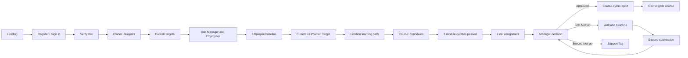

# Đặc tả luồng chi tiết của web DigiTalent Pulse

**Phiên bản tài liệu:** 14/10/2026
**Phạm vi:** bản thiết kế tương tác tại [Pulse product site](14-pulse-product-site/index.html#/welcome) trên nhánh `design/ui-flow-redesign`.  
**Đối tượng đọc:** Product Owner, UI/UX, frontend, backend, QA và người duyệt nghiệp vụ.  
**Ngôn ngữ giao diện:** tiếng Việt. Các tên route, khóa dữ liệu và trạng thái kỹ thuật vẫn giữ nguyên trong mã để bảo toàn luồng đã có.

> Đây là **đặc tả của web Pulse đã thiết kế**, không phải xác nhận các chức năng tương ứng đã hoạt động trong ứng dụng chính. Bản Pulse chạy bằng dữ liệu trong trình duyệt; những giới hạn ở mục 13 là một phần của tài liệu.

## 1. Cách đọc và quy ước

- `#/...` là địa chỉ trong bản Pulse. Ví dụ `#/course/0-1` là khóa **Data & information · Basic**.
- **Digital AI** là khung chuẩn của nền tảng; **Business** là doanh nghiệp; **Department** là phòng ban; **Position** là vị trí công việc.
- **Current** là mức năng lực đã được xác nhận; **Target** là mức vị trí cần đạt; **Gap** chỉ được xác định khi Current có kết quả và thấp hơn Target.
- **Module quiz** là kiểm tra ngắn trong từng module; **final assignment** là bài cuối **mỗi khóa**, do Manager chấm. **Practical task** là nhánh minh chứng công việc riêng, không dùng giới hạn hai lần nộp của final assignment.
- Trong mã hiện tại, trường `lessons[0..2]` được dùng để lưu trạng thái hoàn thành **ba module**. Một số nhãn cũ trên Owner, Manager và báo cáo vẫn gọi chúng là “lessons”. Trên giao diện học mới của Employee, mỗi module gồm ba slide và một quiz.
- Cờ `finalCheck` vẫn tồn tại để tương thích với luồng assignment cũ. Trên giao diện Employee mới, cờ này được bật sau khi đủ ba module quiz; không có thêm một bài learning check riêng sau module 3.

## 2. Bản đồ hành trình chính



Luồng dùng thử và luồng khóa mua thêm dùng cùng cấu trúc học, nộp bài, chấm và báo cáo. Khác biệt nằm ở **quyền truy cập**: Cơ bản miễn phí; Trung cấp và Nâng cao cần cấp trước được duyệt và suất đã mua cho đúng phòng ban. Suất được giữ khi công bố lộ trình và tự kích hoạt khi nhân viên đủ điều kiện.

## 3. Vai trò, phạm vi nhìn và điều hướng

| Vai trò | Việc chính | Các trang/nhánh nhìn thấy trong bản Pulse |
| --- | --- | --- |
| Visitor | Tìm hiểu sản phẩm, xem danh mục, đăng ký hoặc đăng nhập | Landing, course collection/course preview, Register, Sign in, Forgot password, Activate invitation preview |
| Enterprise Owner | Thiết kế trần và đích năng lực, quản lý người, mua/gán khóa, xem toàn doanh nghiệp | Overview, Blueprint, People, Capability gap, Courses, Cycle reports, Shared framework, Training cohorts, Practical tasks, Certificates, Activity |
| Department Manager | Theo dõi **một phòng ban**, đề xuất điều chỉnh, chấm bài cuối khóa và minh chứng thực tế | Overview, Team capability, Final assignments, Cycle reports theo phòng ban, Shared framework, Team training, Practical evidence, Activity |
| Employee | Làm baseline, theo lộ trình vị trí của mình, học và nộp bài | Today, Path, Practice; từ đó mở Course detail, Module reader, Final assignment, Verified outcomes, Activity |
| Platform Admin | Quản trị chuẩn chung, phát hành nội dung, hỗ trợ tổ chức/tài khoản | Admin Overview, Framework, Curriculum, Organizations, Users, Orders & pricing, Audit log |

Thanh điều hướng chính của Employee chỉ có **Today / Path / Practice**. Course detail và module reader là các trang theo ngữ cảnh, mở từ Today hoặc Path. Owner/Manager có sidebar theo chức năng. Trong bản preview, bộ chọn role ở header chỉ mô phỏng ba vai trò Owner/Manager/Employee; Platform Admin được chọn tại trang Sign in. Bộ chọn Manager ở sidebar mô phỏng việc chuyển giữa các tài khoản Manager đã gán phòng ban; tài khoản thật phải được ràng buộc bởi xác thực ở server.

## 4. Luồng công khai → dùng thử miễn phí

### 4.1 Landing và xem thử

1. Visitor vào `#/welcome`, đọc ba ý chính: đặt mục tiêu năng lực, đo điểm đầu vào, học và chứng minh kết quả.
2. **Start your free business trial** đưa đến `#/register`.
3. **Explore sample business** nạp doanh nghiệp mẫu *Northstar Studio* và mở `#/owner`. Mẫu đã có Accounting, Marketing, Manager, Employee, baseline và một khóa đang học để người duyệt đi ngay qua các vai trò.
4. Visitor có thể mở course collection và course detail để đọc thông tin công khai. Các màn làm việc nội bộ yêu cầu trạng thái đã xác minh trong bản preview.

### 4.2 Đăng ký, xác minh và đăng nhập

1. `#/register` nhận tên doanh nghiệp, email Owner và mật khẩu nhập thử. Gửi form tạo trạng thái doanh nghiệp mới với blueprint **chưa công bố**, rồi đến `#/verify`.
2. `#/verify` mô phỏng việc xác minh email. Bấm **Confirm email in preview** kích hoạt trial ngay và chuyển tới `#/setup`. Không có hàng chờ Platform Admin duyệt.
3. `#/login` cho người duyệt nhập email bất kỳ và chọn vai trò. Nếu chưa có trạng thái đã xác minh, bản preview mở dữ liệu mẫu. Đây không phải đăng nhập thật.
4. `#/forgot` và `#/invite` là các nhánh hỗ trợ: form phục hồi chỉ hiện thông báo; kích hoạt lời mời chọn một Employee mẫu và mở không gian của người đó, không kiểm tra token email thật.

**Chính sách trial đã chốt trong giao diện:** không giới hạn thời gian, tối đa **10 Employee trên toàn bộ phòng ban**, Manager không chiếm suất Employee, tất cả khóa **Basic** được xem và học đầy đủ. Intermediate/Advanced là khóa mua theo suất. Trang không thu tiền thật.

## 5. Owner thiết kế khung năng lực trước khi mời người

### 5.1 Cấu trúc trần và đích

Tại `#/setup`, Owner chọn Department rồi Position; mỗi trong sáu năng lực có bốn lớp mức:

```text
Position target ≤ Department ceiling ≤ Business ceiling ≤ Digital AI standard
```

| Lớp | Ai quản lý | Tác dụng |
| --- | --- | --- |
| Digital AI standard | Platform Admin | Trần ngoài cùng, sáu lĩnh vực và ba cấp Basic / Intermediate / Advanced; Owner chỉ xem. |
| Business ceiling | Owner | Mức tối đa doanh nghiệp chọn trong từng lĩnh vực. |
| Department ceiling | Owner; Manager được gửi đề xuất | Mức tối đa của một phòng ban, không vượt Business. |
| Position target | Owner | Đích học của một vị trí trong phòng ban, không vượt Department. Employee được đi theo đúng đích này. |

Sáu lĩnh vực là **Data & information, Communication, Digital content, Safety, Problem solving, AI literacy**. Mức 0 là chưa đặt/không yêu cầu trong các phép so sánh; mức 1/2/3 tương ứng Basic/Intermediate/Advanced. Bản preview có giá trị gợi ý ban đầu cho Business, Accounting và Accountant; Owner có thể giữ hoặc chỉnh từng mức, thêm phòng ban và vị trí.

### 5.2 Chỉnh sửa, kiểm tra và công bố

1. Owner chọn phòng ban và vị trí cần cấu hình. Khi chọn phòng ban khác, danh sách vị trí đổi theo phòng ban.
2. Owner chỉnh Business → Department → Position cho từng lĩnh vực. Giao diện chặn con cao hơn cha và chặn hạ cha thấp hơn một con hiện có; Owner phải sửa theo thứ tự hợp lệ.
3. Thêm phòng ban/vị trí hoặc đổi một mức sẽ đưa blueprint về **Draft** (`published=false`). Đổi chính sách thời gian nộp lại cũng cần công bố lại.
4. **Publish blueprint** kiểm tra mọi phòng ban và vị trí, rồi đưa trạng thái về Published. Sau đó mới mở bước tạo Manager và mời Employee.
5. Nếu một Manager đề xuất đổi trần phòng ban, Owner xem tại Overview, **Accept** đưa mức vào bản nháp nếu không xung đột, hoặc **Reject**. Chấp nhận chưa phải phát hành: Owner phải công bố lại blueprint.

**Điều kiện chặn:** chưa Published thì không tạo Manager mới, không thêm Employee mới và không gán khóa học mới. Mức của Position là mức để quyết định khóa nào thuộc lộ trình Employee, không phải chỉ nhìn Department.

## 6. Tạo Manager, mời Employee và gán đúng vị trí

### 6.1 Gán Manager

Tại `#/people`, Owner gán một Manager cho từng phòng ban. Manager chỉ xem Employee, bài cuối khóa, minh chứng và báo cáo của phòng ban đang phụ trách. Trong bản preview, có bộ chọn tài khoản Manager để đối chiếu Accounting và Marketing; việc phân quyền server chưa tồn tại.

### 6.2 Thêm từng Employee

1. Owner nhập tên, email, chọn **Department**.
2. Danh sách **Position** chỉ hiện vị trí thuộc Department đó; đây là điểm quyết định lộ trình cụ thể của Employee.
3. Bản preview kiểm tra blueprint Published, phòng ban/vị trí hợp lệ, Manager đã gán cho phòng ban, email không trùng và tổng số Employee chưa vượt 10.
4. Người mới có sáu mức Current = Pending và `assessed=false`. Chưa có gap xác nhận và chưa được gán khóa trước baseline.

### 6.3 Nhập CSV

Owner tải mẫu CSV và nhập các cột `email,full_name,department,position,role`. Bản preview đọc file, kiểm tra từng hàng (bao gồm role phải là `EMPLOYEE`), hiện lỗi trước khi bấm thêm. Mỗi hàng hợp lệ vẫn đi qua cùng quy tắc như thêm thủ công, nên giới hạn 10 suất tính **chung**. CSV chỉ thêm người vào dữ liệu mẫu; không gửi lời mời email.

## 7. Baseline → Current / Target → Gap → đề xuất khóa

### 7.1 Employee làm bài đầu vào

Employee mở `#/assessment` từ Hôm nay hoặc Lộ trình. Bài đầu vào hiện hỏi các tình huống ngắn **chỉ ở những lĩnh vực và mức thuộc mục tiêu vị trí của nhân viên**. Mỗi mức chỉ được ghi nhận khi trả lời đúng mức đó và các mức thấp hơn. Khi nộp, bản preview lưu mức đầu vào và mở lộ trình cá nhân.

Đây là **bộ câu hỏi minh họa cho bản xem trước**, chưa phải ngân hàng câu hỏi được kiểm định hay thuật toán chấm điểm chính thức. Owner/Manager xem được kết quả và trạng thái chờ; nhân viên tự làm bài của mình.

### 7.2 So sánh năng lực

- Owner mở `#/gap` để chọn Employee trong doanh nghiệp; Manager mở cùng trang nhưng chỉ thấy người thuộc phòng ban của mình; Employee xem bản cá nhân ở `#/path` và Today.
- Mỗi lĩnh vực đặt **Baseline đầu vào → Current đã xác nhận → Position target** cạnh nhau, cùng chú thích chuỗi Digital AI ≥ Business ≥ Department ≥ Position.
- `Current = 0` hoặc chưa assessed là **Pending**, không được tô như một gap đo được. `0 < Current < Target` là gap xác nhận; `Current ≥ Target` là đã đạt hoặc vượt mục tiêu.
- Đề xuất khóa ưu tiên lĩnh vực có gap xác nhận và vẫn nằm trong target của vị trí. Nếu chưa có gap đo được, giao diện chỉ cung cấp khóa nền tảng trong vị trí; không tự khẳng định năng lực đã thiếu.
- Xem slide, qua quiz hoặc nộp bài cuối khóa **chưa** cập nhật Current. Khi Manager đúng phòng ban duyệt final assignment, cấp của khóa được ghi vào `courseLevels` và có thể nâng Current đã xác nhận tới cấp đó; Baseline đầu vào (`baselineCurrent`) giữ nguyên. Minh chứng thực tế được Manager duyệt cũng có thể nâng Current. Gap còn lại tính từ Current đã xác nhận tới Position target. Khóa Basic cấp 1 không làm mức L1 đầu vào tăng lên; khóa Intermediate cấp 2 được duyệt có thể đưa L1 → L2. Bài bị trả lại, chờ chấm hoặc gắn cờ không làm tăng mức năng lực.

## 8. Danh mục, quyền truy cập và lộ trình theo vị trí

`#/catalog` hiển thị 18 khóa mẫu = sáu lĩnh vực × ba cấp. Có lọc theo lĩnh vực và cấp. `#/course/<courseId>` là chi tiết một khóa; `<courseId>` có dạng `<domainIndex>-<tier>`, ví dụ `0-1` = Data & information · Basic, `0-2` = Intermediate.

| Tình huống | Người học xem được | Ghi tiến độ / gán khóa |
| --- | --- | --- |
| Basic nằm trong Position target, đã baseline | Toàn bộ ba module và quiz | Có thể bắt đầu, lưu tiến độ, nộp bài cuối. |
| Basic ngoài Position target | Nội dung Basic vẫn đọc miễn phí | Không ghi tiến độ cho lộ trình của vị trí đó. |
| Chưa baseline | Xem thông tin khóa; nội dung Basic có thể đọc | Phải làm baseline trước khi ghi tiến độ. |
| Intermediate/Advanced chưa có suất | Outline, tiêu chí cuối khóa và **slide mẫu đầu tiên của module 1** | Không mở các slide còn lại/quiz, không ghi tiến độ. |
| Trung cấp/Nâng cao đã được giữ suất theo phòng ban | Đề cương và bài mẫu trong lúc chờ; toàn bộ nội dung sau khi tự kích hoạt | Cần bài đầu vào, cấp trước được duyệt và cấp khóa không vượt mục tiêu vị trí. |
| Khóa trả phí bị Platform Admin tạm ngừng bán | Thông tin đang công bố vẫn xem được | Không tạo lượt mua mới; suất đã cấp có thể tiếp tục dùng. |

Owner có thể xem đề cương, kết quả mong đợi, bài mẫu và khu vực đánh giá **được gắn nhãn dữ liệu minh họa** trước khi mua. Tại trang khóa, Owner mua mô phỏng một hoặc nhiều suất và chọn phòng ban, hoặc để trống để phân bổ sau. Khi lộ trình được công bố và chỉ một phòng ban có vị trí phù hợp, hệ thống tự gắn suất cho phòng ban đó. Suất được giữ cho nhân viên thuộc đúng phòng ban **và** vị trí có mục tiêu bao gồm khóa này, kể cả khi nhân viên chưa hoàn thành khóa Cơ bản. Nếu số người phù hợp vượt số suất, Owner thấy số thiếu, có thể mua thêm hoặc chọn người ưu tiên trước khi suất được kích hoạt. Người đã mở khóa giữ nguyên suất. Nhánh Nhóm đào tạo vẫn cho phép giao khóa cho cả phòng ban hoặc chọn nhiều nhân viên, nhưng chỉ dùng suất thuộc đúng phòng ban.

**Điều kiện tự mở khóa:** khung năng lực đã công bố, nhân viên đã làm bài đầu vào, cấp khóa không vượt mục tiêu vị trí; Trung cấp cần khóa Cơ bản cùng lĩnh vực được duyệt, Nâng cao cần Trung cấp được duyệt; suất đã mua phải thuộc phòng ban nhân viên và chưa được người khác sử dụng. Hoàn thành điều kiện trước sẽ tự tạo lượt học mà không cần Owner gán lại. **Phòng ban quyết định phạm vi suất; vị trí quyết định khóa nào thuộc lộ trình.**

## 9. Cấu trúc khóa học Employee mới

### 9.1 Trang tổng quan khóa

`#/course/<courseId>` trong vai trò Employee có phần giới thiệu, kết quả mong đợi, quyền truy cập, thanh tiến độ, ba thẻ module và tiêu chí assignment cuối. CTA dẫn đến baseline, module tiếp theo, slide mẫu hoặc assignment tùy trạng thái. Trang này là **course detail**, chưa phải nội dung bài học chi tiết.

### 9.2 Module reader

`#/lesson/<courseId>/<moduleIndex>` là trang học riêng; `moduleIndex` là 0, 1 hoặc 2. Trong bản preview, mỗi khóa có đúng ba module:

| Module | Vai trò nội dung | Thành phần của trang |
| --- | --- | --- |
| 01 · Understand ... at work | Nhận biết bối cảnh, nguồn dữ liệu và kết quả cần có | 3 slide: Observe → Connect → Prepare; 2 câu quiz. |
| 02 · Make a reliable decision | Dùng tình huống công việc để chọn hành động có căn cứ | 3 slide: Scenario → Method → Reason; 2 câu quiz. |
| 03 · Apply it in your role | Tạo kết quả gắn với vị trí, kiểm tra trước khi bàn giao | 3 slide: Apply → Review → Hand off; 2 câu quiz. |

Slide dùng ví dụ theo sáu lĩnh vực, hình minh họa trừu tượng và phần **Try it in your role**. Quiz chỉ mở sau khi Employee đi tới slide cuối của module. Cần đúng **2/2** câu để đánh dấu module hoàn thành; trả lời sai hiện lý do và cho làm lại quiz. Module sau chỉ ghi nhận quiz khi module trước đã hoàn thành. Mỗi quiz đỗ ghi điểm và thời điểm trong trạng thái preview.

Dữ liệu Northstar Studio được tạo trước khi trang module quiz mới có mặt, nên khóa Data & information · Basic của Mia đã có sẵn **1/3 module hoàn thành**. Đây là tiến độ mẫu để duyệt màn hình, không phải kết quả quiz mới được chấm trong phiên hiện tại.

Bản hiện tại hiển thị **slide**, chưa có video nguồn thực tế. Cấu trúc sản phẩm cho phép một module sau này dùng slide hoặc video, nhưng không mô phỏng video giả như thể đã có nội dung. Các slide/quiz đang là nội dung minh họa cho trải nghiệm và cần được biên tập, phát hành theo phiên bản trước khi dùng thật.

### 9.3 Mở assignment cuối mỗi khóa

Đủ ba module quiz, Employee được dẫn đến `#/assignment/<courseId>`. Route có `courseId` để khi một người học nhiều khóa, assignment không mở nhầm khóa khác. Nếu chưa bắt đầu khóa, người dùng chỉ xem trước tiêu chí; nếu đã học nhưng chưa đủ ba module, trang chỉ dẫn quay về module còn thiếu.

Ba tiêu chí được nêu trước khi nộp:

1. **Traceable source** — xác định được nguồn/bối cảnh.
2. **Checkable action** — người khác kiểm tra lại được thao tác hoặc phép tính.
3. **Supported conclusion** — kết luận và bước tiếp theo có căn cứ.

Trong preview, Employee nộp một ghi chú bằng văn bản. Không có đính kèm file thật ở final assignment.

## 10. Manager chấm bài cuối khóa và xử lý chưa đạt

### 10.1 Lần nộp đầu

1. Employee nộp assignment → trạng thái **pending**; khi đang pending không nộp thêm.
2. Manager thuộc đúng Department của Employee mở `#/review`, thấy tên người, vị trí, khóa, lần nộp, ghi chú minh chứng và ba tiêu chí.
3. Giao diện có gợi ý AI minh họa dựa trên văn bản, chỉ để tham khảo. **Manager** chọn **Approve course** hoặc **Not yet · needs revision**, bắt buộc ghi lý do.
4. Nếu Approve: trạng thái **approved**, khóa được xác nhận hoàn thành, báo cáo chu kỳ mở và cấp kế tiếp có thể được xét khi đủ điều kiện/suất.

### 10.2 Chưa đạt lần 1 → lần nộp cuối

- Nếu lần đầu Not yet: trạng thái **retry-wait**. Employee xem nhận xét, chờ đến `releaseAt`; trước thời điểm này không có form nộp lại.
- Sau thời gian chờ và trước `deadlineAt`: trạng thái hiệu lực **retry-ready**, Employee được nộp **lần 2 và là lần cuối**.
- Mặc định preview: chờ **48 giờ**, hạn cuối **7 ngày sau khi mở lần 2**. Owner có thể chỉnh ở Blueprint (1–720 giờ; 1–90 ngày) rồi phải công bố lại. Đây là thông số mẫu, không phải chính sách production đã cố định.
- Nút **Advance preview time** chỉ dùng để duyệt luồng mà không phải đợi ngoài đời.
- Nếu quá hạn mà chưa nộp lần 2: **deadline-missed**. Manager thấy ca quá hạn để sắp xếp hỗ trợ; trạng thái này khác với cờ hai lần không đạt.
- Nếu Manager chấm lần 2 vẫn Not yet: **flagged**. Manager thấy cờ hỗ trợ và có thể ghi nhận coaching, đề xuất chu kỳ học mới hoặc tạm dừng lộ trình. Không mở cấp tiếp.

### 10.3 Bảng trạng thái assignment

| Trạng thái | Phát sinh khi | Employee thấy | Manager/Owner thấy |
| --- | --- | --- | --- |
| `learning` | Đã gán/bắt đầu khóa, chưa nộp | Module/quiz và form cuối khi đủ điều kiện | Tiến độ học. |
| `pending` | Đã nộp bài, chờ quyết định | Thông báo chờ Manager, không nộp thêm | Hàng chờ chấm của phòng ban. |
| `approved` | Manager duyệt một trong hai lần | Khóa hoàn thành, xem bước tiếp | Báo cáo chu kỳ, outcome được xác nhận. |
| `retry-wait` | Lần 1 Not yet, chưa đến giờ mở | Phản hồi, giờ chờ và hạn cuối | Theo dõi người cần sửa. |
| `retry-ready` | Đã đến giờ mở lần 2, chưa quá hạn | Form nộp lần cuối | Theo dõi thời gian còn lại. |
| `deadline-missed` | Quá hạn lần 2 | Không có form nộp, cần hỗ trợ | Ca quá hạn và hành động hỗ trợ. |
| `flagged` | Lần 2 Not yet | Thông báo cần hỗ trợ, không lên cấp | Cờ hỗ trợ và lựa chọn xử lý. |

`retry-ready` và `deadline-missed` được tính từ `retry-wait` cùng thời gian hiện hành; chúng không nhất thiết là giá trị `status` được lưu riêng.

## 11. Báo cáo chu kỳ và khóa mua thêm

`#/report` hiển thị báo cáo chu kỳ khi có ít nhất một final assignment **approved**. Owner xem toàn doanh nghiệp; Manager xem phạm vi phòng ban. Báo cáo gồm:

- Số khóa đã duyệt, số người tham gia, số lần nộp, khóa đang học.
- Từng Employee: phòng ban/vị trí, khóa Basic hay trả phí, baseline có bao nhiêu lĩnh vực được xác nhận, Position target, tiến độ module và số lần nộp.
- Bằng chứng/nhận xét quyết định của Manager, mốc hoạt động và gợi ý bước tiếp.
- Bảng cả cohort: người đã xong, đang học, chờ quyết định hoặc cần hỗ trợ nằm cùng một bức tranh.
- Baseline đầu vào, Current đã xác nhận và Target được so sánh rõ. Chỉ khóa có cấp **cao hơn** mức đã xác nhận mới làm Current tăng khi final assignment được Manager duyệt; việc hoàn thành module hoặc mua suất không đủ. Báo cáo giữ Baseline gốc để thấy tiến bộ và gap còn lại.
- Nhánh minh chứng công việc được duyệt nằm trong khu vực liên kết riêng.

Khóa Intermediate/Advanced mua thêm đi qua **cùng** enrollment → module → quiz → final assignment → Manager review → report. Mua quyền truy cập không thay đổi tiêu chí đánh giá. Nút Print ở bản preview dùng chức năng in của trình duyệt; dữ liệu báo cáo chưa được kiểm toán server.

## 12. Các luồng phụ đã nối vào web

### 12.1 Practical task và minh chứng công việc

**Owner `#/tasks` → Employee `#/assignment` phần Workplace practice → Manager `#/evidence`.**

Owner tạo nhiệm vụ với tiêu đề, bối cảnh, lĩnh vực, cấp cần chứng minh, rubric, ngày hạn và đối tượng là một Position hoặc một Employee. Người nhận phải có baseline và cấp nhiệm vụ không vượt Position target. Employee gửi ghi chú, link tùy chọn và tên file chọn trong trình duyệt. Manager của đúng phòng ban chọn **Approve / Request revision / Reject** kèm lý do. Khi duyệt, bản preview giữ baseline gốc (`baselineCurrent`) và ghi mức xác nhận qua minh chứng (`evidenceLevels`); Current hiển thị có thể nâng đến mức được duyệt. Đây là **nhánh riêng** với assignment cuối khóa; không áp dụng hai lần nộp/timing ở mục 10. File không thực sự được tải lên hoặc kiểm tra an toàn.

### 12.2 Training cohorts

**Owner `#/cohorts` → Manager `#/team-training`.** Owner chọn tên nhóm, cả phòng ban hoặc nhiều nhân viên, khóa và ngày cần hoàn thành. Trước khi gán, bản preview kiểm tra bài đầu vào, khóa cấp trước, mục tiêu vị trí, trạng thái bán và **suất đã mua cho đúng phòng ban**. Một phòng ban không thể mượn suất của phòng ban khác. Manager chỉ theo dõi người thuộc phòng ban mình: tiến độ mô đun, trạng thái và hạn. Manager không đổi nhóm hoặc tự mua suất.

### 12.3 Đề xuất trần từ Manager

**Manager `#/gap` → Owner `#/owner` → Owner `#/setup`.** Manager chọn lĩnh vực và mức Department muốn đề xuất. Mức phải nằm trong Business ceiling và không thấp hơn các Position target hiện có. Owner chấp nhận hoặc từ chối; chấp nhận chỉ sửa **Draft**, rồi Owner công bố lại. Manager không tự công bố khung.

### 12.4 Shared framework và phát hành nội dung

**Admin `#/admin/framework`, `#/admin/curriculum/<courseId>` → Owner/Manager `#/framework`, Owner Blueprint và Courses.** Admin lưu nháp, phát hành phiên bản mô tả sáu lĩnh vực; với khóa có thể sửa title, outcome, giá mỗi suất và trạng thái bán. Có nơi thêm câu hỏi vào question bank nháp. Business xem nguồn chuẩn đã công bố rồi thiết kế trần riêng bên dưới.

**Giới hạn quan trọng:** quiz hai câu trong module Employee hiện là nội dung mẫu nằm trong `pulse-course-studio.js`, **chưa lấy động từ question bank Admin**. Giao diện có phiên bản phát hành, nhưng chưa bảo đảm snapshot nội dung cũ cho người đang học khi Admin phát hành bản mới. Đây là việc cần giải quyết khi tích hợp backend/CMS.

### 12.5 Chứng chỉ / verified outcomes

**Owner/Employee `#/certificates` → `#/certificate/<id>`.** Một bản ghi outcome xuất hiện từ final course assignment được Manager duyệt hoặc practical evidence được Manager duyệt. Bản ghi cho thấy người nhận, tổ chức, nguồn và mã tham chiếu; Employee chỉ xem bản ghi của mình, Owner xem doanh nghiệp. Chứng chỉ trong preview không có chữ ký số hoặc trang tra cứu công khai.

### 12.6 Activity, tài khoản và hỗ trợ tổ chức

- `#/notifications`: sự kiện học, nộp, duyệt, thay đổi tổ chức; có **Mark all read** ở dữ liệu mẫu.
- `#/forgot`, `#/invite`: mô phỏng phục hồi và kích hoạt lời mời; không gửi email/token.
- `#/admin/customers`: Admin xem một tổ chức mẫu, có thể mô phỏng cấp một suất trả phí hoặc suspend/restore tổ chức; bắt buộc lý do và có audit log.
- `#/admin/users`: Admin mô phỏng khóa/mở tài khoản Employee với lý do. Người bị khóa không vào không gian Employee trong preview.
- `#/admin/commerce`: danh mục giá/suất và lịch sử order hoặc Admin grant mẫu.
- `#/admin/audit`: sự kiện quản trị có người làm, thời gian và lý do.

## 13. Giới hạn của bản thiết kế tương tác

| Phần đang mô phỏng | Trạng thái thực tế của bản Pulse |
| --- | --- |
| Lưu dữ liệu | `localStorage` trong **một trình duyệt**, khóa `digitatalent-pulse-product-preview-v1`; không có đồng bộ đa thiết bị/người dùng. |
| Tài khoản, phân quyền | Sign in bằng email bất kỳ và role selector để duyệt UI; chặn phía frontend chỉ là mô phỏng, không phải bảo mật production. |
| Email và CSV | Không gửi email mời/xác minh/phục hồi. CSV được đọc tại máy và thêm bản ghi mẫu. |
| Baseline | Chọn mức thay cho bộ đề và chấm điểm thật. Không dùng kết quả này làm chứng cứ năng lực production. |
| Bài học | 18 khóa cùng cấu trúc ba module; slide/quiz chứa tình huống minh họa theo lĩnh vực. Chưa có video, media hosting, biên tập học liệu và phiên bản nội dung theo enrollment. |
| AI | Gợi ý ở màn Manager là kiểm tra văn bản minh họa, không có AI thật hoặc thẩm định tệp. Manager luôn quyết định cuối. |
| Thu tiền | Mua khóa/suất, giá và order là giả lập; không có payment gateway, hóa đơn hay thanh toán thật. |
| Minh chứng tệp | Practical task lưu tên file, không tải tệp; final assignment nhận ghi chú văn bản. |
| Chứng chỉ/báo cáo | Dựng từ trạng thái mẫu trong trình duyệt; chưa có ký số, xác thực công khai hay báo cáo chuẩn kế toán/kiểm toán. |
| Chính sách backend | 10 suất Employee, trial không hết hạn, trần năng lực, phân quyền Manager, quyền khóa học và giới hạn lần nộp phải được kiểm tra lại ở API/server trước khi triển khai chính thức. |

Nút **Reset sample** xóa dữ liệu preview trong trình duyệt và trở lại landing. Để duyệt nhanh một hành trình có sẵn, bấm **Explore sample business**. Tài liệu này mô tả trạng thái của web tại ngày ghi ở đầu file; các thay đổi tiếp theo nên cập nhật đồng thời màn UI, quy tắc nghiệp vụ, route và tài liệu này.

## 14. Danh mục route để kiểm tra

| Nhóm | Route |
| --- | --- |
| Công khai | `#/welcome`, `#/register`, `#/verify`, `#/login`, `#/forgot`, `#/invite`, `#/catalog`, `#/course/<courseId>` |
| Owner | `#/owner`, `#/setup`, `#/people`, `#/gap`, `#/catalog`, `#/course/<courseId>`, `#/report`, `#/framework`, `#/cohorts`, `#/tasks`, `#/certificates`, `#/certificate/<id>`, `#/notifications` |
| Manager | `#/manager`, `#/gap`, `#/review`, `#/report`, `#/framework`, `#/team-training`, `#/evidence`, `#/notifications` |
| Employee | `#/employee`, `#/assessment`, `#/path`, `#/course/<courseId>`, `#/lesson/<courseId>/<0..2>`, `#/assignment/<courseId>`, `#/assignment`, `#/certificates`, `#/certificate/<id>`, `#/notifications` |
| Platform Admin | `#/admin`, `#/admin/framework`, `#/admin/curriculum/<courseId>`, `#/admin/customers`, `#/admin/users`, `#/admin/commerce`, `#/admin/audit` |

## 15. Kịch bản duyệt nhanh từ đầu đến cuối

1. Mở `#/welcome` → **Explore sample business** để có Northstar Studio; hoặc **Start free** để xem trial từ đầu.
2. Với công ty mới: Owner chỉnh Blueprint → Publish → gán Manager → thêm Employee/CSV.
3. Chuyển Employee, làm baseline → xem Current / Target tại Path → mở khóa phù hợp vị trí.
4. Vào course detail → module 1, đọc tới slide 3 → làm quiz 2/2; lặp cho module 2 và 3.
5. Mở assignment của chính khóa đó, viết nguồn, hành động kiểm tra được và kết luận → Submit.
6. Chuyển Manager đúng phòng ban → Final assignments → chọn verdict và ghi lý do.
7. Nếu Approved, chuyển Owner → Cycle reports. Nếu Not yet, xem thời gian chờ/hạn cuối, nộp lần 2 hoặc mở ca hỗ trợ quá hạn; lần 2 không đạt tạo cờ.
8. Với khóa cấp cao, Owner xem đề cương/bài mẫu/đánh giá minh họa → mua mô phỏng số suất cho phòng ban → công bố lộ trình → hệ thống giữ suất cho đúng người → sau khi khóa mức trước được quản lý duyệt, khóa đã mua tự mở → lặp cùng chu kỳ học và báo cáo.

**Nguồn đối chiếu trong repo:** [mã web Pulse](14-pulse-product-site/index.html), [hướng dẫn preview](14-pulse-product-site/README.md), [đối chiếu luồng trước đó](15-flow-conformance-audit.md). Hai HTML mô tả luồng do người dùng cung cấp là tài liệu yêu cầu; các hành vi được ghi ở đây đã được đối chiếu với mã của bản Pulse, và các quyết định mới nhất của người dùng được ưu tiên khi tài liệu nguồn có phương án cũ khác nhau.
