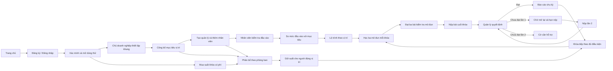

# Đặc tả luồng chi tiết của web DigiTalent Pulse

**Phiên bản tài liệu:** 14/10/2026 · cập nhật theo bản Pulse tiếng Việt và luồng tự giữ suất

**Phạm vi:** bản thiết kế tương tác tại [Pulse product site](14-pulse-product-site/index.html#/welcome) trên nhánh `design/ui-flow-redesign`.  
**Đối tượng đọc:** chủ sản phẩm, thiết kế UI/UX, frontend, backend, QA và người duyệt nghiệp vụ.

**Ngôn ngữ giao diện:** tiếng Việt. Các tên route, khóa dữ liệu và trạng thái kỹ thuật vẫn giữ nguyên trong mã để bảo toàn luồng đã có.

> Đây là **đặc tả của web Pulse đã thiết kế**, không phải xác nhận các chức năng tương ứng đã hoạt động trong ứng dụng chính. Bản Pulse chạy bằng dữ liệu trong trình duyệt; những giới hạn ở mục 13 là một phần của tài liệu.

## 1. Cách đọc và quy ước

- `#/...` là địa chỉ trong bản Pulse. Ví dụ `#/course/0-1` là khóa **Dữ liệu và thông tin · Cơ bản**. Mã route và mã khóa vẫn giữ dạng kỹ thuật để không làm hỏng liên kết.
- **Digital AI** là khung chuẩn của nền tảng; **doanh nghiệp**, **phòng ban** và **vị trí** là ba lớp mục tiêu do doanh nghiệp thiết lập bên dưới.
- **Mức đầu vào** là kết quả bài kiểm tra ban đầu; **mức đã xác nhận** là mức được cập nhật qua kết quả do quản lý duyệt; **mục tiêu vị trí** là mức cần đạt. **Khoảng cách năng lực** chỉ được xác định khi đã có mức đo được và mức đó thấp hơn mục tiêu.
- **Câu hỏi ôn tập mô đun** nằm trong từng mô đun; **bài cuối khóa** là bài nộp sau tất cả mô đun của **mỗi khóa**, do quản lý phòng ban chấm. **Nhiệm vụ thực tế** là nhánh minh chứng công việc riêng, không dùng giới hạn hai lần nộp của bài cuối khóa.
- Trong mã hiện tại, `lessons[0..2]` lưu trạng thái hoàn thành **ba mô đun**. Mỗi mô đun trên trang học gồm ba trang nội dung và một bài kiểm tra ngắn. `finalCheck` là cờ tương thích, được bật sau khi đạt đủ ba bài kiểm tra mô đun; không có bài kiểm tra phụ sau mô đun 3.
- **Suất mua** là quyền dành cho **một nhân viên học một khóa có phí**. **Giữ suất** chọn người thụ hưởng trước khi đủ điều kiện học; **kích hoạt suất** tạo lượt học và mở toàn bộ nội dung khi người đó đủ điều kiện. Mua khóa cho phòng ban không đồng nghĩa cả phòng ban được học không giới hạn.

## 2. Bản đồ hành trình chính



Luồng dùng thử và luồng khóa mua thêm dùng cùng cấu trúc học, nộp bài, chấm và báo cáo. Khác biệt nằm ở **quyền truy cập**: Cơ bản miễn phí; Trung cấp và Nâng cao cần khóa cấp trước được duyệt cùng một suất đã mua cho đúng phòng ban. Có thể mua suất **trước** khi thiết lập khung. Sau khi công bố lộ trình **và có nhân viên phù hợp**, hệ thống giữ suất; khi nhân viên làm bài đầu vào và được duyệt cấp trước, suất tự kích hoạt mà chủ doanh nghiệp không phải cấp lại.

## 3. Vai trò, phạm vi nhìn và điều hướng

| Vai trò | Việc chính | Các trang/nhánh nhìn thấy trong bản Pulse |
| --- | --- | --- |
| Khách truy cập | Tìm hiểu sản phẩm, xem danh mục, đăng ký hoặc đăng nhập | Trang chủ, thư viện và giới thiệu khóa, đăng ký, đăng nhập, quên mật khẩu, kích hoạt lời mời |
| Chủ doanh nghiệp | Thiết kế trần và đích năng lực, quản lý người, mua và phân bổ suất, xem toàn doanh nghiệp | Tổng quan, khung năng lực, nhân sự, khoảng cách năng lực, khóa học, báo cáo chu kỳ, khung chung, nhóm đào tạo, nhiệm vụ thực tế, chứng nhận, hoạt động |
| Quản lý phòng ban | Theo dõi **một phòng ban**, đề xuất điều chỉnh, chấm bài cuối khóa và minh chứng thực tế | Tổng quan, năng lực nhóm, bài cuối khóa, báo cáo phòng ban, khung chung, đào tạo nhóm, minh chứng thực tế, hoạt động |
| Nhân viên | Làm bài đầu vào, theo lộ trình vị trí, học và nộp bài | Hôm nay, Lộ trình, Thực hành; từ đó mở chi tiết khóa, trang học mô đun, bài cuối khóa, kết quả đã xác nhận, hoạt động |
| Quản trị nền tảng | Quản trị chuẩn chung, phát hành nội dung, hỗ trợ tổ chức và tài khoản | Tổng quan quản trị, khung chung, chương trình học, tổ chức, người dùng, đơn hàng và giá, nhật ký kiểm tra |

Thanh điều hướng chính của nhân viên chỉ có **Hôm nay / Lộ trình / Thực hành**. Chi tiết khóa và trang học là các trang theo ngữ cảnh, mở từ Hôm nay hoặc Lộ trình. Chủ doanh nghiệp và quản lý có menu bên theo chức năng. Trong bản xem trước, bộ chọn vai trò trên thanh đầu trang mô phỏng chủ doanh nghiệp/quản lý/nhân viên; quản trị nền tảng được chọn tại trang Đăng nhập. Bộ chọn quản lý ở menu bên mô phỏng việc chuyển giữa các tài khoản quản lý đã gán phòng ban; tài khoản thật phải được ràng buộc bởi xác thực ở máy chủ.

Mỗi vai trò đã đăng nhập có lối vào **Hồ sơ của tôi** (`#/profile`) trên thanh đầu trang. Hồ sơ nêu danh tính mẫu, phạm vi nhìn, trách nhiệm và số liệu liên quan. Hồ sơ nhân viên so mức hiện tại với mục tiêu vị trí; hồ sơ quản lý giới hạn theo phòng ban. Bản xem trước không tự tạo email cá nhân cho quản lý hoặc danh tính cá nhân thật của quản trị nền tảng.

## 4. Luồng công khai → dùng thử miễn phí

### 4.1 Trang chủ và xem thử

1. Khách vào `#/welcome`, đọc ba ý chính: đặt mục tiêu năng lực, đo điểm đầu vào, học và chứng minh kết quả.
2. Nút **Bắt đầu dùng thử miễn phí** đưa đến `#/register`.
3. Nút **Khám phá doanh nghiệp dùng thử** nạp *Northstar Studio* và mở `#/owner`; nút **Khám phá doanh nghiệp đã mua khóa** nạp *Northstar Growth* với ba suất mô phỏng khóa **Dữ liệu và thông tin · Trung cấp**. Mẫu đã mua có khóa Cơ bản được duyệt cho Mia và Ben; Mia đã mở khóa Trung cấp, hai suất còn lại có thể phân bổ theo điều kiện.
4. Khách có thể mở thư viện và trang chi tiết khóa để xem thông tin công khai. Các màn làm việc nội bộ yêu cầu trạng thái đã xác minh trong bản xem trước.

### 4.2 Đăng ký, xác minh và đăng nhập

1. `#/register` nhận tên doanh nghiệp, email chủ doanh nghiệp và mật khẩu nhập thử. Gửi form tạo trạng thái doanh nghiệp mới với khung năng lực **chưa công bố**, rồi đến `#/verify`.
2. `#/verify` mô phỏng việc xác minh email. Bấm **Xác nhận email trong bản xem trước** kích hoạt dùng thử ngay và chuyển tới `#/setup`. Không có hàng chờ quản trị nền tảng duyệt.
3. `#/login` cho người duyệt nhập email bất kỳ và chọn vai trò. Nếu chưa có trạng thái đã xác minh, bản xem trước mở dữ liệu mẫu. Đây không phải đăng nhập thật.
4. `#/forgot` và `#/invite` là các nhánh hỗ trợ: form phục hồi chỉ hiện thông báo; kích hoạt lời mời chọn một nhân viên mẫu và mở không gian của người đó, không kiểm tra mã email thật.

**Chính sách dùng thử đã chốt trong giao diện:** không giới hạn thời gian, tối đa **10 nhân viên trên toàn bộ phòng ban**; quản lý không chiếm suất nhân viên; tất cả khóa **Cơ bản** được xem và học đầy đủ. Khóa **Trung cấp/Nâng cao** mua theo suất của từng khóa, từng phòng ban. Trang không thu tiền thật.

## 5. Chủ doanh nghiệp thiết kế khung năng lực trước khi mời người

### 5.1 Cấu trúc trần và đích

Tại `#/setup`, chủ doanh nghiệp chọn phòng ban rồi vị trí; mỗi trong sáu lĩnh vực năng lực có bốn lớp mức:

```text
Mục tiêu vị trí ≤ Trần phòng ban ≤ Trần doanh nghiệp ≤ Trần Digital AI
```

| Lớp | Ai quản lý | Tác dụng |
| --- | --- | --- |
| Trần Digital AI | Quản trị nền tảng | Trần ngoài cùng, sáu lĩnh vực và ba cấp Cơ bản / Trung cấp / Nâng cao; chủ doanh nghiệp chỉ xem. |
| Trần doanh nghiệp | Chủ doanh nghiệp | Mức tối đa doanh nghiệp chọn trong từng lĩnh vực. |
| Trần phòng ban | Chủ doanh nghiệp; quản lý được gửi đề xuất | Mức tối đa của một phòng ban, không vượt trần doanh nghiệp. |
| Mục tiêu vị trí | Chủ doanh nghiệp | Đích học của một vị trí trong phòng ban, không vượt trần phòng ban. Nhân viên đi theo đúng đích này. |

Sáu lĩnh vực là **Dữ liệu và thông tin, Giao tiếp và cộng tác, Nội dung số, An toàn số, Giải quyết vấn đề, Năng lực AI**. Mức 0 là chưa đặt/không yêu cầu trong các phép so sánh; mức 1/2/3 tương ứng Cơ bản/Trung cấp/Nâng cao. Bản xem trước có giá trị gợi ý ban đầu cho doanh nghiệp, phòng Kế toán và vị trí Kế toán viên; chủ doanh nghiệp có thể giữ hoặc chỉnh từng mức, thêm phòng ban và vị trí. Tên riêng trong dữ liệu mẫu có thể giữ nguyên để phân biệt các tài khoản mô phỏng.

### 5.2 Chỉnh sửa, kiểm tra và công bố

1. Chủ doanh nghiệp chọn phòng ban và vị trí cần cấu hình. Khi chọn phòng ban khác, danh sách vị trí đổi theo phòng ban.
2. Chủ doanh nghiệp chỉnh trần doanh nghiệp → trần phòng ban → mục tiêu vị trí cho từng lĩnh vực. Giao diện chặn mức con cao hơn mức cha và chặn hạ mức cha thấp hơn mức con hiện có; cần sửa theo thứ tự hợp lệ.
3. Thêm phòng ban/vị trí hoặc đổi một mức sẽ đưa khung về **Bản nháp** (`published=false`). Đổi chính sách thời gian nộp lại cũng cần công bố lại.
4. Nút **Công bố khung năng lực** kiểm tra mọi phòng ban và vị trí, rồi chuyển sang trạng thái **Đã công bố**. Sau đó mới mở bước tạo quản lý và mời nhân viên.
5. Nếu quản lý đề xuất đổi trần phòng ban, chủ doanh nghiệp xem tại Tổng quan, chấp nhận đưa mức vào bản nháp nếu không xung đột hoặc từ chối. Chấp nhận chưa phải phát hành: phải công bố lại khung.

**Điều kiện chặn:** chưa công bố thì không tạo quản lý mới, không thêm nhân viên mới và không gán khóa học mới. Có thể mua suất khóa có phí trước khi công bố. **Phòng ban** là phạm vi phân bổ suất và quản lý; **vị trí** mới quyết định lĩnh vực/cấp khóa trong lộ trình nhân viên, không dùng cùng một lộ trình cho mọi người trong phòng.

## 6. Tạo quản lý, mời nhân viên và gán đúng vị trí

### 6.1 Gán quản lý

Tại `#/people`, chủ doanh nghiệp gán quản lý cho từng phòng ban. Quản lý chỉ xem nhân viên, bài cuối khóa, minh chứng và báo cáo của phòng ban đang phụ trách. Trong bản xem trước có bộ chọn tài khoản quản lý để đối chiếu Kế toán và Tiếp thị; việc phân quyền ở máy chủ chưa tồn tại.

### 6.2 Thêm từng nhân viên

1. Chủ doanh nghiệp nhập tên, email và chọn **phòng ban**.
2. Danh sách **vị trí** chỉ hiện các vị trí thuộc phòng ban đó; đây là điểm quyết định lộ trình cụ thể của nhân viên.
3. Bản xem trước kiểm tra khung đã công bố, phòng ban/vị trí hợp lệ, quản lý đã gán cho phòng ban, email không trùng và tổng số nhân viên chưa vượt 10.
4. Người mới có sáu mức năng lực **chờ đánh giá** và `assessed=false`. Chưa có khoảng cách năng lực được xác nhận và chưa được gán khóa để ghi tiến độ trước bài đầu vào. Suất khóa có phí đã mua có thể được **giữ trước** cho người phù hợp nhưng chưa kích hoạt.

### 6.3 Nhập CSV

Chủ doanh nghiệp tải mẫu CSV và nhập các cột kỹ thuật `email,full_name,department,position,role`. Bản xem trước đọc file, kiểm tra từng hàng (gồm giá trị `role` phải là `EMPLOYEE`), hiện lỗi trước khi bấm thêm. Mỗi hàng hợp lệ đi qua cùng quy tắc như thêm thủ công, nên giới hạn 10 người tính **chung**. CSV chỉ thêm người vào dữ liệu mẫu; không gửi lời mời email.

## 7. Bài đầu vào → Mức hiện tại / Mục tiêu → Khoảng cách → Đề xuất khóa

### 7.1 Nhân viên làm bài đầu vào

Nhân viên mở `#/assessment` từ Hôm nay hoặc Lộ trình. Bài đầu vào hỏi các tình huống ngắn **chỉ ở những lĩnh vực và mức thuộc mục tiêu vị trí của nhân viên**; mỗi câu có hai phương án minh họa. Mức L2 chỉ được ghi nhận nếu trả lời đúng câu L1 và L2; tương tự L3 cần đúng liên tiếp từ L1 đến L3. Trả lời sai ở một mức sẽ chặn việc ghi nhận các mức cao hơn của cùng lĩnh vực, kể cả khi câu sau đúng. Khi nộp, bản xem trước lưu mức đầu vào và mở lộ trình cá nhân.

Đây là **bộ câu hỏi minh họa cho bản xem trước**, chưa phải ngân hàng câu hỏi được kiểm định hay thuật toán chấm điểm chính thức. Chủ doanh nghiệp/quản lý xem được kết quả và trạng thái chờ; nhân viên tự làm bài của mình. Giao diện hiện tại không cho chọn thẳng mức đầu vào từ một danh sách.

### 7.2 So sánh năng lực

- Chủ doanh nghiệp mở `#/gap` để chọn nhân viên trong doanh nghiệp; quản lý mở cùng trang nhưng chỉ thấy người thuộc phòng ban của mình; nhân viên xem bản cá nhân ở `#/path` và Hôm nay.
- Mỗi lĩnh vực đặt **mức đầu vào → mức đã xác nhận → mục tiêu vị trí** cạnh nhau, cùng chú thích chuỗi Digital AI ≥ doanh nghiệp ≥ phòng ban ≥ vị trí.
- Mức chưa đo được hoặc bằng 0 là **chờ xác nhận**, không được tô như một khoảng cách đã đo. Mức đã xác nhận từ L1 trở lên nhưng thấp hơn mục tiêu là khoảng cách đã xác nhận; mức bằng hoặc vượt mục tiêu là đã đạt.
- Đề xuất khóa ưu tiên lĩnh vực còn khoảng cách và vẫn nằm trong mục tiêu vị trí. Nếu chưa có khoảng cách đo được, giao diện chỉ cung cấp khóa nền tảng trong vị trí; không tự khẳng định năng lực đã thiếu.
- Xem nội dung, đạt câu hỏi mô đun, mua/giữ suất hoặc nộp bài cuối khóa **chưa** cập nhật mức đã xác nhận. Khi quản lý đúng phòng ban duyệt bài cuối khóa, cấp của khóa được ghi vào `courseLevels` và có thể nâng mức đã xác nhận tới cấp đó; mức đầu vào (`baselineCurrent`) giữ nguyên. Minh chứng thực tế được duyệt cũng có thể nâng mức đã xác nhận. Khoảng cách còn lại tính từ mức đã xác nhận tới mục tiêu vị trí. Khóa Cơ bản cấp 1 không làm mức L1 đầu vào tăng lên; khóa Trung cấp cấp 2 được duyệt có thể đưa L1 → L2. Bài bị trả lại, chờ chấm hoặc gắn cờ không làm tăng mức năng lực.

## 8. Danh mục, quyền truy cập và lộ trình theo vị trí

`#/catalog` hiển thị 18 khóa mẫu = sáu lĩnh vực × ba cấp. Có lọc theo lĩnh vực và cấp. `#/course/<courseId>` là chi tiết một khóa; `<courseId>` có dạng `<domainIndex>-<tier>`, ví dụ `0-1` = Dữ liệu và thông tin · Cơ bản, `0-2` = Dữ liệu và thông tin · Trung cấp. Mã khóa giữ nguyên để lưu tiến độ; tên hiển thị bằng tiếng Việt.

| Tình huống | Người học xem được | Ghi tiến độ / gán khóa |
| --- | --- | --- |
| Khóa Cơ bản nằm trong mục tiêu vị trí, đã làm bài đầu vào | Toàn bộ ba mô đun và câu hỏi ôn tập | Có thể bắt đầu, lưu tiến độ, nộp bài cuối. |
| Khóa Cơ bản ngoài mục tiêu vị trí | Nội dung Cơ bản vẫn đọc miễn phí | Không ghi tiến độ cho lộ trình của vị trí đó. |
| Chưa làm bài đầu vào | Xem thông tin khóa; nội dung Cơ bản có thể đọc | Phải làm bài đầu vào trước khi ghi tiến độ. |
| Khóa Trung cấp/Nâng cao chưa có suất | Đề cương, tiêu chí bài cuối và **trang nội dung mẫu đầu tiên của mô đun 1** | Không mở phần còn lại/câu hỏi, không ghi tiến độ. |
| Khóa Trung cấp/Nâng cao đã được giữ suất theo phòng ban nhưng chưa đủ điều kiện | Đề cương và bài mẫu; thấy thông báo suất đã giữ | Chờ bài đầu vào và khóa cấp trước được quản lý duyệt. Không phải yêu cầu chủ doanh nghiệp cấp suất lần nữa. |
| Khóa Trung cấp/Nâng cao có suất đã kích hoạt | Toàn bộ mô đun, câu hỏi ôn tập và bài cuối khóa | Học, nộp bài và nhận quyết định theo cùng luồng khóa Cơ bản. |
| Khóa trả phí bị quản trị nền tảng tạm ngừng bán | Thông tin đang công bố vẫn xem được | Không tạo lượt mua mới; suất đã cấp có thể tiếp tục dùng. |

Chủ doanh nghiệp có thể xem đề cương, kết quả mong đợi, trang học mẫu và khu vực đánh giá **được gắn nhãn dữ liệu minh họa** trước khi mua. Sau khi mua, chủ doanh nghiệp có thể xem đầy đủ nội dung khóa để duyệt, nhưng chỉ nhân viên đủ điều kiện mới ghi tiến độ và làm câu hỏi. Tại trang khóa, chủ doanh nghiệp mua mô phỏng một hoặc nhiều suất và chọn phòng ban, hoặc để trống để phân bổ sau. Việc mua được phép xảy ra **trước khi thiết lập/công bố khung**, nhưng lúc đó chưa tự mở nội dung cho nhân viên. Khi khung đã công bố và chỉ **một** phòng ban có vị trí phù hợp, suất chưa gắn phòng ban sẽ được tự gắn cho phòng ban ấy. Nếu nhiều phòng ban phù hợp, chủ doanh nghiệp phải chọn phòng ban nhận suất tại trang khóa. Sau khi có nhân viên phù hợp, hệ thống giữ suất cho người thuộc đúng phòng ban **và** vị trí có mục tiêu bao gồm khóa này, kể cả khi người đó chưa được duyệt khóa Cơ bản.

Mỗi suất chỉ dành cho **một nhân viên và một khóa**. Nếu số người phù hợp vượt số suất, trang khóa hiện số thiếu; chủ doanh nghiệp mua thêm hoặc chọn người ưu tiên khi suất chưa kích hoạt. Người đã mở khóa giữ nguyên suất, không chuyển sang phòng ban khác. Nhánh **Nhóm đào tạo** vẫn cho phép gán cả phòng ban hoặc chọn nhiều nhân viên, nhưng chỉ dùng suất của đúng phòng ban và kiểm tra đủ suất cho cả nhóm sẵn sàng trước khi gán. Mua một khóa Trung cấp không tự mở mọi khóa Trung cấp hoặc toàn bộ khóa cho mọi nhân viên trong phòng.

**Điều kiện tự mở khóa:** khung năng lực đã công bố, nhân viên đã làm bài đầu vào, cấp khóa không vượt mục tiêu vị trí; Trung cấp cần khóa Cơ bản **cùng lĩnh vực** được duyệt, Nâng cao cần khóa Trung cấp cùng lĩnh vực được duyệt; có suất đã mua, phân bổ đúng phòng ban và được giữ cho nhân viên đó. Khi đủ điều kiện, bản xem trước tự tạo lượt học và mở **toàn bộ** nội dung khóa, không yêu cầu chủ doanh nghiệp bấm “cấp suất” thêm lần nữa. **Phòng ban quyết định phạm vi suất; vị trí quyết định khóa nào thuộc lộ trình.**

**Ví dụ kiểm tra nghiệp vụ:** doanh nghiệp mua một suất **Nội dung số · Trung cấp**, rồi đặt mục tiêu Nội dung số L2 cho vị trí thuộc phòng Tiếp thị và công bố khung. Một nhân viên Tiếp thị phù hợp được giữ suất; sau bài đầu vào, người đó học khóa **Nội dung số · Cơ bản** miễn phí. Khi quản lý Tiếp thị duyệt bài cuối khóa Cơ bản, suất Trung cấp tự kích hoạt và nhân viên xem được toàn bộ mô đun, câu hỏi và bài cuối khóa Trung cấp. Nếu có hai người phù hợp nhưng chỉ một suất, người còn lại chưa có quyền học đầy đủ cho tới khi được ưu tiên suất chưa kích hoạt hoặc doanh nghiệp mua thêm. Khoảng cách năng lực chỉ giảm sau khi bài cuối khóa tương ứng được quản lý duyệt.

## 9. Cấu trúc khóa học của nhân viên

### 9.1 Trang tổng quan khóa

`#/course/<courseId>` trong vai trò nhân viên có phần giới thiệu, kết quả mong đợi, quyền truy cập, thanh tiến độ, ba thẻ mô đun và tiêu chí bài cuối khóa. Nút hành động dẫn đến bài đầu vào, mô đun tiếp theo, trang mẫu hoặc bài cuối khóa tùy trạng thái. Đây là **trang chi tiết khóa**, chưa phải nội dung bài học chi tiết.

### 9.2 Trang học mô đun

`#/lesson/<courseId>/<moduleIndex>` là trang học riêng; `moduleIndex` là 0, 1 hoặc 2. Trong bản xem trước, mỗi khóa có đúng ba mô đun:

| Module | Vai trò nội dung | Thành phần của trang |
| --- | --- | --- |
| 01 · Hiểu năng lực trong công việc | Nhận biết bối cảnh, nguồn dữ liệu và kết quả cần có | 3 trang nội dung: Quan sát → Kết nối → Chuẩn bị; mỗi lần làm 2 câu ôn tập. |
| 02 · Đưa ra quyết định có căn cứ | Dùng tình huống công việc để chọn hành động có căn cứ | 3 trang nội dung: Tình huống → Phương pháp → Lý do; mỗi lần làm 2 câu ôn tập. |
| 03 · Áp dụng vào vị trí của bạn | Tạo kết quả gắn với vị trí, kiểm tra trước khi bàn giao | 3 trang nội dung: Áp dụng → Đánh giá → Bàn giao; mỗi lần làm 2 câu ôn tập. |

Các trang nội dung dùng ví dụ theo sáu lĩnh vực, hình minh họa trừu tượng và phần áp dụng vào vị trí công việc. Câu hỏi ôn tập chỉ mở sau khi nhân viên đi tới trang cuối của mô đun. Mỗi mô đun có **ngân hàng 6 câu, 2 câu gắn với mỗi trang nội dung** (câu 1–2 ↔ trang 1, 3–4 ↔ trang 2, 5–6 ↔ trang 3); mỗi lần làm rút **2 câu** và trộn thứ tự phương án, lần sau là câu khác (ba lần đầu không lặp câu nào). Cần đúng **2/2** câu để đánh dấu mô đun hoàn thành. Trả lời sai **không hiện đáp án hay lời giải**: trang chỉ báo câu nào chưa đúng và trang nội dung liên quan; nhân viên phải **chủ động mở lại** các trang đó (nút “Mở lại trang” hoặc chuyển trang — trang đang hiện sẵn lúc nộp không tính) thì câu hỏi của lần tiếp theo mới mở. Không giới hạn số lần làm; mọi lần làm đều được lưu. Mô đun sau chỉ ghi nhận kết quả khi mô đun trước đã hoàn thành. Mỗi bài đạt ghi điểm và thời điểm trong trạng thái xem trước.

Dữ liệu Northstar Studio được tạo trước khi trang ôn tập mô đun mới có mặt, nên khóa Dữ liệu và thông tin · Cơ bản của Mia đã có sẵn **1/3 mô đun hoàn thành**. Đây là tiến độ mẫu để duyệt màn hình, không phải kết quả câu hỏi mới được chấm trong phiên hiện tại.

Bản hiện tại hiển thị **trang nội dung dạng slide**, chưa có video nguồn thực tế. Cấu trúc sản phẩm cho phép một mô đun sau này dùng slide hoặc video, nhưng không mô phỏng video giả như thể đã có nội dung. Nội dung và câu hỏi hiện là học liệu minh họa; cần biên tập, phát hành theo phiên bản trước khi dùng thật.

### 9.3 Mở bài cuối mỗi khóa

Đạt đủ ba bài ôn tập mô đun, nhân viên được dẫn đến `#/assignment/<courseId>`. Route có `courseId` để khi một người học nhiều khóa, bài cuối không mở nhầm khóa khác. Nếu chưa bắt đầu khóa, người dùng chỉ xem trước tiêu chí; nếu đã học nhưng chưa đủ ba mô đun, trang chỉ dẫn quay về mô đun còn thiếu.

Ba tiêu chí được nêu trước khi nộp:

1. **Nguồn có thể truy vết** — xác định được nguồn/bối cảnh.
2. **Hành động có thể kiểm tra** — người khác kiểm tra lại được thao tác hoặc phép tính.
3. **Kết luận có căn cứ** — kết luận và bước tiếp theo có căn cứ.

Trong bản xem trước, nhân viên nộp một ghi chú bằng văn bản. Bài cuối khóa chưa nhận tệp đính kèm thật.

## 10. Quản lý chấm bài cuối khóa và xử lý chưa đạt

### 10.1 Lần nộp đầu

1. Nhân viên nộp bài cuối khóa → trạng thái kỹ thuật **`pending`**; khi đang chờ chấm không nộp thêm.
2. Quản lý thuộc đúng phòng ban của nhân viên mở `#/review`, thấy tên người, vị trí, khóa, lần nộp, ghi chú minh chứng và ba tiêu chí.
3. Giao diện có gợi ý AI minh họa dựa trên văn bản, chỉ để tham khảo. **Quản lý** chọn **Duyệt khóa học** hoặc **Chưa đạt · cần sửa**, bắt buộc ghi lý do.
4. Nếu duyệt: trạng thái **`approved`**, khóa được xác nhận hoàn thành, báo cáo chu kỳ mở và cấp kế tiếp có thể được xét. Nếu cấp kế tiếp đã có suất giữ đúng người/phòng ban, hệ thống tự kích hoạt khi các điều kiện còn lại cũng đạt.

### 10.2 Chưa đạt lần 1 → lần nộp cuối

- Nếu lần đầu chưa đạt: trạng thái **`retry-wait`**. Nhân viên xem nhận xét, chờ đến `releaseAt`; trước thời điểm này không có form nộp lại.
- Sau thời gian chờ và trước `deadlineAt`: trạng thái hiệu lực **`retry-ready`**, nhân viên được nộp **lần 2 và là lần cuối**.
- Mặc định bản xem trước: chờ **48 giờ**, hạn cuối **7 ngày sau khi mở lần 2**. Chủ doanh nghiệp có thể chỉnh ở Khung năng lực (1–720 giờ; 1–90 ngày) rồi phải công bố lại. Đây là thông số mẫu, chưa phải chính sách vận hành chính thức.
- Nút **Tua thời gian bản xem trước** chỉ dùng để duyệt luồng mà không phải đợi ngoài đời.
- Nếu quá hạn mà chưa nộp lần 2: **`deadline-missed`**. Quản lý thấy ca quá hạn để sắp xếp hỗ trợ; trạng thái này khác với cờ hai lần không đạt.
- Nếu quản lý chấm lần 2 vẫn chưa đạt: **`flagged`**. Quản lý thấy cờ hỗ trợ và có thể ghi nhận hướng dẫn, đề xuất chu kỳ học mới hoặc tạm dừng lộ trình. Không mở cấp tiếp.

### 10.3 Bảng trạng thái bài cuối khóa

| Trạng thái kỹ thuật | Phát sinh khi | Nhân viên thấy | Quản lý/chủ doanh nghiệp thấy |
| --- | --- | --- | --- |
| `learning` | Đã gán/bắt đầu khóa, chưa nộp | Mô đun/câu hỏi và form cuối khi đủ điều kiện | Tiến độ học. |
| `pending` | Đã nộp bài, chờ quyết định | Thông báo chờ quản lý, không nộp thêm | Hàng chờ chấm của phòng ban. |
| `approved` | Quản lý duyệt một trong hai lần | Khóa hoàn thành, xem bước tiếp | Báo cáo chu kỳ, kết quả được xác nhận. |
| `retry-wait` | Lần 1 chưa đạt, chưa đến giờ mở | Phản hồi, giờ chờ và hạn cuối | Theo dõi người cần sửa. |
| `retry-ready` | Đã đến giờ mở lần 2, chưa quá hạn | Form nộp lần cuối | Theo dõi thời gian còn lại. |
| `deadline-missed` | Quá hạn lần 2 | Không có form nộp, cần hỗ trợ | Ca quá hạn và hành động hỗ trợ. |
| `flagged` | Lần 2 chưa đạt | Thông báo cần hỗ trợ, không lên cấp | Cờ hỗ trợ và lựa chọn xử lý. |

`retry-ready` và `deadline-missed` được tính từ `retry-wait` cùng thời gian hiện hành; chúng không nhất thiết là giá trị `status` được lưu riêng.

## 11. Báo cáo chu kỳ và khóa mua thêm

`#/report` hiển thị báo cáo chu kỳ khi có ít nhất một bài cuối khóa được **duyệt**. Chủ doanh nghiệp xem toàn doanh nghiệp; quản lý xem phạm vi phòng ban. Báo cáo gồm:

- Số khóa đã duyệt, số người tham gia, số lần nộp, khóa đang học.
- Từng nhân viên: phòng ban/vị trí, khóa Cơ bản hay trả phí, mức đầu vào ở các lĩnh vực đã xác nhận, mục tiêu vị trí, tiến độ mô đun và số lần nộp.
- Bằng chứng/nhận xét quyết định của quản lý, mốc hoạt động và gợi ý bước tiếp.
- Bảng cả cohort: người đã xong, đang học, chờ quyết định hoặc cần hỗ trợ nằm cùng một bức tranh.
- Mức đầu vào, mức đã xác nhận và mục tiêu được so sánh rõ. Chỉ khóa có cấp **cao hơn** mức đã xác nhận mới làm mức đó tăng khi bài cuối khóa được quản lý duyệt; việc hoàn thành mô đun hoặc mua suất không đủ. Báo cáo giữ mức đầu vào gốc để thấy tiến bộ và khoảng cách còn lại.
- Nhánh minh chứng công việc được duyệt nằm trong khu vực liên kết riêng.

Khóa Trung cấp/Nâng cao mua thêm đi qua **cùng** chu trình ghi danh → mô đun → câu hỏi ôn tập → bài cuối khóa → quản lý duyệt → báo cáo. Mua quyền truy cập không thay đổi tiêu chí đánh giá. Nút In ở bản xem trước dùng chức năng in của trình duyệt; dữ liệu báo cáo chưa được kiểm toán ở máy chủ.

## 12. Các luồng phụ đã nối vào web

### 12.1 Nhiệm vụ thực tế và minh chứng công việc

**Chủ doanh nghiệp `#/tasks` → nhân viên `#/assignment` phần Thực hành công việc → quản lý `#/evidence`.**

Chủ doanh nghiệp tạo nhiệm vụ với tiêu đề, bối cảnh, lĩnh vực, cấp cần chứng minh, tiêu chí, ngày hạn và đối tượng là một vị trí hoặc một nhân viên. Người nhận phải có mức đầu vào và cấp nhiệm vụ không vượt mục tiêu vị trí. Nhân viên gửi ghi chú, liên kết tùy chọn và tên tệp chọn trong trình duyệt. Quản lý đúng phòng ban chọn **Duyệt / Yêu cầu sửa / Từ chối** kèm lý do. Khi duyệt, bản xem trước giữ mức đầu vào gốc (`baselineCurrent`) và ghi mức xác nhận qua minh chứng (`evidenceLevels`); mức đã xác nhận hiển thị có thể nâng đến mức được duyệt. Đây là **nhánh riêng** với bài cuối khóa; không áp dụng hai lần nộp/thời gian ở mục 10. Tệp không thực sự được tải lên hoặc kiểm tra an toàn.

### 12.2 Nhóm đào tạo

**Chủ doanh nghiệp `#/cohorts` → quản lý `#/team-training`.** Chủ doanh nghiệp chọn tên nhóm, cả phòng ban hoặc nhiều nhân viên, một khóa chung **hoặc khóa tiếp theo đủ điều kiện trên lộ trình riêng của từng người**, cùng ngày cần hoàn thành. Trước khi gán, bản xem trước hiện người sẵn sàng/người bị loại và lý do, kiểm tra bài đầu vào, khóa cấp trước, mục tiêu vị trí, trạng thái bán và **suất đã mua cho đúng phòng ban**. Nếu thiếu suất cho nhóm sẵn sàng, nút gán cả nhóm bị chặn; một phòng ban không thể mượn suất của phòng ban khác. Quản lý chỉ theo dõi người thuộc phòng ban mình: tiến độ mô đun, trạng thái và hạn. Quản lý không đổi nhóm hoặc tự mua suất. Việc tự giữ suất tại mục 8 vẫn hoạt động độc lập với thao tác tạo nhóm; tạo nhóm không phải bước bắt buộc để mở khóa đã mua.

### 12.3 Đề xuất trần từ quản lý

**Quản lý `#/gap` → chủ doanh nghiệp `#/owner` → chủ doanh nghiệp `#/setup`.** Quản lý chọn lĩnh vực và mức trần phòng ban muốn đề xuất. Mức phải nằm trong trần doanh nghiệp và không thấp hơn các mục tiêu vị trí hiện có. Chủ doanh nghiệp chấp nhận hoặc từ chối; chấp nhận chỉ sửa **bản nháp**, rồi chủ doanh nghiệp công bố lại. Quản lý không tự công bố khung.

### 12.4 Khung năng lực chung và phát hành nội dung

**Quản trị nền tảng `#/admin/framework`, `#/admin/curriculum/<courseId>` → chủ doanh nghiệp/quản lý `#/framework`, Khung năng lực và Khóa học.** Quản trị lưu nháp, phát hành phiên bản mô tả sáu lĩnh vực; với khóa có thể sửa tên, kết quả học, giá mỗi suất và trạng thái bán. Có nơi thêm câu hỏi vào ngân hàng câu hỏi nháp. Doanh nghiệp xem nguồn chuẩn đã công bố rồi thiết kế trần riêng bên dưới.

**Giới hạn quan trọng:** câu ôn tập trong mô đun nhân viên hiện là nội dung mẫu (bản HTML: `pulse-course-studio.js`; máy chủ: ngân hàng 6 câu/mô đun do `PulseContentSeeder` sinh theo mẫu), **chưa lấy động từ ngân hàng câu hỏi quản trị**. Giao diện có phiên bản phát hành, nhưng chưa bảo đảm ảnh chụp phiên bản nội dung cũ cho người đang học khi quản trị phát hành bản mới. Đây là việc cần giải quyết khi tích hợp máy chủ/hệ quản trị nội dung.

### 12.5 Chứng nhận và kết quả đã xác nhận

**Chủ doanh nghiệp/nhân viên `#/certificates` → `#/certificate/<id>`.** Một kết quả được xác nhận xuất hiện từ bài cuối khóa hoặc minh chứng thực tế được quản lý duyệt. Bản ghi cho thấy người nhận, tổ chức, nguồn và mã tham chiếu; nhân viên chỉ xem bản ghi của mình, chủ doanh nghiệp xem toàn doanh nghiệp. Chứng nhận trong bản xem trước không có chữ ký số hoặc trang tra cứu công khai.

### 12.6 Hoạt động, tài khoản và hỗ trợ tổ chức

- `#/notifications`: sự kiện học, nộp, duyệt và thay đổi tổ chức; có thao tác **Đánh dấu tất cả đã đọc** trong dữ liệu mẫu.
- `#/forgot`, `#/invite`: mô phỏng phục hồi và kích hoạt lời mời; không gửi email hoặc mã thật.
- `#/admin/customers`: quản trị xem một tổ chức mẫu, có thể mô phỏng cấp một suất trả phí hoặc tạm khóa/khôi phục tổ chức; bắt buộc lý do và ghi nhật ký.
- `#/admin/users`: quản trị mô phỏng khóa/mở tài khoản nhân viên với lý do. Người bị khóa không vào không gian nhân viên trong bản xem trước.
- `#/admin/commerce`: danh mục giá/suất và lịch sử đơn hàng hoặc suất quản trị cấp mẫu.
- `#/admin/audit`: sự kiện quản trị có người làm, thời gian và lý do.

## 13. Giới hạn của bản thiết kế tương tác

| Phần đang mô phỏng | Trạng thái thực tế của bản Pulse |
| --- | --- |
| Lưu dữ liệu | `localStorage` trong **một trình duyệt**, khóa `digitatalent-pulse-product-preview-v1`; không có đồng bộ đa thiết bị/người dùng. |
| Tài khoản, phân quyền | Đăng nhập bằng email bất kỳ và bộ chọn vai trò để duyệt giao diện; chặn ở frontend chỉ là mô phỏng, không phải bảo mật chính thức. |
| Email và CSV | Không gửi email mời/xác minh/phục hồi. CSV được đọc tại máy và thêm bản ghi mẫu. |
| Bài kiểm tra đầu vào | Câu hỏi tình huống minh họa theo lĩnh vực/cấp trong mục tiêu vị trí; chấm theo chuỗi mức liên tiếp đúng. Chưa có ngân hàng đề, quy tắc đo lường được kiểm định hoặc giám sát bài làm thật. Không dùng kết quả này làm chứng cứ năng lực chính thức. |
| Bài học | 18 khóa cùng cấu trúc ba mô đun; trang nội dung/câu hỏi chứa tình huống minh họa theo lĩnh vực. Chưa có video, lưu trữ media, biên tập học liệu và phiên bản nội dung theo lượt học. |
| AI | Gợi ý ở màn quản lý là kiểm tra văn bản minh họa, không có AI thật hoặc thẩm định tệp. Quản lý luôn quyết định cuối. |
| Thu tiền | Mua khóa/suất, giá và đơn hàng là giả lập; không có cổng thanh toán, hóa đơn hay giao dịch thật. |
| Minh chứng tệp | Nhiệm vụ thực tế lưu tên tệp, không tải tệp; bài cuối khóa nhận ghi chú văn bản. |
| Chứng chỉ/báo cáo | Dựng từ trạng thái mẫu trong trình duyệt; chưa có ký số, xác thực công khai hay báo cáo chuẩn kế toán/kiểm toán. |
| Chính sách ở máy chủ | 10 suất nhân viên, dùng thử không hết hạn, trần năng lực, phân quyền quản lý, giữ/kích hoạt suất theo phòng ban và vị trí, cùng giới hạn lần nộp phải được kiểm tra lại ở API/máy chủ trước khi triển khai chính thức. |

Nút **Đặt lại dữ liệu mẫu** xóa dữ liệu bản xem trước trong trình duyệt và trở lại trang chủ. Để duyệt nhanh, chọn mẫu **dùng thử miễn phí** hoặc mẫu **đã mua khóa**. Tài liệu này mô tả trạng thái của web tại ngày ghi ở đầu file; các thay đổi tiếp theo nên cập nhật đồng thời giao diện, quy tắc nghiệp vụ, route và tài liệu này.

## 14. Danh mục route để kiểm tra

| Nhóm | Route |
| --- | --- |
| Công khai | `#/welcome`, `#/register`, `#/verify`, `#/login`, `#/forgot`, `#/invite`, `#/catalog`, `#/course/<courseId>` |
| Chủ doanh nghiệp | `#/owner`, `#/profile`, `#/setup`, `#/people`, `#/gap`, `#/catalog`, `#/course/<courseId>`, `#/report`, `#/framework`, `#/cohorts`, `#/tasks`, `#/certificates`, `#/certificate/<id>`, `#/notifications` |
| Quản lý | `#/manager`, `#/profile`, `#/gap`, `#/review`, `#/report`, `#/framework`, `#/team-training`, `#/evidence`, `#/notifications` |
| Nhân viên | `#/employee`, `#/profile`, `#/assessment`, `#/path`, `#/course/<courseId>`, `#/lesson/<courseId>/<0..2>`, `#/assignment/<courseId>`, `#/assignment`, `#/certificates`, `#/certificate/<id>`, `#/notifications` |
| Quản trị nền tảng | `#/admin`, `#/profile`, `#/admin/framework`, `#/admin/curriculum/<courseId>`, `#/admin/customers`, `#/admin/users`, `#/admin/commerce`, `#/admin/audit` |

## 15. Kịch bản duyệt nhanh từ đầu đến cuối

1. Mở `#/welcome` → chọn **Khám phá doanh nghiệp dùng thử** để xem *Northstar Studio*, hoặc **Bắt đầu dùng thử miễn phí** để tạo doanh nghiệp mới.
2. Với doanh nghiệp mới: chủ doanh nghiệp có thể xem/mua mô phỏng suất khóa Trung cấp trước; sau đó chỉnh **Khung năng lực → Công bố** → gán quản lý → thêm nhân viên bằng form hoặc CSV. Nếu mua suất chưa chọn phòng ban, công bố khung giúp tự chọn khi chỉ có một phòng ban phù hợp; nếu có nhiều, chủ doanh nghiệp chọn tại trang khóa.
3. Chuyển sang nhân viên, làm **bài kiểm tra đầu vào dạng tình huống** → xem **mức đầu vào / mức đã xác nhận / mục tiêu vị trí** tại Lộ trình. Khóa Cơ bản trong vị trí được học miễn phí. Nếu có suất Trung cấp phù hợp, nhân viên thấy thông báo **đã giữ suất** trong lúc chờ điều kiện mở.
4. Vào chi tiết khóa Cơ bản → mở mô đun 1, đọc tới trang nội dung 3 → đạt 2/2 câu ôn tập; lặp cho mô đun 2 và 3.
5. Mở bài cuối **của chính khóa đó**, viết nguồn, hành động kiểm tra được và kết luận → nộp.
6. Chuyển quản lý đúng phòng ban → **Bài cuối khóa** → duyệt/chưa đạt và ghi lý do. Nếu duyệt khóa Cơ bản, suất Trung cấp đã giữ cho người này **tự kích hoạt**, mở toàn bộ khóa Trung cấp; không cần chủ doanh nghiệp cấp thêm suất.
7. Nhân viên học và nộp bài cuối khóa Trung cấp; quản lý duyệt → mức đã xác nhận có thể tăng tới L2, mức đầu vào không đổi, khoảng cách giảm. Chủ doanh nghiệp xem **Báo cáo chu kỳ** của cả khóa Cơ bản và khóa đã mua; quản lý chỉ thấy phòng ban mình.
8. Nếu bài cuối khóa chưa đạt lần 1, xem thời gian chờ/hạn nộp, nộp lần 2; quá hạn được đánh dấu cần hỗ trợ, lần 2 chưa đạt tạo cờ và không nâng mức năng lực.

**Nguồn đối chiếu trong repo:** [mã web Pulse](14-pulse-product-site/index.html), [hướng dẫn bản xem trước](14-pulse-product-site/README.md), [đối chiếu luồng trước đó](15-flow-conformance-audit.md). Hai HTML mô tả luồng do người dùng cung cấp là tài liệu yêu cầu; các hành vi được ghi ở đây đã được đối chiếu với mã của bản Pulse, và các quyết định mới nhất của người dùng được ưu tiên khi tài liệu nguồn có phương án cũ khác nhau.
