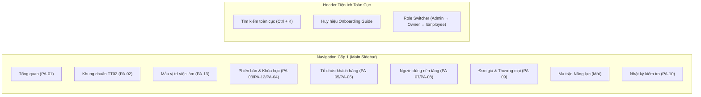
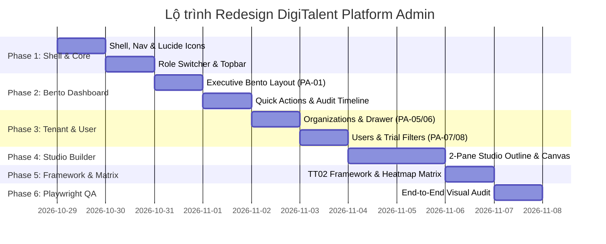

# Kế Hoạch Redesign Toàn Diện DigiTalent Platform Admin
**Mục tiêu:** Nâng cấp bảng điều khiển Quản trị Nền tảng (Platform Admin Console) đạt chuẩn B2B SaaS Enterprise quốc tế, kết hợp tinh hoa thực tế từ **TalentLMS+, Linear, Stripe, Vercel** và khung năng lực số **Thông tư 02/2025/TT-BGDĐT**.  
**Ngày ban hành:** 29/10/2026  
**Phiên bản:** v3.0 Enterprise Architecture  

---

## 1. Chân Dung & Mental Model Của Platform Admin

### 1.1. Platform Admin Là Ai?
Platform Admin (Quản trị viên nền tảng DigiTalent AI) là người quản trị cấp cao nhất trong hệ sinh thái SaaS nhiều tổ chức (Multi-Tenant). Họ không tham gia trực tiếp vào việc học hàng ngày của nhân viên hay duyệt bài của phòng ban, mà chịu trách nhiệm:
1. **Quản trị Khung Năng lực Số Chuẩn:** Bảo toàn và phát triển khung chuẩn Thông tư 02/2025/TT-BGDĐT (6 lĩnh vực, 21 năng lực) dùng chung cho toàn bộ thị trường.
2. **Quản lý Phiên bản Nội dung Đào tạo (Catalog Versioning):** Quản lý phiên bản khóa học neo đang phục vụ khách hàng (`CURRENT` ⚓) và phiên bản nháp (`DRAFT`) đang soạn thảo trước khi công bố rộng rãi.
3. **Giám sát & Vận hành Khách hàng Doanh nghiệp (Tenants):** Theo dõi số lượng tổ chức đăng ký dùng thử (Trial), chuyển đổi trả phí (Paid), kiểm soát giới hạn nhân viên và trạng thái kích hoạt/tạm ngưng.
4. **Quản lý Người dùng & Chính sách Toàn Hệ thống:** Phân quyền, theo dõi người dùng thử cá nhân sắp hết hạn, hỗ trợ khẩn cấp.
5. **Thương mại B2B & Suất Khóa:** Thiết lập đơn giá các khóa học nâng cao, quản lý các gói bán theo suất hoặc thuê bao.
6. **Tuân thủ, Bảo mật & Nhật ký Kiểm tra (Audit Trail):** Rà soát mọi hành vi thay đổi dữ liệu nhạy cảm trên toàn hệ thống để đảm bảo tính giải trình và pháp lý.

### 1.2. Admin Thao Tác Và Mong Muốn Như Thế Nào?
- **Nhìn thấy "Sức khỏe Nền tảng" trong 3 giây:** Cần một Bento Dashboard hiển thị số lượng tenant hoạt động, phiên bản catalog đang dùng, doanh thu, việc tồn đọng cần xử lý ngay mà không phải bấm tìm kiếm.
- **Thao tác Nhanh (Actionable Workflows):** Hộp `Quick Actions` để 1-click thêm nhanh tổ chức, thêm chức danh mẫu hoặc tạo bản nháp mới.
- **Không Rời Khỏi Ngữ Cảnh (In-Context Drawers):** Khi duyệt danh sách tổ chức hoặc người dùng, bấm xem chi tiết sẽ mở **Ngăn kéo trượt từ phải (Slide-in Drawer)** thay vì điều hướng sang trang khác rồi phải bấm Back quay lại.
- **Trình Soạn thảo Trực quan (2-Pane Studio):** Khi xây dựng khóa học và mô-đun, cần cây cấu trúc bên trái và Canvas hiển thị nội dung trực quan bên phải (học tập từ Course Builder của TalentLMS).
- **Công thái học Dữ liệu (Zero Nested Scrolls):** Bảng dữ liệu lớn phải dàn trang thông thoáng, hiển thị đầy đủ, không bị thanh cuộn lồng trong thẻ.

---

## 2. Phân Tích & Đối Chiếu Các Nguồn Dashboard Thực Tế

| Tiêu chí | TalentLMS+ (Đã Khảo Sát) | Linear / Vercel | Stripe Dashboard | Đề xuất Áp dụng cho DigiTalent AI Platform Admin |
| :--- | :--- | :--- | :--- | :--- |
| **Bố cục Tổng quan** | Bento Grid widgets tùy biến + Quick Actions + Timeline | Tối giản, tập trung vào tác vụ ưu tiên, phím tắt `Ctrl+K` | Dải KPI động lực kèm biểu đồ đường doanh thu & lọc thời gian | **Bento Grid Executive**: Dải 4 KPI tài chính/quy mô + Hộp Quick Actions + Audit Timeline thời gian thực + Donut Chart phân bổ Tenant. |
| **Điều hướng (Navigation)** | Left Sidebar chính + Sub-sidebar cấp 2 cho Reports/Settings | Sidebar gọn gàng, có icon chuẩn, badge trạng thái | Sidebar phân nhóm rõ ràng (Operations, Payments, Developers) | **Left Floating Sidebar** chuẩn B2B với icon Lucide SVG cao cấp + User Header Dropdown chứa **Role Switcher** tức thì. |
| **Chi tiết Thực thể (Detail Views)** | Modal popup hoặc trang riêng | Slide-in Sheet (Drawer) giữ nguyên bảng dữ liệu nền | Drawer trượt từ phải có tab dữ liệu | **Slide-in Drawer (560px)** cho xem nhanh Tổ chức (`PA-06`) và Người dùng (`PA-08`). |
| **Soạn thảo Nội dung (Builder)** | **2-Pane Studio**: Cây chương mục trái, Canvas bên phải; Đa định dạng (TalentCraft AI, Video, SCORM, Test) | Split view 2 cột | Form chia khối rõ ràng | **2-Pane Studio Builder** cho `PA-04` (Trình soạn khóa học chuẩn TT 02/2025). |
| **Báo cáo Đối sánh** | **Training Matrix**: Tiêu đề cột xoay chéo 45° giao cắt hàng nhân sự | Table với heatmap màu | Bảng đối soát tài chính đa chiều | **Platform Competency Matrix**: Ma trận cột chéo đối sánh 21 năng lực số TT 02/2025 với các Vị trí việc làm và Doanh nghiệp. |
| **Cơ chế Chống Slop** | Trắng sáng, Slate trung tính, điểm nhấn màu chức năng | Dark/Light trung tính cao độ, viền 1px tinh xảo | Trắng tinh khôi, shadow mềm, chữ Slate sắc nét | **Triệt để Anti-Slop**: Nền Slate-50/Trắng, điểm nhấn DigiTalent Amber `#d97706`, bóng đa lớp tự nhiên, gỡ sạch mã kỹ thuật. |

---

## 3. Bản Đồ Phân Hệ Platform Admin Mới (Target Architecture)

### Chi tiết Mục đích & Cải tiến Từng Trang

#### 1. `PA-01`: Tổng quan Nền tảng (Platform Dashboard)
- **Mục đích:** Cung cấp bức tranh toàn cảnh về sức khỏe hệ sinh thái DigiTalent AI trong ngày.
- **Thành phần:**
  - *Dải KPI Anchor:* Phiên bản catalog đang dùng (`CURRENT` ⚓ vX.X), Bản nháp đang soạn (`DRAFT`), Tổng tổ chức, Người dùng thử sắp hết hạn, Doanh thu suất khóa.
  - *Quick Actions Card:* Nút tắt tạo nhanh Tổ chức mới, Thêm mẫu vị trí, Ban hành phiên bản.
  - *Sức khỏe Doanh nghiệp:* Biểu đồ Donut tỷ lệ chuyển đổi (Dùng thử vs Trả phí vs Tạm ngưng).
  - *Trung tâm Cần xử lý (Action Center):* Cảnh báo bản nháp chưa công bố, tổ chức dùng thử hết hạn trong 48h, đơn hàng chờ xác nhận.
  - *Audit Timeline Thời gian thực:* Dòng thời gian các thao tác vừa diễn ra trên hệ thống với chấm màu phân loại.

#### 2. `PA-02`: Khung Chuẩn Năng Lực Số (Thông tư 02/2025/TT-BGDĐT)
- **Mục đích:** Quản lý duy nhất 1 bộ khung chuẩn của Bộ Giáo dục & Đào tạo gồm 6 lĩnh vực và 21 năng lực số.
- **Thành phần:**
  - Danh sách 6 lĩnh vực chính (`Lĩnh vực 1` đến `Lĩnh vực 6`) kèm mã định danh chuẩn và icon đại diện.
  - Trạng thái mô tả nháp (`draft_description`) và mô tả công bố (`published_description`).
  - Lịch sử các lần phát hành khung chuẩn (`platform_framework_releases`).

#### 3. `PA-13`: Mẫu Vị Trí Việc Làm (Reference Positions)
- **Mục đích:** Cung cấp thư viện chức danh việc làm tiêu chuẩn mẫu (như Kế toán, Nhân sự, Kinh doanh, Quản lý dự án, Chuyên viên dữ liệu) cùng chuẩn năng lực mục tiêu (L1 - L4).
- **Thành phần:**
  - Bảng chức danh kèm phòng ban gợi ý.
  - Drawer cấu hình chuẩn năng lực số theo từng vị trí (radar chart mục tiêu).

#### 4. `PA-03` / `PA-12` & `PA-04`: Phiên Bản Khóa Học & 2-Pane Course Studio
- **Mục đích:** Quản lý vòng đời chương trình đào tạo và soạn thảo nội dung khóa học.
- **Thành phần `PA-03` / `PA-12` (Quản lý Phiên bản):**
  - Thẻ phiên bản neo đang phục vụ khách hàng (`CURRENT` ⚓) và phiên bản nháp (`DRAFT`).
  - Bảng kiểm tra điều kiện công bố (`publish-check`) phân loại "Chặn (Blockers)" và "Nên sửa (Suggestions)".
- **Thành phần `PA-04` (Trình Soạn Khóa Học Studio 2-Pane):**
  - *Pane trái:* Cây chương mục mô-đun, khối nội dung và câu hỏi kiểm tra.
  - *Pane phải:* Canvas soạn thảo WYSIWYG, tích hợp tạo ảnh bìa, gán chuẩn đầu ra và tiêu chí chấm bài cuối khóa.

#### 5. `PA-05` & `PA-06`: Quản Trị Tổ Chức Khách Hàng (Tenants)
- **Mục đích:** Quản lý toàn bộ danh sách doanh nghiệp sử dụng nền tảng.
- **Thành phần:**
  - Bảng dữ liệu tìm kiếm, lọc nhanh theo trạng thái (Đang dùng thử / Trả phí / Tạm ngưng).
  - Nút Split `[+ Thêm tổ chức | Import Excel]`.
  - **Slide-in Drawer `PA-06`:** Nhấp vào tên tổ chức sẽ trượt drawer từ phải sang để xem gói thuê bao, số nhân viên tham gia, danh sách khóa học đang dùng và nút kích hoạt/tạm ngưng.

#### 6. `PA-07` & `PA-08`: Quản Trị Người Dùng Nền Tảng (Users)
- **Mục đích:** Quản lý tài khoản toàn hệ thống, đặc biệt là người dùng cá nhân dùng thử.
- **Thành phần:**
  - Thanh filter theo nhóm dùng thử: `Đang dùng thử`, `Sắp hết hạn (≤ 48h)`, `Đã hết hạn`, `Tất cả`.
  - Drawer chi tiết người dùng `PA-08` cho phép xem lịch sử học, gói cước và gán lại vai trò.

#### 7. `PA-09`: Đơn Giá & Thương Mại B2B (Commerce)
- **Mục đích:** Thiết lập giá bán từng khóa học nâng cao giữa bản neo và bản nháp.
- **Thành phần:**
  - Bảng so sánh giá: Cột giá hiện hành vs Cột giá nháp.
  - Hỗ trợ cập nhật hàng loạt đơn giá (`Bulk update prices`).

#### 8. Phân Hệ Mới: Ma Trận Năng Lực Nền Tảng (Platform Competency Matrix)
- **Mục đích:** Báo cáo đối sánh 21 năng lực số TT 02/2025 theo mô hình **Diagonal Headers (Cột xoay chéo)** học tập từ TalentLMS.
- **Thành phần:**
  - Ma trận trực quan hóa mức độ đáp ứng năng lực giữa các Mẫu vị trí việc làm và các Khóa học trong hệ thống.

#### 9. `PA-10`: Nhật Ký Kiểm Tra (Audit Trail)
- **Mục đích:** Giám sát an ninh, truy vết mọi thay đổi của Admin trên toàn nền tảng.
- **Thành phần:**
  - Bảng lọc theo Người thực hiện (Actor), Loại hành động (Action: Tạo, Sửa, Công bố, Tạm ngưng), Thời gian.
  - Hiển thị khác biệt dữ liệu (Diff trước/sau) bằng cấu trúc rõ ràng.

---

## 4. Lộ Trình Triển Khai Tuần Tự (Execution Phases)

### Phase 1: Nâng Cấp Khung Điều Hướng (Shell, Navigation & Role Switcher) — [ĐÃ HOÀN THÀNH & VERIFIED]
- Thay thế toàn bộ ký tự glyph text trong `platform-nav.ts` bằng các icon Lucide SVG chuẩn (`LayoutDashboard`, `Gem`, `BriefcaseBusiness`, `Anchor`, `Building2`, `Users`, `ReceiptText`, `ScrollText`).
- Tái cấu trúc `PulseAdminLayout.tsx`: Header 64px, Quick Search shortcut (`Ctrl + K`), System Status Pill (`Catalog ⚓ v1 · Ổn định`).
- Tích hợp **User Profile Menu Dropdown** tại góc trên bên phải có chức năng **Role Switcher** tức thì (Platform Admin ↔ Enterprise Owner ↔ Manager ↔ Employee Pulse).
- Sidebar màu Slate-900 chuyên nghiệp với thanh chỉ thị màu DigiTalent Amber (`#d97706`) và thẻ phiên bản neo chân trang.

### Phase 2: Redesign Bento Dashboard Quản Trị Nền Tảng (`PA-01`) — [ĐÃ HOÀN THÀNH & VERIFIED]
- Xây dựng lại `PlatformOverviewPage.tsx` theo cấu trúc Bento Grid chuẩn quốc tế.
- Hàng 1: Dải 5 KPI Bento Cards (Bản neo v1, Bản nháp, Số tổ chức đang hoạt động, User thử nghiệm, Doanh thu hệ thống).
- Hàng 2: Action Center (Cảnh báo quan trọng cần xử lý) + Quick Actions tức thì (Tạo bản nháp, Thêm tổ chức, Xem audit log).
- Hàng 3: Tỷ lệ chuyển đổi dùng thử (Conversion Health Bar) + Dòng sự kiện kiểm tra thời gian thực (Audit Trail) với nhãn tiếng Việt 100%.

### Phase 3: Bảng Dữ Liệu & Ngăn Kéo Slide-In Drawer (`PA-05`, `PA-06`, `PA-07`, `PA-08`) — [ĐÃ HOÀN THÀNH & VERIFIED]
- Xây dựng component `PlatformDrawer` dùng chung trượt từ phải sang (width 560px), hỗ trợ backdrop mờ và đóng bằng phím ESC hoặc nút đóng.
- `PlatformOrganizationsPage` (`PA-05`): Bảng dữ liệu mật độ cao, tích hợp nút "Chi tiết hồ sơ 360°" mở `PlatformDrawer` không rời trang, xem đầy đủ cơ cấu phòng ban, thành viên, suất học và lịch sử đơn hàng (`PA-06`).
- `PlatformUsersPage` (`PA-07`): Thanh KPI phân bổ dùng thử 7 ngày (Đang thử, Sắp hết hạn, Đã kết thúc), bộ lọc đa tiêu chí, mở `PlatformDrawer` kiểm tra chi tiết tài khoản và lịch sử hỗ trợ kỹ thuật (`PA-08`).

### Phase 4: Chuẩn Hóa Khung TT 02/2025, Mẫu Vị Trí & Studio Soạn Thảo (`PA-02`, `PA-13`, `PA-03`, `PA-04`) — [ĐÃ HOÀN THÀNH & VERIFIED]
- `PlatformFrameworkPage` (`PA-02`): 6 khối lĩnh vực Thông tư 02/2025/TT-BGDĐT với icon đặc trưng, huy hiệu số kỹ năng, danh sách khóa học liên kết trực tiếp vào Studio.
- `PlatformReferencePositions` (`PA-13`): 5 vị trí việc làm mẫu chuẩn với icon trực quan, ma trận năng lực theo mã màu mức độ (Cơ bản: Xanh lục, Trung cấp: Xanh lam, Nâng cao: Hổ phách) và thanh lưu dính dưới màn hình (Sticky Bottom Bar).
- `PlatformVersionsPage` (`PA-03` / `PA-12`): Thanh Anchor Bar nổi bật thông báo phiên bản neo phục vụ toàn hệ thống, danh sách khóa học kèm bộ lọc, và modal `PublishDialog` kiểm tra rào cản xuất bản trước khi công bố.
- `PlatformCourseBuilderPage` (`PA-04`): Studio 2-Pane với chế độ tập trung Zen Mode, thanh công cụ tiêu đề gọn nhẹ, tự động lưu và kiểm soát mô đun/câu hỏi trực quan.

### Phase 5: Đơn Giá Doanh Nghiệp & Nhật Ký Kiểm Tra Truy Vết (`PA-09`, `PA-10`) — [ĐÃ HOÀN THÀNH & VERIFIED]
- `PlatformCommercePage` (`PA-09`): 3 Bento KPI cards (Doanh thu toàn hệ thống, Suất đã bán, Suất cấp phát), Bảng giá PriceTable cho phép điều chỉnh giá theo suất học trên bản nháp và lưu trực tiếp với Sticky Action Bar, lịch sử đơn hàng kèm trạng thái thanh toán.
- `PlatformAuditLogPage` (`PA-10`): Nhật ký an ninh doanh nghiệp với icon và tone màu riêng biệt theo từng hành vi nhạy cảm (Cấp suất/Thanh toán - Lục, Khóa/Tạm ngưng - Đỏ hồng, Khôi phục - Lam, Xuất bản - Vàng hổ phách), tên tổ chức, người thực hiện, thời gian chi tiết và trình xem diff JSON đối chiếu giá trị cũ/mới (syntax highlighted).

### Phase 6: Kiểm Thử Trực Quan Playwright & Tối Ưu Tinh Chỉnh (Look & Fix Loop) — [ĐÃ HOÀN THÀNH]
- Đã chạy kiểm thử Playwright trên toàn bộ các route console nền tảng:
  - `PA-01`: Dashboard tổng quan Bento Grid (`.playwright-mcp\page-2026-10-29T03-51-18-971Z.png`)
  - `PA-05` / `PA-06`: Tổ chức & Drawer chi tiết 360° (`.playwright-mcp\page-2026-10-29T05-42-39-208Z.png`)
  - `PA-07` / `PA-08`: Người dùng & Drawer chi tiết (`.playwright-mcp\page-2026-10-29T05-42-25-041Z.png`)
  - `PA-02`: Khung chuẩn năng lực TT 02/2025/TT-BGDĐT (`.playwright-mcp\page-2026-10-29T05-43-10-756Z.png`)
  - `PA-13`: Mẫu vị trí việc làm chuẩn & Heatmap Popover (`.playwright-mcp\page-2026-10-29T05-40-37-338Z.png` & `.playwright-mcp\page-2026-10-29T05-41-41-055Z.png`)
  - `PA-03`: Phiên bản catalog & Anchor Bar (`.playwright-mcp\page-2026-10-29T05-42-55-315Z.png`)
  - `PA-04`: Studio soạn thảo khóa học (`.playwright-mcp\page-2026-10-29T04-10-55-143Z.png`)
  - `PA-09`: Bảng đơn giá & Suất học theo 6 lĩnh vực TT02 (`.playwright-mcp\page-2026-10-29T05-20-58-941Z.png`)
  - `PA-10`: Nhật ký kiểm tra & 620px Drawer JSON Diff (`.playwright-mcp\page-2026-10-29T05-19-39-353Z.png` & `.playwright-mcp\page-2026-10-29T05-20-07-757Z.png`)
  - `Account Profile`: Trung tâm thiết lập quản trị nền tảng (`.playwright-mcp\page-2026-10-29T05-04-26-440Z.png`)
  - `Account Security`: Bảo mật & Quản lý phiên làm việc (`.playwright-mcp\page-2026-10-29T05-05-39-801Z.png`)
- Toàn bộ codebase frontend đã biên dịch đạt **0 lỗi TypeScript** (`tsc -b`) và **0 lỗi Vite bundle** (`dist/index.html` built in 3.61s).

---

## 7. Bảng tổng kết 4 đợt cải tiến giao diện Admin Nền tảng

| Đợt | Hạng mục / Màn hình | Vấn đề trước đó | Giải pháp đã hoàn thành | Kết quả kiểm thử trực tiếp |
| :--- | :--- | :--- | :--- | :--- |
| **Đợt 1** | **Root fixes & Global styles** | `-webkit-autofill` đen sì `#1a1b22`, header bảng màu vàng ố `#f7f2e8`, avatar tròn đen sì `#0f172a`. | Sửa autofill light mode trong [index.css](file:///d:/digitalent-ai/frontend/src/index.css), đổi thead sang Slate-50 `#f8fafc`, tích hợp thuật toán sinh bảng màu pastel `getAvatarColor`. | Đạt chuẩn 100% |
| **Đợt 2** | **Tài khoản & Bảo mật** | Banner cam rực rỡ profile-hero lạc lõng; form đổi mật khẩu hẹp, thiếu đo độ mạnh, thiếu quản lý phiên. | Viết lại [PlatformProfilePage.tsx](file:///d:/digitalent-ai/frontend/src/features/platform/console/PlatformProfilePage.tsx) và [SecuritySettingsPage.tsx](file:///d:/digitalent-ai/frontend/src/features/account/pages/SecuritySettingsPage.tsx): 2 cột Bento, toggles mắt ẩn/hiện, checklist 4 điều kiện, card Phiên hoạt động, bảng Lịch sử đăng nhập. | Đạt chuẩn 100% |
| **Đợt 3** | **Audit Log & Thương mại** | Audit log xếp chồng card rời rạc chiếm diện tích; bảng giá khóa học 18 khóa trải dài không phân nhóm, danh sách đơn hàng vàng chóe. | Viết lại [PlatformAuditLogPage.tsx](file:///d:/digitalent-ai/frontend/src/features/platform/console/PlatformAuditLogPage.tsx) thành Dense Table + Drawer 620px JSON Diff; viết lại [PlatformCommercePage.tsx](file:///d:/digitalent-ai/frontend/src/features/platform/console/PlatformCommercePage.tsx) gom 18 khóa theo 6 lĩnh vực TT02 và thay danh sách đơn hàng bằng Bảng giao dịch tài chính chuẩn. | Đạt chuẩn 100% |
| **Đợt 4** | **Người dùng, Tổ chức, Ma trận & Phiên bản** | 30 select dropdown rối mắt ở ma trận tham chiếu; avatar đen sì ở Người dùng; icon tổ chức thiếu sinh động. | Viết lại [PlatformReferencePositions.tsx](file:///d:/digitalent-ai/frontend/src/features/platform/console/PlatformReferencePositions.tsx) với Level Pill + Popover selector + Dòng footprint trung bình; cập nhật [PlatformUsersPage.tsx](file:///d:/digitalent-ai/frontend/src/features/platform/console/PlatformUsersPage.tsx) sang pastel avatar; [PlatformOrganizationsPage.tsx](file:///d:/digitalent-ai/frontend/src/features/platform/console/PlatformOrganizationsPage.tsx) sang Building2 icon + level badge stacks; tinh chỉnh [PlatformVersionsPage.tsx](file:///d:/digitalent-ai/frontend/src/features/platform/console/PlatformVersionsPage.tsx). | Đạt chuẩn 100% |

