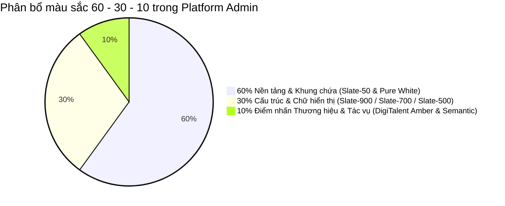

# Hệ Thống Thiết Kế & Design Tokens Cho Platform Admin
**Hệ thống:** DigiTalent AI Platform Admin Design System  
**Phong cách:** B2B Enterprise SaaS · Trust & Authority · Anti-Slop  
**Phiên bản:** v3.0  

---

## 1. Triết Lý & Phân Tích Màu Sắc (Color Architecture)

Theo quy luật vàng công thái học **60 - 30 - 10**, một giao diện phần mềm quản trị doanh nghiệp chuyên nghiệp (Operate Mode) cần giảm thiểu tối đa kích ứng thị giác, giúp người dùng làm việc liên tục 8 tiếng không mỏi mắt nhưng vẫn nhận biết ngay điểm nóng và trạng thái nghiệp vụ.



### 1.1. Tỷ lệ 60%: Nền Tảng & Khung Chứa (Canvas & Surfaces)
- **Mục đích:** Tạo phông nền tĩnh lặng, độ sáng vừa phải, triệt tiêu cảm giác chói gắt nhưng vẫn tinh khiết và hiện đại.
- **Tokens cốt lõi:**
  - `canvas-bg`: `#f8fafc` (Slate-50) — Nền chính của toàn bộ trang ứng dụng.
  - `surface-card`: `#ffffff` (Pure White) — Nền của các thẻ Bento, bảng dữ liệu và thanh Drawer.
  - `surface-sidebar`: `#0f172a` (Slate-900) — Nền của thanh Sidebar quản trị mang lại cảm giác quyền lực và phân tách rõ ràng với khu vực làm việc.
  - `border-subtle`: `#f1f5f9` (Slate-100) — Viền phân tách nội bộ thẻ.
  - `border-strong`: `#e2e8f0` (Slate-200) — Viền bao ngoài thẻ, bảng và trường nhập liệu.

### 1.2. Tỷ lệ 30%: Cấu Trúc & Phân Cấp Nội Dung (Typography & Structural Elements)
- **Mục đích:** Thiết lập thứ bậc thị giác sắc nét, tỷ lệ tương phản đạt chuẩn WCAG AAA (≥ 7:1 đối với văn bản thông thường).
- **Tokens cốt lõi:**
  - `text-primary`: `#0f172a` (Slate-900) — Tiêu đề màn hình (H1, H2), chỉ số KPI chính và tên thực thể.
  - `text-secondary`: `#334155` (Slate-700) — Nhãn trường, nội dung bảng và văn bản đọc chính.
  - `text-muted`: `#64748b` (Slate-500) — Chú thích phụ, metadata ngày giờ và placeholder.
  - `text-disabled`: `#94a3b8` (Slate-400) — Trạng thái vô hiệu hóa.

### 1.3. Tỷ lệ 10%: Màu Chính & Hệ Màu Phụ Điểm Nhấn (Brand Accent & Semantic Tones)

#### Màu Chính (Primary Brand Accent): **DigiTalent Amber (Vàng Hổ Phách Hoàng Gia)**
- **Lý do lựa chọn:**
  - Đại diện cho trí tuệ nhân tạo, sự thịnh vượng và năng lượng tích cực của nền tảng phát triển nhân tài số.
  - Đồng bộ 100% với nhận diện thương hiệu đã được chuẩn hóa tại Cổng Nhân viên (Employee Pulse) và Bàn làm việc Doanh nghiệp (Enterprise Portal).
  - Nổi bật mạnh mẽ trên nền trắng Slate mà không gây chói hay mất tập trung như màu đỏ hoặc vàng chanh.
- **Tokens:**
  - `brand-primary`: `#d97706` (Amber-600) — Nút hành động chính (Primary CTA), trạng thái hoạt động (Active Tab/Nav), đường viền tiêu điểm (Focus Ring).
  - `brand-hover`: `#b45309` (Amber-700) — Trạng thái rê chuột qua nút chính.
  - `brand-tint`: `#fef3c7` (Amber-100) — Nền của nhãn gắn thẻ (Badges), dải cảnh báo nhẹ hoặc ô trạng thái đang chọn.
  - `brand-anchor`: `#78350f` (Amber-900) — Chữ trên nền tint hổ phách.

#### Hệ Màu Phụ & Màu Nghiệp Vụ (Secondary & Semantic Tokens)
- **Executive Blue (Xanh Điều Hành):** `#0284c7` (Sky-600), Tint: `#e0f2fe` — Dùng cho liên kết điều hướng thông tin, chỉ số số lượng học viên, icon phụ trợ.
- **Success (Thành công / Hoạt động):** `#059669` (Emerald-600), Tint: `#ecfdf5` — Trạng thái tổ chức đang kích hoạt (Active), khóa học đã công bố, bài thi đạt.
- **Warning / Pending (Đang chờ / Cần chú ý):** `#d97706` (Amber-600), Tint: `#fffbeb` — Tổ chức dùng thử sắp hết hạn trong 48h, bản nháp chưa công bố.
- **Destructive / Danger (Tạm ngưng / Lỗi):** `#e11d48` (Rose-600), Tint: `#fff1f2` — Tổ chức bị tạm ngưng (Suspended), khóa học ngưng bán, xóa tài khoản.
- **Neutral (Bản cũ / Lưu trữ):** `#64748b` (Slate-500), Tint: `#f1f5f9` — Phiên bản đã nghỉ hưu (Retired), dữ liệu lịch sử.

---

## 2. Hệ Thống Typography Chuẩn Enterprise

- **Font Family Chính:** `'Plus Jakarta Sans', 'Inter', -apple-system, BlinkMacSystemFont, 'Segoe UI', Roboto, sans-serif`
- **Font Chữ Số & Mã Kỹ Thuật (Monospace):** `'JetBrains Mono', 'Fira Code', ui-monospace, monospace`

| Cấp Bậc | Cỡ Chữ | Trọng Lượng | Line Height | Ứng Dụng |
| :--- | :--- | :--- | :--- | :--- |
| **Display / KPI** | 32px (2rem) | 800 (Extra Bold) | 1.15 | Con số KPI tổng quan, số lượng doanh thu |
| **Heading 1** | 24px (1.5rem) | 700 (Bold) | 1.25 | Tiêu đề chính của màn hình (`Page Title`) |
| **Heading 2** | 18px (1.125rem) | 600 (Semi-bold) | 1.35 | Tiêu đề khối Bento, tiêu đề bảng dữ liệu |
| **Heading 3** | 15px (0.9375rem) | 600 (Semi-bold) | 1.4 | Tiêu đề nhóm con, nhãn cột bảng |
| **Body Large** | 15px (0.9375rem) | 400 (Regular) | 1.5 | Đoạn mô tả mở đầu trang |
| **Body Regular** | 13.5px (0.84375rem) | 400 / 500 | 1.5 | Nội dung ô trong bảng, nhãn trường nhập liệu |
| **Caption / Meta** | 12px (0.75rem) | 500 (Medium) | 1.4 | Nhãn Badge trạng thái, thời gian tương đối |
| **Code / Hash** | 12px (0.75rem) | 400 (Mono) | 1.4 | Mã phiên bản vX.X, ID hóa đơn, địa chỉ IP |

---

## 3. Hệ Thống Đổ Bóng & Phân Tầng Thị Giác (Elevation & Shadows)

Không sử dụng hiệu ứng phát sáng neon dã quang (`glow`). Toàn bộ hệ thống sử dụng đổ bóng tự nhiên nhiều lớp (`Multi-layer Soft Elevation`):

```css
/* Lớp 0: Phẳng trên bề mặt */
--shadow-flat: 0 0 0 1px rgba(15, 23, 42, 0.06);

/* Lớp 1: Thẻ Bento, Khối nội dung trên nền Canvas */
--shadow-card: 
  0 1px 3px 0 rgba(15, 23, 42, 0.05),
  0 1px 2px -1px rgba(15, 23, 42, 0.05),
  0 0 0 1px rgba(15, 23, 42, 0.06);

/* Lớp 2: Thẻ khi rê chuột qua (Hover Elevation) */
--shadow-card-hover: 
  0 12px 24px -6px rgba(15, 23, 42, 0.08),
  0 4px 8px -4px rgba(15, 23, 42, 0.04),
  0 0 0 1px rgba(217, 119, 6, 0.2);

/* Lớp 3: Menu xổ xuống (Dropdown Popovers) */
--shadow-popover: 
  0 10px 30px -5px rgba(15, 23, 42, 0.12),
  0 4px 6px -2px rgba(15, 23, 42, 0.04),
  0 0 0 1px rgba(15, 23, 42, 0.08);

/* Lớp 4: Ngăn kéo trượt Slide-in Drawer & Modal nổi */
--shadow-drawer: 
  -16px 0 40px -10px rgba(15, 23, 42, 0.16),
  0 0 0 1px rgba(15, 23, 42, 0.08);
```

---

## 4. Đặc Tả Chi Tiết Các Thành Phần Cốt Lõi (Component Specs)

### 4.1. Khung Điều Hướng 2 Tầng (App Shell & Two-Tier Navigation)
- **Top Micro-bar (Header - Cao 60px):**
  - Trái: Logo DigiTalent AI dạng biểu tượng sắc nét + breadcrumbs điều hướng theo vị trí hiện tại.
  - Giữa: Thanh tìm kiếm toàn cục (Global Search) tích hợp phím tắt `Ctrl + K`.
  - Phải:
    - Huy hiệu tiến độ Onboarding Checklist (Hình cúp 🏆 kèm tỷ lệ `%`).
    - Nút Thông báo hệ thống có chuông báo tin chưa đọc.
    - **User Profile Dropdown:** Hiển thị Tên Admin, Avatar bo tròn, kèm **Role Switcher** chọn nhanh:
      - `[●] Quản trị Nền tảng (Platform Admin)`
      - `[ ] Chủ Doanh nghiệp (Enterprise Owner)`
      - `[ ] Quản lý Đào tạo (Department Manager)`
      - `[ ] Cổng Nhân viên (Employee Pulse)`
- **Thanh Menu Trái (Sidebar - Rộng 260px mở rộng / 68px thu gọn):**
  - Nền Slate-900 sang trọng, viền phải Slate-800.
  - Danh sách Menu với icon Lucide SVG 20px, có trạng thái Active màu vàng hổ phách `#d97706` với dải viền sáng bên trái.
  - Nút thu gọn / mở rộng góc trên thanh menu giúp tối ưu không gian cho màn hình nhỏ.

### 4.2. Thẻ Bento Quản Trị (Bento Grid Cards)
- Bo góc chuẩn: `border-radius: 16px` (1rem).
- Padding chuẩn: `padding: 24px` đối với thẻ lớn, `16px` đối với thẻ thống kê nhỏ.
- Tiêu đề thẻ có dải phân tách mờ `border-b border-slate-100` kèm nút tác vụ phụ ở góc phải (ví dụ: `Xem tất cả →`).

### 4.3. Bảng Dữ Liệu Công Thái Học (Ergonomic Data Table)
- **Quy tắc tuyệt đối:** `overflow-y: visible !important` — không tạo thanh cuộn dọc bên trong bảng. Toàn bộ trang cuộn tự nhiên.
- Chiều cao dòng thoáng đãng: `padding: 14px 16px` trên mỗi ô (`td`).
- Hàng tiêu đề (`th`): Nền Slate-50, chữ hoa nhỏ gọn `text-xs font-semibold text-slate-500 uppercase tracking-wider`, có mũi tên sắp xếp khi nhấp vào.
- Trạng thái dòng khi hover: Nền chuyển đổi nhẹ `bg-slate-50/80` kèm hiệu ứng hiện các nút thao tác nhanh ở cột cuối cùng (`Preview`, `Edit`, `More`).

### 4.4. Ngăn Kéo Slide-In Drawer (Cho `PA-06` và `PA-08`)
- Chiều rộng cố định: `width: 560px` (trên màn hình ≥ 1024px) hoặc `100vw` (trên mobile).
- Hiệu ứng trượt mượt mà: `transform: translateX(0)` với thời gian `250ms cubic-bezier(0.16, 1, 0.3, 1)`.
- Lớp phủ nền làm mờ: `backdrop-filter: blur(4px); background: rgba(15, 23, 42, 0.4)`.
- Cấu trúc Drawer gồm 3 phần:
  1. *Header sticky:* Tên thực thể, Badge trạng thái, nút đóng `[X]`.
  2. *Body có tab:* Cuộn tự nhiên với các Tab chi tiết (Thông tin chung, Khóa học, Nhân sự, Lịch sử).
  3. *Footer sticky:* Nút hành động chính (`Lưu thay đổi`, `Tạm ngưng`, `Hủy`).

### 4.5. Ma Trận Đào Tạo Cột Chéo (Diagonal Headers Training Matrix)
- Học tập trực tiếp từ thiết kế đỉnh cao của TalentLMS:
  - Cột đầu tiên cố định bên trái (Họ tên nhân sự / Tên tổ chức).
  - Các cột tiếp theo (Khóa học / 21 Năng lực TT02) có tiêu đề xoay nghiêng 45 độ, tiết kiệm 70% chiều ngang so với hiển thị ngang thông thường.
  - Ô giao nhau thể hiện bằng các biểu tượng hình học trực quan:
    - Vòng tròn xanh lá viền đặc: Đã đạt / Hoàn thành 100%.
    - Vòng tròn vàng cam viền đôi: Đang trong tiến trình học / Đang chờ duyệt.
    - Dấu chấm xám nhạt: Chưa bắt đầu.
