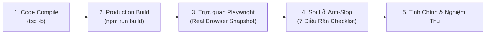

# Bộ Nguyên Tắc Thiết Kế Chống AI Slop & Trải Nghiệm B2B Enterprise
**Dự án:** DigiTalent AI Platform Admin  
**Tiêu chuẩn:** Out-of-Distribution Craft · Anti-Slop Architecture · WCAG AAA  
**Ngày ban hành:** 29/10/2026  

---

## 1. Định Nghĩa "AI Slop" Trong Giao Diện Quản Trị Enterprise

> [!WARNING]
> **"AI Slop" trong thiết kế UI là gì?**  
> Đó là xu hướng các mô hình AI khi tạo giao diện thường tạo ra các sản phẩm rập khuôn, màu sắc lòe loẹt giả tạo (tím/hồng neon trên nền đen), hiệu ứng đổ bóng phát sáng vô nghĩa (glowing shadows), nhồi nhét thẻ trong thẻ (nested cards), tạo các thanh cuộn lồng nhau (scroll-in-scroll) và để lộ các mã kỹ thuật nội bộ (như `PA-01`, `EM-02`, `TT02_D1`) ra trước mắt người dùng.
> 
> Một giao diện quản trị doanh nghiệp cao cấp (B2B Enterprise) phải toát lên vẻ đẹp của **sự chính xác, tĩnh lặng, công thái học tối ưu và độ tin cậy tuyệt đối**.

---

## 2. Bảy Điều Răn Chống AI Slop (The 7 Anti-Slop Commandments)

### Điều Răn 1: Cấm Tuyệt Đối Bảng Màu Tím/Hồng Neon Mặc Định Của AI
- **Hành vi slop:** Sử dụng gradient tím - xanh neon (`indigo-950 / violet-950`), chữ phát sáng dã quang, nền tối mờ ảo thiếu tương phản.
- **Quy chuẩn đúng:**
  - Nền Canvas trắng tinh khôi (`#ffffff`) hoặc xám đá phiến siêu nhạt (`#f8fafc`).
  - Viền phân định tinh tế 1px (`#e2e8f0`).
  - Điểm nhấn thương hiệu là màu vàng hổ phách **DigiTalent Amber** (`#d97706`) đầy đặn và quyền quý.
  - Chữ Slate đậm (`#0f172a`) trên nền sáng đạt độ tương phản tối thiểu 7:1 (chuẩn WCAG AAA).

### Điều Răn 2: Xóa Sổ Triệt Để Thanh Cuộn Lồng Nhau (Zero Nested Scrolls)
- **Hành vi slop:** Nhốt một bảng dữ liệu vào trong một hộp có chiều cao cố định `height: 400px` với thanh cuộn riêng, khiến người dùng bị kẹt chuột và thanh cuộn bị giật khi duyệt trang.
- **Quy chuẩn đúng:**
  - Mọi bảng dữ liệu chính (`table`, `grid`) phải có `overflow-y: visible !important`.
  - Toàn bộ trang web cuộn tự nhiên theo chiều dọc của trình duyệt.
  - Chiều rộng của bảng phải khớp chính xác với khung bao (`width: 100%`), không sinh ra thanh cuộn ngang thừa thãi.
  - Chỉ cho phép cuộn ngang trong các trường hợp có chủ đích đặc biệt (như Gantt chart hoặc Ma trận đào tạo với hơn 30 cột).

### Điều Răn 3: Tuyệt Đối Không Để Lộ Mã Kỹ Thuật Ra Giao Diện
- **Hành vi slop:** Hiển thị mã ticket Jira, mã screen quy cách của lập trình viên (như `PA-01`, `PA-05`, `TT02_D1`, `CFG_SYS_09`) vào tiêu đề, nút bấm hay tooltip.
- **Quy chuẩn đúng:**
  - Mọi tiêu đề, nhãn, nút bấm đều dùng văn phong tiếng Việt tự nhiên, trang trọng, hướng tới nghiệp vụ quản trị:
    - Thay vì *"PA-01 Platform Dashboard"* -> Dùng **"Tổng quan nền tảng"**.
    - Thay vì *"PA-05 Quản lý Organizations"* -> Dùng **"Tổ chức khách hàng"**.
    - Thay vì *"Mã TT02_D1"* -> Dùng **"Lĩnh vực 1: Dữ liệu và thông tin số"**.
  - Các mã kỹ thuật chỉ được tồn tại ngầm dưới dạng thuộc tính dữ liệu (`data-testid`, `id`, `data-tour`).

### Điều Răn 4: Cấm Nhồi Nhét Thẻ Lồng Trong Thẻ (No Nested Cards)
- **Hành vi slop:** Một chiếc Card lớn bo góc, bên trong lại chứa 3 chiếc Card con có viền nổi, bên trong Card con lại chứa thêm hộp bóng mờ. Kết quả là giao diện chật chội, mất diện tích và rối mắt.
- **Quy chuẩn đúng:**
  - Áp dụng triệt để **Bố cục Phẳng (Flat Grouping)**.
  - Bên trong một Bento Card lớn, các nhóm thông tin phân cách nhau bằng khoảng trắng (`gap-4`, `gap-6`), đường kẻ mảnh (`border-b border-slate-100`) hoặc nền tint nhẹ nhàng (`bg-slate-50/60`).
  - Giữ tỷ lệ "thở" (whitespace) thông thoáng, padding dòng tối thiểu 14px - 16px.

### Điều Răn 5: Hành Động Theo Đúng Ngữ Cảnh (Contextual Actions Only)
- **Hành vi slop:** Đặt các nút điều hướng thừa thãi trên thanh công cụ của trang chi tiết, ví dụ như trang "Hồ sơ năng lực" lại có nút "Quay lại Bàn làm việc" trong khi Sidebar bên trái đã có sẵn.
- **Quy chuẩn đúng:**
  - Nút bấm xuất hiện trên trang nào phải giải quyết trực tiếp bài toán của trang đó:
    - Trang Danh sách Tổ chức (`PA-05`): `[+ Thêm tổ chức]`, `[Xuất Excel]`, `[Lọc trạng thái]`.
    - Trang Phiên bản Khóa học (`PA-03`): `[Tạo bản nháp mới]`, `[Kiểm tra điều kiện công bố]`, `[Công bố phiên bản]`.
  - Không nhân bản vô ích các nút điều hướng trùng lặp với thanh Sidebar.

### Điều Răn 6: Giữ Ngữ Cảnh Bằng Ngăn Kéo Slide-In Drawer Thay Vì Nhảy Trang
- **Hành vi slop:** Mỗi lần xem chi tiết 1 tổ chức hay 1 người dùng, trang lại chuyển hướng hoàn toàn sang một URL mới, khiến Admin muốn so sánh hay xem người tiếp theo phải liên tục bấm nút Back và chờ tải lại bảng dữ liệu.
- **Quy chuẩn đúng:**
  - Chi tiết đối tượng (`PA-06` Organization Detail, `PA-08` User Detail) được mở bằng **Slide-in Drawer (Ngăn kéo trượt từ phải sang rộng 560px)**.
  - Bảng dữ liệu nền vẫn giữ nguyên vị trí cuộn và bộ lọc hiện tại, giúp Admin kiểm tra 10 doanh nghiệp liên tiếp với tốc độ nhanh gấp 5 lần.

### Điều Răn 7: Công Thái Học Dữ Liệu & Khả Năng Đọc Lướt (Scannability)
- **Hành vi slop:** Hiển thị các khối văn bản dài dằng dặc bằng chữ in hoa toàn bộ (`ALL-CAPS`), hoặc các đoạn văn trải rộng 100% màn hình Ultrawide 34-inch khiến mắt phải đảo liên tục từ mép trái sang mép phải.
- **Quy chuẩn đúng:**
  - Độ dài dòng văn bản đọc khống chế tối đa `max-w-3xl` (khoảng 75 - 85 ký tự/dòng).
  - Sử dụng Visual Indicators thay cho văn bản lặp: dùng Badge trạng thái có màu chuẩn (`Active`, `Trial`, `Suspended`), thanh đo cấp độ (`LevelBar`), icon trực quan thay vì lặp lại chữ "Đạt chuẩn", "Không đạt chuẩn" trên mọi hàng.
  - Thời gian hiển thị nhân bản hóa (Humanized relative time): *"Vừa xong"*, *"10 phút trước"*, *"2 giờ trước"*, kèm ngày giờ chuẩn khi rê chuột vào tooltip.

---

## 3. Khung Đánh Giá Kiểm Định Sau Mỗi Lần Redesign (Design QA Loop)

Mỗi khi hoàn thành một màn hình hoặc một thành phần, tiến trình kiểm định chất lượng phải tuân thủ nghiêm ngặt 5 bước:

1. **Kiểm tra TypeScript (`tsc -b`):** 0 lỗi cảnh báo cú pháp hoặc kiểu dữ liệu.
2. **Kiểm tra Build Vite (`npm run build`):** Đóng gói thành công, không vỡ bundle.
3. **Mở trình duyệt thật qua MCP Playwright:** Truy cập đường dẫn thực tế, tương tác các nút bấm, mở drawer, kiểm tra trạng thái hover và focus.
4. **Đối chiếu 7 Điều Răn Chống Slop:** Rà soát từng pixel, kiểm tra tương phản màu sắc, triệt tiêu scroll-in-scroll.
5. **Nghiệm thu trực quan:** Chụp ảnh màn hình làm bằng chứng kiểm thử trước khi bàn giao cho người dùng.
