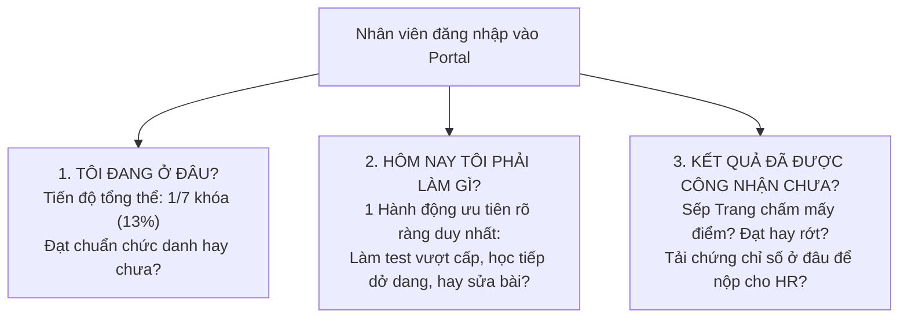
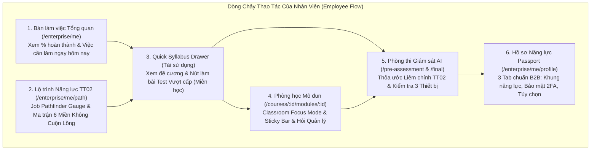

# Kế Hoạch Redesign Toàn Diện Cổng Nhân Viên (Employee Portal)
**Dự án:** DigiTalent Pulse — Cổng Quản trị & Nâng cao Năng lực Số Chuẩn TT 02/2025/TT-BGDĐT  
**Đối tượng trọng tâm:** Nhân viên Doanh nghiệp (Employee / Learner)  
**Tiêu chuẩn tham chiếu:** B2B SaaS Enterprise Quốc tế (TalentLMS Plus, Linear, Coursera for Business)  
**Ngày ban hành:** 29/10/2026  
**Phiên bản:** v3.0 Enterprise Learning Architecture  

---

## 1. Chân Dung & Mental Model Của Nhân Viên Doanh Nghiệp (Employee)

### 1.1. Nhân Viên Là Ai và Họ Thực Sự Cần Gì?
Trong môi trường doanh nghiệp thực tế, nhân viên (điển hình như *Chuyên viên Kế toán tài chính Hoàng Anh Thư*) phải đối mặt với áp lực công việc hàng ngày dày đặc. Họ không phải là sinh viên có nhiều thời gian rảnh rỗi để "lướt dạo" khóa học. 

Khi mở Cổng Năng lực Số DigiTalent Pulse lên, **họ chỉ quan tâm đến 3 câu hỏi cốt tử trong vòng 3 giây đầu tiên**:

### 1.2. Những Nỗi Đau (Pain Points) Trải Nghiệm Cần Loại Bỏ Ngay Lập Tức
1. **Rườm rà, bắt click nhiều bước:** Muốn học tiếp bài dở dang phải bấm qua 4 tầng trang (Trang chủ $\rightarrow$ Lộ trình $\rightarrow$ Chi tiết khóa học $\rightarrow$ Mô-đun $\rightarrow$ Bài học).
2. **Không phân biệt rõ "Học thật" và "Vượt cấp":** Nhân viên đã có kinh nghiệm thực tế nhưng vẫn bị ép xem lý thuyết suông từ đầu đến cuối thay vì được làm bài **Đánh giá Đầu vào (Pre-assessment)** có AI giám sát để được miễn học 70% thời gian.
3. **Mơ hồ về trạng thái thẩm định:** Nộp bài xong không biết quản lý đã xem chưa, khi nào có điểm, có cần sửa lại không, hay đã được cấp chứng nhận.
4. **Mất dấu vị trí khi xem đề cương:** Đang duyệt bảng ma trận năng lực mà click vào khóa học là bị nhảy văng sang trang khác, khi bấm quay lại thì trang web bị cuộn ngược lên đầu.
5. **Giao diện rực rỡ giả tạo (AI Slop):** Chữ tím neon, bóng phát sáng dạ quang, card lồng card chật chội khiến mắt nhanh mỏi khi phải đọc tài liệu chuyên môn dài.

---

## 2. Bảng Đối Chiếu Các Nguồn Trải Nghiệm Học Tập Doanh Nghiệp Thực Tế

| Tiêu chí | Cổng Nhân viên Hiện tại | TalentLMS Plus (Đã khảo sát thực tế) | Coursera for Business / Linear | Chuẩn Redesign DigiTalent Pulse v3.0 |
| :--- | :--- | :--- | :--- | :--- |
| **Bàn làm việc (Dashboard)** | Bento 2 cột, danh sách việc tĩnh, card lồng card | **Bento Action-driven**: Khóa học gần nhất to rõ + Don't Miss Carousel + Gamification Drawer | Tối giản, tập trung vào 1 tác vụ duy nhất cần làm ngay hôm nay | **Executive Bento Hero**: Dải 4 KPI năng lực + Khối "Việc làm tiếp" có CTA kích hoạt 1-click + Don't Miss Carousel cảnh báo SLA duyệt bài. |
| **Xem Đề cương Khóa học** | Trang riêng biệt (`/courses/:id`), tải lại toàn bộ DOM | **Slide-over Drawer** trượt từ mép phải (540px), có video + checklist bài học + nút Get Course | Modal xem nhanh đề cương không rời luồng | **Quick Syllabus Drawer**: Click vào bất kỳ ô khóa học nào trên Ma trận sẽ mở ngăn kéo xem ngay mục tiêu, điều kiện miễn học và nút vào học. |
| **Đối sánh Vị trí Chức danh** | Bảng ma trận 6 miền x 3 mức dạng bảng tĩnh | **Job Pathfinder**: Visual Gauge đo % sẵn sàng + danh sách Pill kỹ năng Met/Gap | Radar Chart kỹ năng + Khoảng hụt năng lực so với Level chuẩn | **Job Fit Pathfinder**: Đồng hồ đo % Sẵn sàng chuẩn vị trí + 6 Pill miền TT02 hiển thị rõ cấp độ thiếu kèm nút `[Đánh giá Vượt cấp]`. |
| **Phòng học & Đọc Bài giảng** | Khung đọc bài + Thanh bottom bar dễ bị trôi khi cuộn | **Distraction-Free Player**: Sticky Navigation trên/dưới + Nút nhắn tin nhanh cho Giảng viên | Focus Mode toàn màn hình, thanh tiến độ mảnh ở viền | **Classroom Focus Mode**: Ẩn triệt để sidebar thừa; thanh điều hướng bám dính đáy (`sticky bottom bar`) kèm nút **`[💬 Hỏi Quản lý chuyên môn]`**. |
| **Minh chứng & Bằng cấp** | Trang danh sách thẻ kết quả thông thường | Badge Gallery + Chứng chỉ điện tử chuẩn in ấn PDF | Verified Digital Certificate có mã tra cứu công khai | **Digital Competency Passport**: Chứng nhận số theo TT 02/2025 có mã hash bảo mật, tên người duyệt (Lê Thị Thu Trang) và nút xuất PDF 1-click. |

---

## 3. Kiến Trúc 6 Màn Hình Cốt Lõi Phân Hệ Nhân Viên

---

## 4. Kế Hoạch Triển Khai Tuần Tự (Step-by-Step Implementation)

Quá trình redesign được chia thành 4 sprint rõ ràng, thực hiện cuốn chiếu:

### Sprint 1 (P0): Quick Syllabus Drawer & Cơ chế Vượt cấp (Bảo toàn Ngữ cảnh)
- **Mục tiêu:** Giải quyết triệt để vấn đề mất ngữ cảnh khi người học click vào khóa học trên Ma trận hoặc Bàn làm việc.
- **Tệp can thiệp:**
  - `frontend/src/features/pulse-employee/components/QuickSyllabusDrawer.tsx` (Component mới)
  - `frontend/src/features/pulse-employee/pages/PulseTodayPage.tsx`
  - `frontend/src/features/pulse-employee/pages/PulsePathPage.tsx`
  - `frontend/src/features/pulse-employee/pulse.css`
- **Nghiệm thu thực tế:** Dùng Playwright MCP nhấp thử vào khóa học M1-I và M2-B trên trình duyệt để kiểm tra độ mượt, đóng mở phím `Esc`, và nút chuyển tiếp sang bài kiểm tra đầu vào.

### Sprint 2 (P0): Classroom Focus Mode & Sticky Navigation Bar
- **Mục tiêu:** Tạo trải nghiệm đọc bài giảng dài không mỏi mắt, thanh điều hướng luôn bám đáy và có nút trao đổi trực tiếp với Quản lý chấm bài.
- **Tệp can thiệp:**
  - `frontend/src/features/pulse-employee/pages/PulseModulePage.tsx`
  - `frontend/src/features/pulse-employee/components/LessonSlide.tsx`
  - `frontend/src/features/pulse-employee/pulse-lesson.css`
- **Nghiệm thu thực tế:** Dùng Playwright MCP mở bài học, cuộn nội dung, bấm chuyển trang `Trang 03 / 11`, làm quiz ôn tập và kiểm tra độ bám dính của thanh công cụ.

### Sprint 3 (P1): Job Pathfinder Gauge & Ma trận Đối sánh Năng lực Số
- **Mục tiêu:** Trực quan hóa con số 13% thành đồng hồ đo bán nguyệt (Visual Gauge) và danh sách 6 pill kỹ năng có trạng thái Đạt/Hụt kèm nút thi bù đắp.
- **Tệp can thiệp:**
  - `frontend/src/features/pulse-employee/pages/PulsePathPage.tsx`
  - `frontend/src/features/pulse-employee/components/roadmap.tsx`
  - `frontend/src/features/pulse-employee/pulse-roadmap.css`
- **Nghiệm thu thực tế:** Kiểm tra độ thoáng, tỷ lệ co giãn trên màn hình 1366px và tablet 768px; đảm bảo zero nested scroll.

### Sprint 4 (P1): Bàn Làm Việc Tổng Quan & Don't Miss Action Carousel
- **Mục tiêu:** Tối ưu hóa khối "Việc nên làm tiếp" thành trung tâm hành động định hướng (Action-driven) với cảnh báo hạn chót và SLA duyệt bài của Quản lý.
- **Tệp can thiệp:**
  - `frontend/src/features/pulse-employee/pages/PulseTodayPage.tsx`
  - `frontend/src/features/pulse-employee/components/PulseHeader.tsx`
  - `frontend/src/features/pulse-employee/pulse.css`
- **Nghiệm thu thực tế:** Rà soát tính trực quan, thông báo Toast phản hồi và kiểm thử tổng thể toàn bộ luồng học tập của nhân viên.
