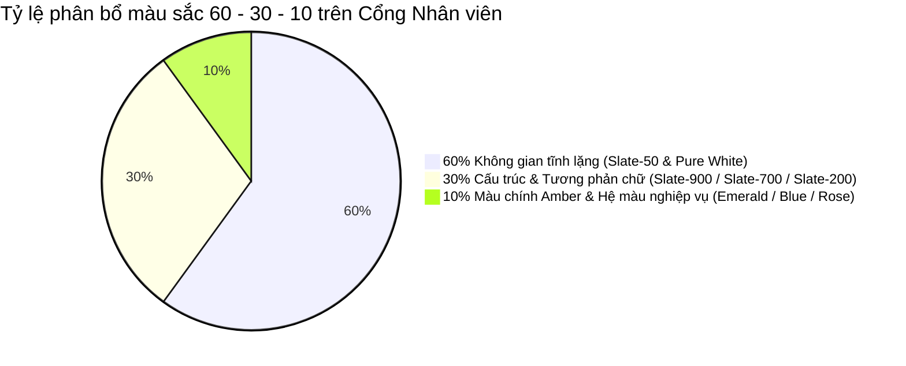

# Hệ Thống Thiết Kế & Design Tokens Cổng Nhân Viên (Employee Portal)
**Hệ thống:** DigiTalent Pulse Design System  
**Phân hệ:** Employee / Learner Experience  
**Phong cách:** Modern B2B SaaS · Cognitive Ergonomics · Action-Driven Minimalist  
**Phiên bản:** v3.0 Enterprise Architecture  

---

## 1. Triết Lý Thiết Kế Dành Riêng Cho Nhân Viên (Cognitive Ergonomics)

Khác với giao diện của Quản trị viên (cần quản lý khối lượng dữ liệu khổng lồ), giao diện của Nhân viên phải hướng tới **giảm thiểu tối đa tải trọng nhận thức (Cognitive Load)**. Một nhân viên sau nhiều giờ làm việc căng thẳng chỉ có thể tiếp thu kiến thức và hoàn thành bài thi tốt nhất khi không gian học tập:
1. **Tuyệt đối tĩnh lặng:** Không có banner quảng cáo nhấp nháy, không có bảng màu neon chói lóa.
2. **Một hành động ưu tiên duy nhất (Single Primary Action):** Luôn có một nút bấm nổi bật nhất hướng dẫn họ bước tiếp theo mà không cần phải suy nghĩ hay đắn đo.
3. **Phân cấp dữ liệu rõ ràng:** Thông số quan trọng (tiến độ %, điểm số, trạng thái duyệt) phải nhìn thấy ngay trong 1 cái liếc mắt.

---

## 2. Phân Tích & Tuyển Chọn Hệ Màu Sắc Chuẩn 60 - 30 - 10



### 2.1. Tỷ lệ 60%: Nền Tảng & Không Gian Đọc (Ground & Canvas Surfaces)
- **Mục đích:** Tạo bề mặt thị giác êm dịu nhất cho mắt người học, chống mỏi điều tiết khi đọc giáo trình chuyên sâu trong 2-3 giờ liên tục.
- **Tokens cốt lõi:**
  - `color-canvas`: `#f8fafc` (Slate-50) — Phông nền toàn trang, mang lại cảm giác sạch sẽ, cao cấp như mặt giấy in văn bản hành chính.
  - `color-surface`: `#ffffff` (Pure White) — Nền của các thẻ Bento, bảng ma trận năng lực và Slide bài học.
  - `color-surface-subtle`: `#f1f5f9` (Slate-100) — Nền của các track tiến độ, hàng bảng xen kẽ và ô nhập liệu phụ.
  - `color-border-subtle`: `#f1f5f9` (Slate-100) — Đường phân cách mảnh giữa các khối nội dung.
  - `color-border-default`: `#e2e8f0` (Slate-200) — Đường viền bao ngoài 1px sắc nét cho thẻ, ô bảng và modal.

---

### 2.2. Tỷ lệ 30%: Cấu Trúc & Độ Tương Phản Đọc (Typography & Hierarchy)
- **Mục đích:** Đảm bảo độ rõ nét tối đa cho việc đọc hiểu, tuân thủ tiêu chuẩn tương phản cao cấp **WCAG AAA** (tỷ lệ tương phản $\ge 7:1$).
- **Tokens cốt lõi:**
  - `color-text-heading`: `#0f172a` (Slate-900) — Tiêu đề màn hình (H1, H2), chỉ số % KPI, tên khóa học và tên nhân sự. Tương phản đạt 14.5:1 trên nền trắng.
  - `color-text-body`: `#334155` (Slate-700) — Nội dung bài giảng, mô tả khóa học, nhận xét của quản lý. Độ tương phản 8.2:1, êm mắt khi đọc bài dài.
  - `color-text-muted`: `#64748b` (Slate-500) — Nhãn metadata (thời lượng, ngày cấp chứng chỉ, mã tra cứu, chú thích).
  - `color-text-disabled`: `#94a3b8` (Slate-400) — Trạng thái chưa mở khóa (Lock), placeholder.

---

### 2.3. Tỷ lệ 10%: Màu Chính (Primary Brand) & Màu Nghiệp Vụ (Semantic Palette)

#### A. Màu Chính Duy Nhất (Single Primary Brand Accent): **DigiTalent Amber (Vàng Hổ Phách)**
- **Tại sao chọn DigiTalent Amber `#d97706` làm màu chính?**
  1. *Ý nghĩa Tâm lý học (Learning Psychology):* Màu hổ phách kích thích vùng não liên quan đến sự tập trung, năng lượng tích cực và sự vinh danh thành tựu (Achievement).
  2. *Khác biệt với phần mềm hành chính thông thường:* Các phần mềm quản lý công việc (Jira, Office365, Slack) đã bão hòa màu xanh lam hoặc xám. Điểm nhấn Amber vàng mật ong tạo nên cá tính riêng biệt cho một nền tảng **Nâng tầm Tài năng Số (DigiTalent)**.
  3. *Hiệu lực dẫn dắt thị giác:* Khi nhân viên bước vào một trang, chỉ có **01 nút hành động chính** mang màu Amber hoặc viền Amber (ví dụ: `[ Làm bài Test Vượt cấp ]` hoặc `[ Tiếp tục học ]`), người dùng không thể bấm nhầm.
- **Tokens:**
  - `color-brand-primary`: `#d97706` (Amber-600) — Nút hành động chính, tab đang kích hoạt, viền tiêu điểm focus ring.
  - `color-brand-hover`: `#b45309` (Amber-700) — Trạng thái rê chuột qua nút chính.
  - `color-brand-tint`: `#fef3c7` (Amber-100) — Nền của huy hiệu nổi bật, khung thông báo quan trọng.
  - `color-brand-text`: `#92400e` (Amber-800) — Màu chữ tương phản cao trên nền tint Amber.

#### B. Hệ Màu Phụ Nghiệp Vụ (Semantic Status Palette)
Màu phụ chỉ được sử dụng đúng mục đích biểu thị trạng thái năng lực, tuyệt đối không dùng để trang trí lòe loẹt:

| Trạng thái Nghiệp vụ | Mã Màu (Hex) | Màu Nền Tint (Hex) | Ứng Dụng Cụ Thể Trong Cổng Nhân Viên |
| :--- | :--- | :--- | :--- |
| **Thành công / Đã đạt (Verified)** | `#059669` (Emerald-600) | `#ecfdf5` (Emerald-50) | Kỹ năng đã đạt chuẩn vị trí (`L2 ✓`, `100% Met`), Khóa học hoàn thành 100%, Chứng chỉ hợp lệ. |
| **Học dở dang / Đang tiến hành** | `#2563eb` (Blue-600) | `#eff6ff` (Blue-50) | Khóa học đang học dở dang (`Đang học 4/11 slide`), nút mở Đề cương khóa học. |
| **Chờ thẩm định / Cần chú ý** | `#d97706` (Amber-600) | `#fffbeb` (Amber-50) | Bài thi đang chờ Quản lý duyệt (`Chờ chấm 48h`), Khoảng hụt kỹ năng cần bồi dưỡng (`-1 cấp`). |
| **Cần sửa bài / Cảnh báo (Action Req)** | `#e11d48` (Rose-600) | `#fff1f2` (Rose-50) | Quản lý yêu cầu sửa bài làm (`Yêu cầu nộp lại lần 2`), Bài thi sắp hết hạn nộp. |
| **Bản nháp / Chưa kích hoạt** | `#64748b` (Slate-500) | `#f8fafc` (Slate-50) | Mô đun chưa mở khóa (`Locked`), Kỹ năng chưa đánh giá. |

---

## 3. Hệ Thống Typography Dành Riêng Cho Đọc Bài Dài (Long-form Reading)

- **Bộ Phông Chữ:**
  - *Giao diện chung & Số liệu:* `'Plus Jakarta Sans', 'Inter', system-ui, sans-serif`.
  - *Tên học viên & Bằng chứng nhận danh dự:* `'Newsreader', Georgia, serif` (tạo sự trang trọng, lịch sự của văn bằng điện tử).
  - *Mã định danh chứng chỉ, hash tra cứu:* `'JetBrains Mono', 'Fira Code', monospace`.
- **Quy Cách Thước Chữ & Dòng Chảy:**
  - Tiêu đề Hero (H1): `24px - 28px` / Line-height `1.25` / `font-bold text-slate-900`.
  - Tiêu đề phân khối (H2): `18px - 20px` / Line-height `1.3` / `font-semibold text-slate-800`.
  - Nội dung bài học (Body Reading): `15px - 16px` / Line-height `1.65` / `font-normal text-slate-700`.
  - Chiều rộng dòng tối đa (Optimal Reading Width): Giới hạn trong khoảng `680px - 740px` (`max-w-2xl` hoặc `max-w-3xl`) để mắt không phải đảo quá xa từ mép trái sang mép phải.
  - Chữ chú thích (Caption / Meta): `12px - 13px` / Line-height `1.4` / `font-medium text-slate-500`. Cấm dùng cỡ chữ nhỏ hơn 12px.

---

## 4. Hệ Thống Độ Sâu Thị Giác & Bóng Mờ (Elevation & Shadows)

Nói không với hiệu ứng bóng phát sáng dạ quang (`glowing shadows`). Toàn bộ hệ thống áp dụng kỹ thuật đổ bóng đa lớp tự nhiên (Natural Layered Shadow):

```css
/* Thẻ Bento thông thường (Trạng thái tĩnh) */
--shadow-card-flat: 0 1px 3px 0 rgba(15, 23, 42, 0.05), 0 0 0 1px rgba(15, 23, 42, 0.06);

/* Trạng thái rê chuột (Hover) */
--shadow-card-hover: 0 8px 16px -4px rgba(15, 23, 42, 0.08), 0 0 0 1px rgba(15, 23, 42, 0.08);

/* Ngăn kéo trượt Drawer & Modal Popup */
--shadow-drawer-elevated: -12px 0 32px -8px rgba(15, 23, 42, 0.16), 0 0 0 1px rgba(15, 23, 42, 0.06);

/* Thanh điều hướng cố định bám đáy (Sticky Bottom Bar) */
--shadow-bottom-bar: 0 -4px 16px -2px rgba(15, 23, 42, 0.06), 0 -1px 0 0 rgba(15, 23, 42, 0.08);
```

---

## 5. Đặc Tả Chi Tiết 4 Component Trọng Tâm

### 5.1. Component: Quick Syllabus Drawer (Ngăn kéo Xem nhanh Đề cương)
- **Kích thước:** Chiều rộng cố định `540px` trên desktop, `100vw` trên mobile.
- **Bề mặt:** Nền trắng `#ffffff`, viền trái `1px solid #e2e8f0`, đổ bóng `--shadow-drawer-elevated`.
- **Lớp phủ nền (Backdrop):** `bg-slate-900/40 backdrop-blur-sm`.
- **Cấu trúc:**
  - Header: Huy hiệu Lĩnh vực TT02 + Tên khóa học + Nút đóng `X` (phím `Esc`).
  - Hộp Thông điệp Vượt cấp (Bypass Box): Nền Amber-50 viền Amber-200, icon tia sét Amber-600.
  - Danh sách mô đun: Khoảng cách dòng `14px`, trạng thái hoàn thành rõ ràng.
  - Sticky Footer: Nút `[Đóng]` và nút chính `[Vào học chuyên đề →]`.

### 5.2. Component: Semi-Circle Readiness Gauge (Thước đo Sẵn sàng Vị trí)
- **Hình thức:** Đồng hồ đo bán nguyệt góc quét 180°, đường kính 140px.
- **Màu sắc vạch đo:**
  - Track nền: `#f1f5f9` (Slate-100).
  - Vạch giá trị: Chuyển màu theo mức độ đạt chuẩn:
    - Dưới 50%: Màu Amber `#d97706` (Cần bồi dưỡng bổ sung).
    - Từ 50% - 79%: Màu Xanh lam `#2563eb` (Đang tiến bộ tốt).
    - Từ 80% - 100%: Màu Xanh ngọc `#059669` (Đạt chuẩn vị trí chức danh).
- **Chỉ số trung tâm:** Số % cỡ lớn `32px` `font-black text-slate-900` nằm gọn ở đáy bán nguyệt.

### 5.3. Component: Sticky Classroom Navigation Bar (Thanh Điều hướng Phòng học)
- **Vị trí:** `position: sticky; bottom: 0; z-index: 40; width: 100%;`
- **Bề mặt:** `bg-white/95 backdrop-blur-md`, viền trên `1px solid #e2e8f0`, bóng `--shadow-bottom-bar`.
- **Chiều cao:** `64px`, căn chỉnh các nút theo chiều dọc hoàn hảo.
- **Tác vụ hỗ trợ:** Nút `[💬 Hỏi Quản lý chuyên môn]` nằm cạnh nút quay lại, cho phép học viên gửi thắc mắc mà không cần thoát khỏi bài học.

### 5.4. Component: Don't Miss Action Carousel (Trung tâm Cảnh báo Hành động)
- **Hình thức:** Bento card có chiều cao `140px`, nền trắng viền xám nhạt, có dải nhấn 3px màu nghiệp vụ tương ứng ở mép trái thẻ.
- **Nội dung:** 1 thông báo ngắn gọn + 1 nút CTA hành động trực tiếp (ví dụ: `[Xem nhận xét & nộp lại]` hoặc `[Làm bài đánh giá ngay]`).
- **Điều hướng slide:** 3 dấu chấm tròn nhỏ (dots) ở góc dưới bên phải, chuyển slide êm ái bằng CSS `transition-opacity`.
