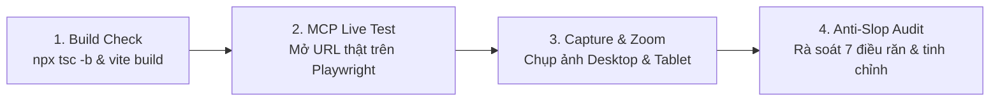

# Bộ Tiêu Chuẩn Chống AI Slop & Nguyên Tắc UX Cổng Nhân Viên
**Dự án:** DigiTalent Pulse — Cổng Quản trị & Nâng cao Năng lực Số Chuẩn TT 02/2025/TT-BGDĐT  
**Phân hệ:** Cổng Nhân viên Doanh nghiệp (Employee Portal)  
**Tiêu chuẩn:** Out-of-Distribution Craft · Anti-Slop Architecture · Enterprise B2B Ergonomics  
**Ngày ban hành:** 29/10/2026  
**Phiên bản:** v3.0 Quality Assurance  

---

## 1. Tuyên Ngôn Trải Nghiệm Nhân Viên: "3 Giây Định Hướng"

> [!IMPORTANT]
> **Nguyên tắc Tối thượng của Cổng Nhân viên:**  
> Một nhân viên khi mở portal lên không được phép bị bối rối hay mất thời gian tìm kiếm. Họ phải biết ngay:
> 1. **Mình đang ở đâu?** (Tiến độ hoàn thành: `1/7 Khóa học · 13%`).
> 2. **Hôm nay cần làm gì ngay bây giờ?** (1 nút hành động duy nhất nổi bật: Làm bài test vượt cấp, học tiếp bài dở dang, hay sửa bài nộp lại).
> 3. **Kết quả của mình ra sao?** (Điểm chấm mấy điểm, sếp nhận xét gì, đạt hay chưa đạt).
>
> Mọi chi tiết đồ họa, hiệu ứng chuyển động hay câu chữ không phục vụ trực tiếp 3 câu hỏi trên đều bị coi là **rác thị giác (visual noise)** và phải bị cắt bỏ.

---

## 2. Bảy Điều Răn Chống AI Slop Trên Giao Diện Nhân Viên

### Điều Răn 1: Cấm Tuyệt Đối Bảng Màu Tím/Hồng Neon Mặc Định Của AI
- **Dấu hiệu AI Slop:** Dùng gradient tím neon (`indigo-950 / violet-950`), bóng phát sáng dạ quang (`glowing shadows`), nền tối mờ ảo làm giao diện trông như game viễn tưởng rẻ tiền.
- **Quy chuẩn đúng:**
  - Nền Canvas trắng tinh thể (`#ffffff`) kết hợp xám đá phiến siêu nhạt (`#f8fafc`).
  - Viền phân định mảnh 1px (`#e2e8f0`).
  - Điểm nhấn thương hiệu là màu vàng hổ phách **DigiTalent Amber** (`#d97706`) quyền quý, ấm áp.
  - Chữ Slate đậm (`#0f172a` và `#334155`) trên nền sáng đạt độ tương phản tối thiểu 7:1 (chuẩn WCAG AAA).

---

### Điều Răn 2: Xóa Sổ Triệt Để Thanh Cuộn Lồng Nhau (Zero Nested Scrolls)
- **Dấu hiệu AI Slop:** Nhốt ma trận năng lực hoặc bảng danh sách bài học vào trong một khung có chiều cao cố định `height: 400px` với thanh cuộn dọc riêng. Khi người dùng cuộn chuột, trang web bị kẹt và giật cục.
- **Quy chuẩn đúng:**
  - Mọi bảng dữ liệu chính (`table`, `grid`, `matrix`) phải có `overflow-y: visible !important`.
  - Toàn bộ trang web cuộn tự nhiên theo dòng chảy trình duyệt.
  - Chiều rộng của bảng phải khớp chính xác với khung bao (`width: 100%`), không sinh thanh cuộn ngang thừa thãi.
  - Chiều cao dòng bảng thoáng đãng (`padding: 14px 16px` đến `16px 16px`).

---

### Điều Răn 3: Tuyệt Đối Không Để Lộ Mã Kỹ Thuật Ra Giao Diện Người Dùng
- **Dấu hiệu AI Slop:** Hiển thị mã ticket Jira, mã screen quy cách của lập trình viên (như `EM-01`, `EM-02`, `EM-03`, `OW-01`, `MG-01`, `TT02_D1`) vào tiêu đề, nút bấm hay tooltip.
- **Quy chuẩn đúng:**
  - Mọi tiêu đề, nhãn, nút bấm đều dùng văn phong tiếng Việt công sở tự nhiên, trang trọng:
    - Thay vì *"EM-01 Hôm nay"* $\rightarrow$ Dùng **"Tổng quan Bàn làm việc"**.
    - Thay vì *"EM-02 Lộ trình"* $\rightarrow$ Dùng **"Lộ trình Năng lực của Tôi"**.
    - Thay vì *"Mã TT02_D1"* $\rightarrow$ Dùng **"Khai thác dữ liệu và thông tin số"**.
  - Các mã kỹ thuật chỉ được tồn tại ngầm dưới dạng thuộc tính dữ liệu (`data-testid`, `id`, `data-tour`).

---

### Điều Răn 4: Cấm Nhồi Nhét Thẻ Lồng Trong Thẻ (No Nested Cards)
- **Dấu hiệu AI Slop:** Một chiếc Card lớn bo góc, bên trong lại chứa 3 chiếc Card con có viền nổi, bên trong Card con lại chứa thêm hộp bóng mờ. Kết quả là giao diện chật chội, mất diện tích và rối mắt.
- **Quy chuẩn đúng:**
  - Áp dụng triệt để **Bố cục Phẳng (Flat Grouping)**.
  - Bên trong một Bento Card lớn, các nhóm thông tin phân cách nhau bằng khoảng trắng (`gap-4`, `gap-6`), đường kẻ mảnh (`border-b border-slate-100`) hoặc nền tint nhẹ nhàng (`bg-slate-50/60`).
  - Giữ tỷ lệ "thở" (whitespace) thông thoáng.

---

### Điều Răn 5: Cấm Kicker / Eyebrow In Hoa Đè Lên Tiêu Đề
- **Dấu hiệu AI Slop:** Đặt một dòng chữ in hoa siêu nhỏ kèm dấu chấm cam (ví dụ: `HỒ SƠ CỦA TÔI · NHÂN VIÊN` hoặc `LỘ TRÌNH ĐÀO TẠO`) nằm đè lên trên tiêu đề H1/H2, làm loãng phân cấp thị giác.
- **Quy chuẩn đúng:**
  - Xóa bỏ toàn bộ pattern Kicker rời rạc.
  - Thay bằng Badge trạng thái xác thực trang trọng (ví dụ: `Nhân viên chính thức` hoặc `Chuẩn vị trí: Chuyên viên Kế toán tài chính`) hoặc Icon ngữ cảnh chuyên nghiệp (`ShieldCheck`, `Award`, `Sparkles`).

---

### Điều Răn 6: Cấm Icon Vô Bổ Trong Hình Tròn Màu Mè (No Tinted Circle Icons)
- **Dấu hiệu AI Slop:** Vẽ 4 thẻ KPI chỉ số, mỗi thẻ nhét một icon trong một vòng tròn màu tím/xanh/hồng nhạt để lấp chỗ trống.
- **Quy chuẩn đúng:**
  - Chỉ số KPI là kiểu chữ (Typography) và số liệu thực tế, không phải đồ chơi tô màu.
  - Số liệu hiển thị lớn, sắc nét (`32px font-black text-slate-900`), nhãn giải thích rõ ràng bên dưới (`text-xs font-semibold uppercase text-slate-500`).
  - Icon chỉ xuất hiện khi nó thực sự đại diện cho một danh mục chức năng cụ thể (như icon của 6 lĩnh vực năng lực số).

---

### Điều Răn 7: Giữ Ngữ Cảnh Bằng Ngăn Kéo Slide-Over Drawer Thay Vì Nhảy Trang
- **Dấu hiệu AI Slop:** Bắt người dùng click nhảy trang liên tục để xem một mẩu thông tin nhỏ (như xem đề cương khóa học hay xem nhận xét của sếp), sau đó bắt họ bấm nút Back để quay lại.
- **Quy chuẩn đúng:**
  - Tận dụng sức mạnh của **Slide-over Drawer (540px)** trượt mượt mà từ mép phải màn hình.
  - Giữ nguyên vị trí cuộn trang của người học, hỗ trợ đóng nhanh bằng phím `Esc` hoặc bấm vùng mờ bên ngoài.

---

## 3. Quy Trình Kiểm Thử & Nghiệm Thu UI/UX Bằng Playwright MCP

Mỗi khi hoàn thành một màn hình hoặc component, phải tuân thủ nghiêm ngặt **Quy trình Kiểm thử 4 Bước**:

1. **Bước 1 - Build & Type Check:**
   - Chạy `npx tsc -b` đảm bảo **0 lỗi TypeScript**.
   - Chạy `npm run build` đảm bảo không có cảnh báo đóng gói module nghiêm trọng.
2. **Bước 2 - Điều hướng Trực tiếp qua Playwright MCP:**
   - Mở URL tương ứng trên trình duyệt thật: `http://localhost:5173/enterprise/me`.
   - Kiểm tra tương tác: Click nút, mở Drawer, đóng Drawer, cuộn trang, làm quiz ôn tập.
3. **Bước 3 - Đo lường Công thái học & Responsive:**
   - Chụp ảnh màn hình ở độ phân giải Desktop tiêu chuẩn (1366x768 hoặc 1440x900).
   - Kiểm tra co giãn Tablet 768px: Đo lường độ tràn màn hình ngang (`clientWidth === scrollWidth === 768px`, overflow = 0px).
4. **Bước 4 - Rà soát Bảng Checklist Chống Slop:**
   - Kiểm tra tương phản chữ (Contrast Ratio $\ge 7:1$).
   - Kiểm tra không có thanh cuộn lồng nhau (Zero nested scroll).
   - Kiểm tra không còn sót bất kỳ mã kỹ thuật `EM-xx`, `OW-xx` nào hiển thị ra màn hình.
   - Chỉ khi đạt 100% tiêu chí trên mới được nghiệm thu bàn giao.
