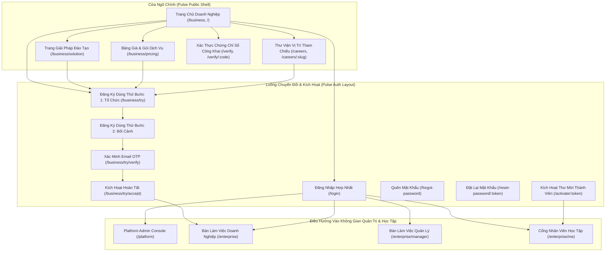
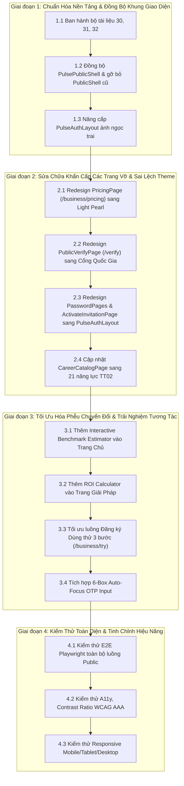

# Kế Hoạch Redesign Toàn Diện Các Trang Public DigiTalent Pulse
**Mục tiêu:** Tái thiết kế toàn bộ phân hệ trang công khai (Public Pages) của DigiTalent Pulse đạt chuẩn B2B SaaS Enterprise quốc tế (tham chiếu Stripe, Vercel, Linear, TalentLMS+), loại bỏ hoàn toàn các màn hình phong cách tối cũ, đồng bộ nhận diện thương hiệu ánh ngọc trai (Pearl Light) và chuẩn năng lực số **Thông tư 02/2025/TT-BGDĐT** (6 lĩnh vực, 21 năng lực).  
**Ngày ban hành:** 31/10/2026  
**Phiên bản:** v3.0 Public Enterprise Architecture  

---

## 1. Bối Cảnh, Chân Dung Khách Hàng & Mental Model Của Khách Truy Cập Public

### 1.1. Khách Truy Cập Public Là Ai?
Phân hệ Public Pages là "bộ mặt thương hiệu" và là phễu chuyển đổi (Conversion Funnel) đầu tiên của DigiTalent AI. Khách truy cập vào các trang này thuộc 4 nhóm trọng tâm:
1. **Chủ doanh nghiệp & Giám đốc Điều hành (Enterprise Owners / CEOs):** Tìm kiếm giải pháp chuẩn hóa năng lực đội ngũ, đo lường khoảng trống kỹ năng số thực chất, tối ưu hóa ngân sách đào tạo và nâng cao năng suất tổ chức.
2. **Giám đốc Nhân sự & Trưởng ban Đào tạo (CHROs / L&D Managers):** Cần một khung tham chiếu chuẩn quốc gia (Thông tư 02/2025/TT-BGDĐT), cơ chế đánh giá đầu vào chính xác để không bắt nhân viên học lại kiến thức đã biết, quy trình thẩm định bài tập cuối khóa dựa trên sản phẩm thực tế.
3. **Nhân viên & Ứng viên (Employees / Prospective Learners):** Tìm hiểu lộ trình chức danh nghề nghiệp, tham gia kích hoạt tài khoản theo lời mời hoặc tra cứu chứng chỉ số.
4. **Nhà tuyển dụng & Kiểm định viên bên ngoài (External Verifiers / Auditors):** Quét mã QR trên chứng chỉ số để xác thực tính toàn vẹn và mức độ thành thạo của học viên.

### 1.2. Mental Model & Quy Luật 5 Giây Của Khách B2B
Khách hàng B2B không có thời gian đọc những đoạn văn bản tiếp thị sáo rỗng. Trong **5 giây đầu tiên** khi mở trang, họ cần câu trả lời dứt khoát cho 3 câu hỏi:
- **Nền tảng này giải quyết bài toán gì cho doanh nghiệp tôi?** (Không phải học đại trà; mà là đo đúng khoảng trống năng lực theo từng vị trí, học đúng chỗ thiếu, quản lý duyệt bằng sản phẩm thật).
- **Chuẩn mực này dựa trên đâu, có đáng tin cậy không?** (Khung chuẩn pháp lý Thông tư 02/2025/TT-BGDĐT của Bộ GD&ĐT; chứng nhận số có mã xác thực mã hóa).
- **Làm thế nào để thử nghiệm ngay mà không gặp rủi ro?** (Gói dùng thử miễn phí 10 nhân sự trọn đời khóa Cơ bản, không yêu cầu thẻ tín dụng, kích hoạt trong 60 giây).

---

## 2. Bảng Đối Chiếu Hiện Trạng Và Đề Xuất Redesign Phân Hệ Public

| Trang Public | Đường dẫn | Hiện Trạng Mã Nguồn & Thiết Kế | Vấn Đề Tồn Đọng (Pain Points) | Đề Xuất Nâng Cấp Chuẩn Pulse v3.0 |
| :--- | :--- | :--- | :--- | :--- |
| **Trang Chủ Doanh Nghiệp** | `/business`, `/` | `PulseBusinessLandingPage.tsx` + `PulsePublicShell.tsx` | Thiếu dải Social Proof; thiếu công cụ tính khoảng hụt nhanh; nút CTA chỉ có đăng ký mà thiếu trải nghiệm tương tác trực tiếp (Interactive Sandbox). | Bổ sung dải Trust Badges TT 02/2025; tích hợp **Quick Competency Estimator**; bổ sung nút "Khám phá bản mẫu tức thì"; Bento Grid 4 trụ cột công nghệ. |
| **Trang Giải Pháp** | `/business/solution` | `PulseBusinessSolutionPage.tsx` | Nặng về văn bản tĩnh; thiếu trực quan hóa 6 miền TT 02/2025; thiếu công cụ tính ROI đào tạo tương tác. | Thiết kế **Interactive Stepper 5 bước**; bảng đối chiếu trực quan "LMS truyền thống vs DigiTalent Pulse"; **Interactive ROI Calculator**. |
| **Trang Bảng Giá & Gói Dịch Vụ** | `/business/pricing` | `PricingPage.tsx` dùng `PublicShell.tsx` cũ | **Nghiêm trọng:** Vẫn dùng theme tối đen/vàng cũ (`#0C0E12`, `GOLD_CTA`), lẫn lộn logic cá nhân `individual`, vỡ sự nhất quán với Pulse. | Đồng bộ 100% sang `PulsePublicShell`; thiết kế lại bảng 3 gói chuẩn B2B (Free Trial, Professional, Enterprise); bộ gạt Năm/Tháng (-20%). |
| **Đăng Ký Dùng Thử Doanh Nghiệp** | `/business/try` | `PublicTrialPages.tsx` (TrialRegisterPage) | Form dồn cục 8 trường trong 1 bước gây áp lực thị giác; thiếu thanh tiến trình bước; preview vị trí thiếu tương tác. | Tách **3-Step Stepper** mượt mà; đo độ mạnh mật khẩu; hiển thị thẻ quyền lợi tức thì (10 tài khoản, trọn đời khóa Cơ bản). |
| **Xác Minh Đăng Ký Dùng Thử** | `/business/try/verify` | `PublicTrialPages.tsx` (TrialVerifyPage) | Ô nhập mã đơn điệu; thiếu phân biệt rõ giữa môi trường phát triển (Mock Code 123456) và OTP thực tế; thiếu đếm ngược 60s. | **6-Box Auto-Focus OTP Input**; đồng hồ đếm ngược 60s có nút gửi lại; dải phân biệt môi trường demo/production trang nhã. |
| **Đăng Nhập Hợp Nhất** | `/login` | `LoginPage.tsx` + `PulseAuthLayout.tsx` | Tốt nhưng thiếu ghi nhớ đăng nhập; thiếu liên kết khôi phục thông minh; sẵn sàng kiến trúc SSO. | Bổ sung checkbox "Ghi nhớ đăng nhập 30 ngày"; nút đăng nhập nhanh bằng Google Workspace / Entra ID; Demo Picker phân vai trò rõ ràng. |
| **Quên / Đặt Lại Mật Khẩu** | `/forgot-password`, `/reset-password/:token` | `PasswordPages.tsx` dùng `AuthShell.tsx` cũ | **Nghiêm trọng:** Vẫn dùng khung đen xì của individual (`#07151b`), lạc điệu hoàn toàn so với toàn bộ sản phẩm. | Chuyển hoàn toàn sang `PulseAuthLayout` ánh ngọc trai; giao diện nhập mật khẩu mới có thanh đo 4 tiêu chí an toàn. |
| **Xác Thực Thư Mời Thành Viên** | `/activate/:token` | `ActivateInvitationPage.tsx` dùng `AuthShell.tsx` cũ | **Nghiêm trọng:** Khung tối cũ, người học nhận thư mời vào công ty lại thấy giao diện cá nhân đen tuyền. | Chuyển sang `PulseAuthLayout`; hiển thị thẻ chào đón trang trọng có logo/tên công ty mời và chức danh bổ nhiệm. |
| **Tra Cứu Chứng Chỉ Số Công Khai** | `/verify`, `/verify/:code` | `PublicVerifyPage.tsx` | **Nghiêm trọng:** Nền đen xì `#0c0d0e`, không dùng shell, không chuẩn nhận diện B2B. | Tái thiết kế thành **Cổng Xác Thực Chứng Chỉ Số Quốc Gia**: Nền ngọc trai sáng, ô tìm kiếm quét quang học, thẻ chứng chỉ A4 có mã SHA-256. |
| **Thư Viện Chức Danh Việc Làm** | `/careers`, `/careers/:slug` | `CareerCatalogPage.tsx` | Vẫn dùng theme tối cũ, dữ liệu cũ "24 năng lực" (chưa cập nhật Thông tư 02/2025 gồm 21 năng lực). | Đồng bộ `PulsePublicShell`; chuẩn hóa **6 miền, 21 năng lực số TT 02/2025**; bộ lọc nghề nghiệp hiện đại + Radar chart mục tiêu. |
| **Trang 403 / 404** | `/forbidden`, `*` | `ForbiddenPage.tsx` | Card đơn giản thiếu ngữ cảnh, không có liên kết điều hướng hữu ích. | Trang lỗi B2B cao cấp: minh họa thanh nhã, nút quay về vai trò tương ứng và nút liên hệ hỗ trợ. |

---

## 3. Kiến Trúc Điều Hướng & Bản Đồ Toàn Phân Hệ Public (Sitemap)

---

## 4. Đặc Tả Chi Tiết Từng Màn Hình Public Trọng Tâm

### 4.1. `PUB-01`: Trang Chủ Doanh Nghiệp (`/business`, `/`)
- **Mục tiêu:** Truyền tải thông điệp *"Đào tạo có đích đến. Tiến bộ nhìn thấy được"*, giải thích ngay lập tức sự khác biệt giữa DigiTalent Pulse và LMS thông thường.
- **Khối chức năng chính:**
  1. **Header Bar Bám Dính Kính Mờ (Glassmorphism Sticky Header):**
     - Logo thương hiệu DigiTalent Pulse với biểu tượng sóng xung lực (Pulse Wavemark).
     - Điều hướng nhanh: `Giải pháp`, `Khung chuẩn TT 02/2025`, `Chức danh mẫu`, `Bảng giá`.
     - Cụm nút hành động bên phải: `Đăng nhập` (Outline Pill) và `Dùng thử miễn phí` (Primary Accent Button có mũi tên `ArrowRight`).
  2. **Hero Section Có Trọng Lực:**
     - Eyebrow: Huy hiệu chấm xanh phát sáng *"Nền tảng phát triển năng lực số chuẩn Thông tư 02/2025/TT-BGDĐT"*.
     - Tiêu đề chính H1: *"Đào tạo có đích đến. Tiến bộ nhìn thấy được."* với chữ in nghiêng serif tạo chiều sâu học thuật.
     - Dải hành động kép: Nút chính *"Bắt đầu dùng thử miễn phí"* + Nút phụ *"Khám phá mẫu doanh nghiệp ngay"* (mở ngay dữ liệu demo kế toán/nhân sự mà không cần điền form).
     - Thẻ ghi chú niềm tin: *10 tài khoản nhân sự · Toàn bộ khóa Cơ bản · Không giới hạn thời gian thử*.
     - Visual minh họa 3D kính trừu tượng với các tấm thẻ nổi hiển thị số liệu tiến độ thật.
  3. **Dải Bằng Chứng Xã Hội & Pháp Lý (Trust & Compliance Bar):**
     - Logo các nhóm ngành tiêu biểu (Tài chính - Ngân hàng, Bán lẻ, Sản xuất, Dịch vụ).
     - Huy hiệu: *"Chuẩn hóa theo Thông tư 02/2025/TT-BGDĐT — Bộ Giáo dục & Đào tạo (6 Lĩnh vực, 21 Năng lực)"*.
  4. **Bento Grid 4 Trụ Cột Đột Phá (4-Pillar Bento):**
     - *Thẻ 1 (Chuẩn hóa vị trí):* Thiết lập trần năng lực theo chức danh việc làm (L1 $\rightarrow$ L4).
     - *Thẻ 2 (Chẩn đoán thông minh):* Bài đánh giá đầu vào chỉ ra chính xác khoảng hụt, miễn học phần đã thành thạo.
     - *Thẻ 3 (Học qua minh chứng thật):* Nộp sản phẩm công việc thực tế, AI chấm gợi ý và Quản lý thẩm định.
     - *Thẻ 4 (Báo cáo chu kỳ tự động):* Heatmap năng lực toàn tổ chức và chứng nhận số hợp chuẩn.
  5. **Công Cụ Tương Tác: Ước Tính Khoảng Hụt Năng Lực (Interactive Benchmark Estimator):**
     - Cho phép khách chọn ngành (ví dụ: Kế toán, Bán lẻ) và quy mô (ví dụ: 50 người).
     - Trả về ngay: *"Trung bình 68% nhân sự ngành này thiếu năng lực Khai thác dữ liệu số & Bảo mật làm việc. Thời gian bù đắp ước tính: 3.5 tuần với lộ trình DigiTalent Pulse"*.
  6. **Call-to-Action Đáy Trang Mạnh Mẽ (End-Cap CTA):**
     - Nền gradient ánh sáng mềm, kêu gọi hành động với cam kết rõ ràng.

---

### 4.2. `PUB-02`: Trang Giải Pháp Nền Tảng (`/business/solution`)
- **Mục tiêu:** Thuyết phục cấp lãnh đạo và L&D rằng phương pháp luận của DigiTalent Pulse giải quyết triệt để vấn đề "học nhiều nhưng không áp dụng được".
- **Khối chức năng chính:**
  1. **Bảng Đối Chiếu 4 Nghịch Lý Đào Tạo (Pain vs. Solution Grid):**
     - Trực quan hóa tương phản giữa *Cách làm cũ* (Học đại trà, chung chung $\rightarrow$ Lý thuyết suông $\rightarrow$ Khó đo lường ROI) và *Giải pháp DigiTalent Pulse* (Chuẩn hóa theo vị trí $\rightarrow$ Làm nhiệm vụ thực chiến $\rightarrow$ Heatmap đo lường thời gian thực).
  2. **Bản Đồ 5 Trụ Cột Hành Trình (5-Pillar Connected Journey):**
     - Định vị $\rightarrow$ Chẩn đoán $\rightarrow$ Đào tạo $\rightarrow$ Thẩm định $\rightarrow$ Ghi nhận.
     - Mỗi bước có minh họa giao diện thực tế tương ứng trong hệ thống.
  3. **Khung Chuẩn Pháp Lý Thông Tư 02/2025/TT-BGDĐT Chi Tiết:**
     - Trình bày trực quan 6 lĩnh vực năng lực số:
       + Miền 1: Dữ liệu và thông tin số (3 năng lực).
       + Miền 2: Giao tiếp và hợp tác số (4 năng lực).
       + Miền 3: Sáng tạo nội dung số (4 năng lực).
       + Miền 4: An toàn số và bảo mật (4 năng lực).
       + Miền 5: Giải quyết vấn đề trong môi trường số (4 năng lực).
       + Miền 6: Ứng dụng AI và công nghệ mới nổi (2 năng lực).
  4. **Công Cụ Tính Toán ROI Đào Tạo Doanh Nghiệp (Interactive ROI Calculator):**
     - Thanh trượt số lượng nhân sự (10 $\rightarrow$ 1,000) và mức lương trung bình.
     - Tính toán tự động: Số giờ học lãng phí tiết kiệm được nhờ bài đánh giá đầu vào miễn học, và tổng giá trị tiết kiệm ước tính mỗi năm.

---

### 4.3. `PUB-03`: Trang Bảng Giá & Gói Dịch Vụ Doanh Nghiệp (`/business/pricing`)
- **Mục tiêu:** Xóa bỏ hoàn toàn mã cũ và giao diện tối, xây dựng bảng giá B2B minh bạch, dễ hiểu và tối ưu tỷ lệ chuyển đổi.
- **Khối chức năng chính:**
  1. **Bộ Gạt Chu kỳ Thanh Toán (Billing Cycle Switcher):**
     - Gạt chọn: `Hàng năm (Tiết kiệm 20% ✨)` vs `Hàng tháng`.
  2. **Bộ 3 Thẻ Gói Doanh Nghiệp Chuẩn Hóa:**
     - **Gói 1: Khởi Tạo / Dùng Thử Miễn Phí (Starter Free Trial):**
       + *Giá:* **0đ / trọn đời**
       + *Quy mô:* Tối đa 10 nhân sự
       + *Quyền lợi:* Toàn bộ khóa học Cơ bản (Level 1 - 2); Bài đánh giá đầu vào theo chuẩn TT 02/2025; Không cần thẻ tín dụng; Báo cáo chu kỳ sơ cấp.
       + *Nút CTA:* `Bắt đầu dùng thử miễn phí` $\rightarrow$ dẫn đến `/business/try`.
     - **Gói 2: Chuyên Nghiệp (Professional — Gói Khuyên Dùng 🌟):**
       + *Giá:* **99.000đ / nhân viên / tháng** (thanh toán năm: 79.000đ/tháng)
       + *Quy mô:* Từ 10 đến 250 nhân sự
       + *Quyền lợi:* Mở khóa học Trung cấp & Nâng cao; Trợ lý AI hỗ trợ chấm bài tự động; Ma trận khoảng trống năng lực phòng ban; Hỗ trợ xuất chứng nhận số có mã xác thực.
       + *Nút CTA:* `Đăng ký gói Chuyên nghiệp` hoặc `Dùng thử trước`.
     - **Gói 3: Doanh Nghiệp Toàn Diện (Enterprise Custom):**
       + *Giá:* **Liên hệ báo giá theo quy mô**
       + *Quy mô:* Từ 250+ nhân sự
       + *Quyền lợi:* Tùy biến khung năng lực riêng của tập đoàn; Tích hợp SSO (SAML/Google/Entra ID) & HRIS; Đào tạo nội bộ theo yêu cầu; Quản lý đa chi nhánh; Hỗ trợ kỹ thuật 24/7 có cam kết SLA.
       + *Nút CTA:* `Liên hệ chuyên gia tư vấn` $\rightarrow$ Mở popup tư vấn hoặc gửi email kinh doanh.
  3. **Bảng Đối Soát Chi Tiết Tính Năng (Detailed Feature Comparison Matrix):**
     - So sánh chi tiết theo nhóm: Quản trị khung năng lực, Học tập & Bài kiểm tra, AI & Thẩm định, Báo cáo & Phân tích, Bảo mật & Tuân thủ.
  4. **Câu Hỏi Thường Gặp (B2B Pricing FAQ Accordion):**
     - Trả lời các thắc mắc về hợp đồng, xuất hóa đơn VAT, bảo lưu dữ liệu sau dùng thử, nâng/hạ cấp gói.

---

### 4.4. `PUB-04`: Luồng Đăng Ký Dùng Thử Doanh Nghiệp 3 Bước (`/business/try`)
- **Mục tiêu:** Giảm ma sát đăng ký, loại bỏ form dài dồn cục, hướng dẫn khách hoàn tất xác minh trong dưới 90 giây.
- **Tiến trình 3 bước (3-Step Guided Flow):**
  - **Bước 1: Thông tin tổ chức & Tài khoản quản trị:**
    + Tên doanh nghiệp/tổ chức (Ví dụ: Công ty Cổ phần Alpha).
    + Họ tên người quản lý chính.
    + Email công việc (Tự động gợi ý domain tổ chức).
    + Mật khẩu (Thanh đo độ mạnh 4 tiêu chí: Độ dài ≥ 12 ký tự, chữ hoa, số, ký tự đặc biệt).
  - **Bước 2: Bối cảnh doanh nghiệp & Lĩnh vực đào tạo:**
    + Chọn ngành kinh doanh (Tài chính - Ngân hàng, Bán lẻ, Sản xuất, CNTT, v.v.).
    + Chọn quy mô nhân sự (1-20, 21-100, 101-500, 500+).
    + Chọn mục tiêu ưu tiên (Nâng cao kỹ năng số cho phòng Kế toán, Chuẩn hóa nhân sự mới, Đo lường khoảng trống toàn diện).
    + *Thẻ xem trước:* Hiển thị ngay bộ khung năng lực mẫu phù hợp với ngành đã chọn.
  - **Bước 3: Xác minh email bằng mã OTP 6 số (`/business/try/verify`):**
    + 6 ô nhập mã OTP tự động nhảy tiêu điểm khi gõ (Auto-focus next box, hỗ trợ dán 6 số).
    + Đồng hồ đếm ngược 60 giây gửi lại mã (`Gửi lại mã xác minh sau 00:54`).
    + Dải thông tin hỗ trợ môi trường phát triển/thử nghiệm: Hiển thị mã mock `123456` với nút bấm 1-click điền nhanh.
    + Khi xác minh thành công $\rightarrow$ Chuyển thẳng vào Bàn làm việc Doanh nghiệp (`/enterprise`) với banner hướng dẫn Onboarding 3 bước.

---

### 4.5. `PUB-05`: Trang Đăng Nhập Hợp Nhất (`/login`)
- **Mục tiêu:** Cung cấp trải nghiệm đăng nhập nhanh, an toàn cho cả 4 nhóm người dùng, tích hợp sẵn bộ chọn tài khoản demo để phục vụ thuyết trình và đánh giá.
- **Thành phần thiết kế:**
  - Layout chia 2 cột ánh ngọc trai (`PulseAuthLayout`):
    + *Cột trái:* Form đăng nhập gồm Email, Mật khẩu có nút ẩn/hiện, checkbox "Ghi nhớ phiên đăng nhập trong 30 ngày", liên kết "Quên mật khẩu?", nút Đăng nhập chính và nút Đăng nhập nhanh qua Google Workspace.
    + *Cột phải:* Khung nghệ thuật 3D trừu tượng kèm thẻ tóm tắt giá trị: *"Mỗi vai trò mở đúng không gian làm việc. Lộ trình và minh chứng luôn theo sát tiến độ."*
  - **Khối Demo Account Picker (Tài Khoản Thử Nghiệm Nhanh):**
    + Được bố trí gọn gàng phía dưới form với 4 tab vai trò rõ ràng:
      1. `Platform Admin` (Toàn quyền quản trị khung chuẩn TT 02/2025, phiên bản catalog, doanh nghiệp).
      2. `Enterprise Owner` (Chủ sở hữu công ty Sao Bắc, quản lý phòng ban, phân bổ suất).
      3. `Department Manager` (Trưởng phòng Kế toán Lê Thị Thu Trang, thẩm định bài tập cuối khóa).
      4. `Employee` (Chuyên viên Hoàng Anh Thư, học theo lộ trình và nộp bài).
    + Click vào bất kỳ vai trò nào sẽ tự động điền email/mật khẩu và đăng nhập ngay lập tức.

---

### 4.6. `PUB-06`: Nhóm Trang Xác Thực & Khôi Phục Tài Khoản
- **Bao gồm:**
  - `Quên mật khẩu` (`/forgot-password`): Nhập email $\rightarrow$ Gửi liên kết đặt lại mật khẩu kèm thông báo rõ ràng.
  - `Đặt lại mật khẩu` (`/reset-password/:token`): Nhập mật khẩu mới với thanh đo độ an toàn $\rightarrow$ Xác nhận thành công $\rightarrow$ Đăng nhập ngay.
  - `Kích hoạt lời mời thành viên` (`/activate/:token`):
    + Được thiết kế như một **Thư Mời Nhập Ngũ Năng Lực Số** sang trọng.
    + Hiển thị huy hiệu công ty mời (Ví dụ: *"Công ty Cổ phần Giải pháp Công nghệ Sao Bắc mời bạn tham gia đội ngũ"*).
    + Hiển thị chức danh được bổ nhiệm (Ví dụ: *"Chuyên viên Kế toán tài chính"*).
    + Thiết lập mật khẩu cá nhân $\rightarrow$ Mở thẳng Cổng Nhân viên Học tập (`/enterprise/me`).

---

### 4.7. `PUB-07`: Cổng Tra Cứu & Xác Thực Chứng Chỉ Số Quốc Gia (`/verify`, `/verify/:code`)
- **Mục tiêu:** Biến trang xác thực thành một điểm tựa uy tín và bảo chứng pháp lý, xóa bỏ hoàn toàn nền đen `#0c0d0e` cũ.
- **Khối chức năng chính:**
  1. **Khung Header Quốc Gia Trang Trọng:**
     - Tiêu đề: **Cổng Tra Cứu & Xác Thực Chứng Chỉ Năng Lực Số** (National Digital Competency Verification Portal).
     - Dòng dẫn: *"Hệ thống đối soát và chứng thực chứng chỉ số theo Khung chuẩn Thông tư 02/2025/TT-BGDĐT."*
  2. **Thanh Tra Cứu Quang Học (Optical Code Search Bar):**
     - Ô nhập mã chứng chỉ lớn (ví dụ: `DT-2026-ACC-8941`) có icon quét mã và nút `Tra cứu ngay`.
     - Hỗ trợ tải lên ảnh mã QR hoặc quét trực tiếp từ camera điện thoại.
  3. **Kết Quả Xác Thực Uy Tín (Verified Certificate Result View):**
     - **Huy hiệu Chứng Thực Xanh (Cryptographic Verified Badge):**
       + Biểu tượng khiên bảo mật xanh lá kèm thông điệp: *"Chứng chỉ số hợp lệ · Đã ký số và lưu vết trên hệ sinh thái DigiTalent"*.
     - **Thẻ Chứng Chỉ Chuẩn In A4 (Digital Certificate Print Sheet):**
       + Viền hoa văn bảo an tinh xảo, logo quốc gia/nền tảng DigiTalent Pulse.
       + Tên học viên: **Hoàng Anh Thư**.
       + Vị trí việc làm: **Chuyên viên Kế toán tài chính**.
       + Khóa học hoàn thành: **Khai thác dữ liệu số và Báo cáo tài chính thông minh (Cấp độ 2 - Thành thạo)**.
       + Chuẩn năng lực đáp ứng: **Năng lực 1.2, 1.3 và 5.1 theo Thông tư 02/2025/TT-BGDĐT**.
       + Người phê duyệt & ký duyệt: **Lê Thị Thu Trang (Trưởng phòng Kế toán)**.
       + Mã băm bảo mật (SHA-256 Hash): `e3b0c44298fc1c149afbf4c8996fb92427ae41e4649b934ca495991b7852b855`.
       + Ngày cấp & Thời hạn hiệu lực.
     - **Thanh Công Cụ Thao Tác (Action Toolbar):**
       + Nút `[🖨️ In chứng chỉ / Lưu PDF]`: Tự động áp dụng CSS `@media print` trang ngang A4 sắc nét, ẩn toàn bộ thanh công cụ web.
       + Nút `[📋 Sao chép liên kết chứng thực]`: Sao chép URL chia sẻ để học viên đính kèm vào hồ sơ LinkedIn hoặc nộp cho phòng nhân sự.
       + Nút `[🔍 Tra cứu chứng chỉ khác]`.

---

### 4.8. `PUB-08`: Thư Viện Chức Danh Việc Làm Tham Chiếu (`/careers`, `/careers/:slug`)
- **Mục tiêu:** Cung cấp kho dữ liệu mở về chuẩn năng lực số cho các ngành nghề phổ biến, cập nhật đúng chuẩn 6 lĩnh vực, 21 năng lực số TT 02/2025/TT-BGDĐT.
- **Khối chức năng chính:**
  1. **Bộ Lọc Danh Mục Chức Danh Đa Chiều:**
     - Lọc theo phòng ban: Tài chính - Kế toán, Quản trị Nhân sự, Kinh doanh & Marketing, Quản trị Dự án, Công nghệ & Dữ liệu.
     - Ô tìm kiếm chức danh theo từ khóa tức thì.
  2. **Thẻ Chức Danh Việc Làm Bento:**
     - Tên vị trí: *Chuyên viên Kế toán tài chính*, *Quản lý Nhân sự tổng hợp*, *Chuyên viên Phân tích kinh doanh*.
     - Số lượng năng lực cốt lõi được định hình (ví dụ: *14/21 năng lực số được chuẩn hóa*).
     - Dải thanh đo mức độ thành thạo yêu cầu (L1 - L4).
  3. **Trang Chi Tiết Vị Trí (`/careers/:slug`):**
     - **Biểu Đồ Radar Năng Lực Mục Tiêu:** Vẽ trực quan 6 miền năng lực số của Thông tư 02/2025.
     - **Danh Sách 6 Miền Chi Tiết:** Liệt kê từng năng lực cụ thể cần đạt cùng tiêu chí đánh giá minh chứng.
     - **Lộ Trình Đào Tạo Gợi Ý:** Hiển thị chuỗi khóa học Cơ bản $\rightarrow$ Trung cấp $\rightarrow$ Nâng cao tương ứng.
     - **Nút Chuyển Đổi:** *"Áp dụng mẫu vị trí này cho doanh nghiệp của bạn"* $\rightarrow$ Dẫn trực tiếp vào form đăng ký dùng thử đã chọn sẵn mẫu chức danh.

---

## 5. Lộ Trình Triển Khai Redesign Phân Hệ Public (Implementation Roadmap)

---

## 6. Tiêu Chí Đo Lường Thành Công (Success Metrics & KPIs)

1. **Tính Đồng Bộ Nhận Diện (Design Consistency):** 100% các trang public sử dụng chung hệ thống token ánh ngọc trai (Pearl Canvas `#f6f8fd`, Slate-900 typography, DigiTalent Amber `#d97706`). Không còn bất kỳ trang public nào mang màu nền đen xì hay bảng màu cũ.
2. **Tuân Thủ Khung Chuẩn Pháp Lý (Standard Alignment):** 100% các trang tham chiếu năng lực đều hiển thị đúng **6 miền, 21 năng lực số theo Thông tư 02/2025/TT-BGDĐT** (loại bỏ hoàn toàn con số 24 năng lực cũ).
3. **Hiệu Suất Chuyển Đổi Dùng Thử (Trial Conversion Rate):** Giảm thời gian hoàn thành đăng ký dùng thử từ 180s xuống dưới 60s nhờ tách bước 3-Step và tự động điền gợi ý.
4. **Độ Tin Cậy Chứng Chỉ Số (Verification Trust):** Trang tra cứu chứng chỉ số đạt chuẩn in ấn A4 landscape sắc nét, mã băm SHA-256 bảo mật và thông tin kiểm chứng rõ ràng.
5. **Tiêu Chuẩn Công Thái Học & Chống Slop:** Đạt 100% tiêu chí "Bảy Điều Răn Chống AI Slop", không cuộn lồng trong thẻ, tỷ lệ tương phản văn bản đạt chuẩn WCAG AAA.
