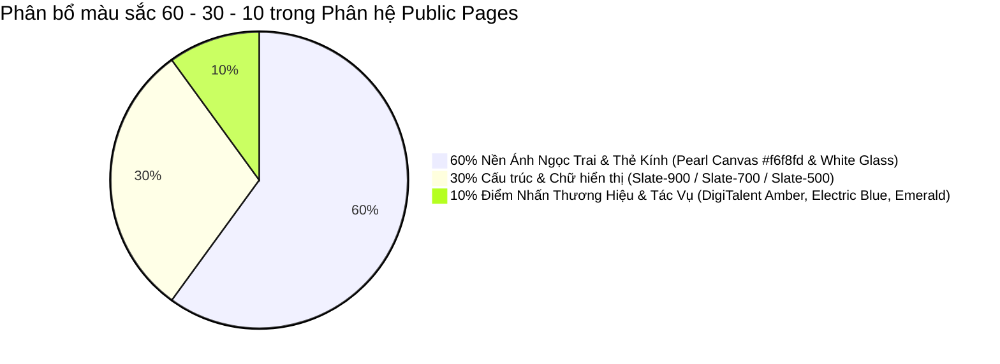

# Hệ Thống Thiết Kế & Design Tokens Ánh Ngọc Trai Cho Các Trang Public
**Dự án:** DigiTalent Pulse Public Pages Design System  
**Phong cách:** B2B Enterprise SaaS · Pearl Glassmorphism · Trust & Authority · Anti-Slop  
**Phiên bản:** v3.0  
**Ngày ban hành:** 31/10/2026  

---

## 1. Triết Lý & Phân Tích Màu Sắc 60 - 30 - 10 Cho Trang Public

Khác với giao diện quản trị hàng ngày (cần tĩnh lặng tối đa), các trang công khai (Public Landing, Solution, Pricing, Auth, Verify) có thêm sứ mệnh **truyền cảm hứng, tạo niềm tin thể chế và thúc đẩy chuyển đổi hành động**. Do đó, bảng màu được thiết kế theo tỷ lệ vàng công thái học **60 - 30 - 10** với phong cách **Ánh ngọc trai (Light Pearl Glassmorphism)**:



### 1.1. Tỷ lệ 60%: Nền Tảng & Khung Chứa Ánh Ngọc Trai (Pearl Canvas & Frosted Glass Surfaces)
- **Mục đích:** Tạo không gian thoáng đãng, trong trẻo như ngọc trai, mang lại cảm giác công nghệ cao cấp mà không bị chói mắt.
- **Tokens cốt lõi:**
  - `public-canvas-bg`: `#f6f8fd` — Nền chính bao phủ toàn bộ các trang public. Màu trắng pha xanh lơ cực nhẹ giúp mắt thư thái.
  - `public-surface-card`: `#ffffff` — Nền thẻ trắng tinh khiết, viền mảnh.
  - `public-glass-panel`: `rgba(255, 255, 255, 0.82)` kết hợp `backdrop-filter: blur(16px)` — Dùng cho Header bám dính (Sticky Header) và các thẻ Bento nổi.
  - `public-border-subtle`: `rgba(226, 232, 240, 0.7)` (Slate-200 nhạt) — Đường viền phân tách các khối thông tin nội bộ.
  - `public-border-strong`: `#cbd5e1` (Slate-300) — Viền bao ngoài thẻ quan trọng và các ô nhập liệu.
  - `public-ambient-glow`: Gradient tỏa tròn mờ ảo ẩn sau nền:
    + Vệt 1: `radial-gradient(circle at 10% 20%, rgba(56, 189, 248, 0.08), transparent 40%)` (Sky Blue)
    + Vệt 2: `radial-gradient(circle at 90% 15%, rgba(245, 158, 11, 0.06), transparent 35%)` (Amber)
    + Vệt 3: `radial-gradient(circle at 50% 85%, rgba(16, 185, 129, 0.05), transparent 45%)` (Emerald)

### 1.2. Tỷ lệ 30%: Cấu Trúc & Phân Cấp Nội Dung (Typography & Hierarchical Hierarchy)
- **Mục đích:** Đảm bảo độ sắc nét, tương phản tuyệt hảo đạt chuẩn **WCAG AAA** (tỷ lệ tương phản chữ $\ge 7:1$ trên nền sáng).
- **Tokens cốt lõi:**
  - `public-text-primary`: `#0f172a` (Slate-900) — Tiêu đề H1, H2, tên gói cước, số liệu thống kê lớn.
  - `public-text-secondary`: `#334155` (Slate-700) — Đoạn văn mô tả chính, nhãn trường nhập form, văn bản hợp đồng.
  - `public-text-muted`: `#64748b` (Slate-500) — Chú thích phụ, điều khoản chi tiết, placeholder.
  - `public-text-kicker`: `#d97706` (Amber-600) — Dòng chữ nhỏ in hoa dẫn đề (`UPPERCASE TRACKING-WIDER`) phía trên tiêu đề chính.

### 1.3. Tỷ lệ 10%: Màu Chính & Hệ Màu Phụ Điểm Nhấn (Brand Accent & Semantic Tones)

#### Màu Chính (Primary Brand Accent): **DigiTalent Amber (Vàng Hổ Phách)**
- **Tokens:**
  - `public-brand-primary`: `#d97706` (Amber-600) — Nút bấm hành động chính (Primary CTA), đường viền trạng thái Focus, ngôi sao đánh giá.
  - `public-brand-hover`: `#b45309` (Amber-700) — Trạng thái rê chuột qua nút chính.
  - `public-brand-tint`: `#fef3c7` (Amber-100) — Nền của thẻ nổi bật (Featured Badge), viền gói cước khuyên dùng.
  - `public-brand-text`: `#78350f` (Amber-900) — Chữ trên nền hổ phách nhạt.

#### Hệ Màu Chức Năng (Functional & Semantic Colors):
- **Electric Blue (Xanh Năng Lực Số):** `#0284c7` (Sky-600), Tint: `#e0f2fe` — Minh họa lộ trình học tập, liên kết văn bản, icon khung năng lực.
- **Verification Emerald (Xanh Xác Thực):** `#059669` (Emerald-600), Tint: `#ecfdf5` — Dấu kiểm chứng chỉ số hợp lệ, biểu tượng tính năng đã bao gồm.
- **Coral Accent (Điểm Nhấn San Hô):** `#f43f5e` (Rose-500), Tint: `#fff1f2` — Cảnh báo hết hạn dùng thử, đánh dấu khoảng trống kỹ năng cần bổ sung gấp.

---

## 2. Hệ Thống Typography Chuẩn Quốc Tế & Điểm Nhấn Học Thuật

Khách hàng doanh nghiệp đánh giá cao sự kết hợp giữa **tính chính xác công nghệ** và **chiều sâu học thuật chuẩn mực**. Do đó, hệ thống typography của phân hệ Public sử dụng:
- **Font Không Chân Chính (Primary Sans):** `'Plus Jakarta Sans', 'Inter', -apple-system, BlinkMacSystemFont, sans-serif` — Sử dụng cho toàn bộ UI, nút bấm, nhãn và văn bản đọc.
- **Font Chân Nghệ Thuật Điểm Nhấn (Editorial Serif Accent):** `'Newsreader', 'Fraunces', 'Merriweather', Georgia, serif` (italic) — Sử dụng có chọn lọc cho 1-2 từ khóa then chốt trong tiêu đề Hero (ví dụ: *"Tiến bộ **nhìn thấy được**"*).
- **Font Mã Kỹ Thuật (Monospace):** `'JetBrains Mono', 'Fira Code', ui-monospace, monospace` — Dùng cho mã chứng chỉ số (`DT-2026-ACC-8941`), mã băm SHA-256 và mã OTP 6 số.

### Bảng Thang Đo Typography Chi Tiết

| Phân Cấp (Role) | Cỡ Chữ (Size) | Trọng Lượng (Weight) | Line Height | Tracking | Ứng Dụng |
| :--- | :--- | :--- | :--- | :--- | :--- |
| **Hero Display H1** | 44px - 56px (clamp) | 800 (Extra Bold) | 1.1 | -0.03em | Tiêu đề chính trang chủ & trang giải pháp |
| **Section H2** | 30px - 36px | 700 (Bold) | 1.2 | -0.025em | Tiêu đề các khối nội dung lớn, Bento header |
| **Card H3** | 20px - 22px | 600 (Semi-bold) | 1.3 | -0.015em | Tiêu đề thẻ giải pháp, tên gói bảng giá |
| **Subtitle / Lead** | 17px - 19px | 400 (Regular) | 1.6 | 0 | Đoạn văn mở đầu dưới tiêu đề Hero |
| **Body Large** | 15px - 16px | 400 / 500 | 1.55 | 0 | Mô tả gói cước, nội dung bài viết giải pháp |
| **Body Regular** | 14px | 400 / 500 | 1.5 | 0 | Nhãn form, danh sách gạch đầu dòng tính năng |
| **Kicker / Overline** | 12px | 700 (Bold) | 1.3 | +0.12em | Dòng chữ in hoa nhỏ phía trên tiêu đề |
| **Caption / Badge** | 12px - 13px | 600 (Semi-bold) | 1.4 | +0.02em | Thẻ badge trạng thái, ghi chú bản quyền |
| **Mono Code** | 13px - 14px | 500 (Medium) | 1.4 | 0 | Mã tra cứu chứng chỉ, mã OTP, hash bảo mật |

---

## 3. Hệ Thống Đổ Bóng Đa Tầng & Hiệu Ứng Kính Mờ (Elevation & Shadows)

Tuyệt đối không sử dụng bóng phát sáng dã quang (`neon glow`). Tất cả các lớp thẻ đều sử dụng bóng đổ tự nhiên mô phỏng nguồn sáng từ đỉnh:

```css
/* Lớp viền tinh thể 1px (Crystal Border) */
--crystal-border: 1px solid rgba(226, 232, 240, 0.8);

/* Lớp thẻ phẳng trên nền ngọc trai */
--shadow-pearl-flat: 
  0 1px 2px 0 rgba(15, 23, 42, 0.04),
  0 0 0 1px rgba(226, 232, 240, 0.8);

/* Lớp thẻ Bento & Thẻ Bảng Giá (Card Elevation) */
--shadow-pearl-card: 
  0 4px 6px -1px rgba(15, 23, 42, 0.04),
  0 2px 4px -2px rgba(15, 23, 42, 0.03),
  0 0 0 1px rgba(226, 232, 240, 0.85);

/* Lớp thẻ khi rê chuột qua (Card Hover Lift) */
--shadow-pearl-hover: 
  0 20px 25px -5px rgba(15, 23, 42, 0.06),
  0 8px 10px -6px rgba(15, 23, 42, 0.04),
  0 0 0 1px rgba(217, 119, 6, 0.25);

/* Lớp hộp thoại nổi & Ngăn kéo (Modal / Dropdown / Popover) */
--shadow-pearl-modal: 
  0 25px 50px -12px rgba(15, 23, 42, 0.15),
  0 0 0 1px rgba(226, 232, 240, 0.9);
```

---

## 4. Đặc Tả Các Thành Phần Giao Diện Công Khai (Public UI Components)

### 4.1. Nút Bấm Hành Động (Action Buttons)
- **Primary CTA Button (Nút Hành Động Chính):**
  - Nền: Gradient hổ phách hoàng gia `#d97706` $\rightarrow$ `#b45309`.
  - Chữ: Trắng tinh khiết (`#ffffff`), `font-weight: 600`.
  - Bo góc: `rounded-xl` (12px) hoặc `rounded-full` (24px đối với header pill).
  - Đổ bóng: `0 4px 14px 0 rgba(217, 119, 6, 0.25)`.
  - Icon: Đi kèm mũi tên `ArrowRight` (16px), dịch chuyển nhẹ 2px sang phải khi hover.
- **Secondary / Outline Button (Nút Phụ):**
  - Nền: `rgba(255, 255, 255, 0.9)`, viền `1px solid #cbd5e1`.
  - Chữ: `#1e293b` (Slate-800), hover đổi thành `#0f172a` và viền `#94a3b8`.
- **Text Link With Chevron (Liên Kết Kèm Mũi Tên):**
  - Chữ: `#d97706` (Amber-600), `font-weight: 600`.
  - Icon: `ArrowRight` hoặc `ChevronRight` có hiệu ứng trượt nhẹ.

### 4.2. Form Nhập Liệu & Trường Xác Thực (Form Controls & OTP Input)
- **Nhãn trường (Field Label):** `text-xs font-semibold text-slate-700 uppercase tracking-wider`.
- **Ô nhập liệu (Input Field):**
  - Chiều cao chuẩn: `h-11` (44px) công thái học bấm chạm mượt trên mobile.
  - Nền: `#ffffff`, viền `1px solid #cbd5e1`, bo góc `rounded-lg` (8px).
  - Trạng thái Focus: Viền `#d97706` kèm vòng tỏa tiêu điểm `ring-4 ring-amber-500/10`.
- **6-Box Auto-Focus OTP Input (Ô Nhập Mã Xác Minh 6 Số):**
  - Kích thước từng ô: `w-12 h-14` (48px x 56px).
  - Font: `JetBrains Mono` cỡ 24px, căn giữa hoàn toàn.
  - Tự động nhảy con trỏ sang ô tiếp theo khi nhập số; tự động lùi lại khi bấm Backspace; hỗ trợ dán (paste) chuỗi 6 ký tự.

### 4.3. Huy Hiệu Trạng Thái & Pháp Lý (Badges & Trust Seals)
- **Huy hiệu Chuẩn Thông Tư 02/2025/TT-BGDĐT:**
  - Nền: `rgba(2, 132, 199, 0.08)` (Sky Tint), viền `rgba(2, 132, 199, 0.3)`.
  - Chữ: `#0369a1` (Sky-700), icon khiên chuẩn hóa `ShieldCheck`.
- **Huy hiệu Chứng Chỉ Đã Xác Thực (Verified Seal):**
  - Nền: `rgba(5, 150, 105, 0.08)` (Emerald Tint), viền `rgba(5, 150, 105, 0.3)`.
  - Chữ: `#047857` (Emerald-700), icon dấu kiểm xanh `CheckCircle2`.
- **Huy hiệu Gói Khuyên Dùng (Popular / Recommended Pill):**
  - Nền: Gradient hổ phách, chữ trắng, hiệu ứng ngôi sao `Sparkles`.

---

## 5. Bảng Kích Thước Bố Cục & Khung Lưới (Layout & Breakpoints)

- **Chiều rộng tối đa khung bao (Container Max Width):**
  - Dải Header / Hero / Bento Grid: `max-w-6xl` (1152px) hoặc `max-w-7xl` (1280px) căn giữa.
  - Khung Đọc Văn Bản / Điều Khoản: `max-w-3xl` (768px) tránh hiện tượng dòng quá dài.
  - Khung Form Xác Thực (Auth Panel): `max-w-md` (448px) cho form đơn, `max-w-4xl` (896px) cho luồng 2 cột kèm Story.
- **Khoảng cách dọc giữa các phân đoạn (Vertical Rhythm):**
  - Giữa các Section: `py-16` đến `py-24` (64px - 96px) tạo độ thoáng tối đa.
  - Padding nội bộ thẻ Bento: `p-6` đến `p-8` (24px - 32px).
- **Điểm ngắt Responsive (Breakpoints):**
  - `sm`: 640px (Mobile xoay ngang)
  - `md`: 768px (Tablet dọc)
  - `lg`: 1024px (Laptop / Tablet ngang)
  - `xl`: 1280px (Màn hình Desktop chuẩn)
  - `2xl`: 1536px (Màn hình lớn)
