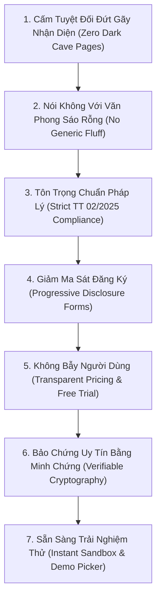

# Bộ Nguyên Tắc Thiết Kế Chống AI Slop & UX Tối Ưu Cho Các Trang Public
**Dự án:** DigiTalent Pulse Public Pages Architecture  
**Tiêu chuẩn:** Out-of-Distribution Craft · Anti-Slop Architecture · Conversion & Trust Engineering  
**Phiên bản:** v3.0  
**Ngày ban hành:** 31/10/2026  

---

## 1. Bản Chất Của "AI Slop" Trên Các Trang Công Khai (Public Landing & Auth)

> [!WARNING]
> **"AI Marketing Slop" trên các trang web B2B là gì?**  
> Đó là khi website tràn ngập những câu từ sáo rỗng vô nghĩa (như *"Cách mạng hóa tương lai doanh nghiệp với giải pháp siêu trí tuệ nhân tạo toàn diện bậc nhất"*), những hình khối 3D màu tím hồng phát sáng giả tạo, các form đăng ký 15 trường bắt người dùng điền thông tin dài dòng vô ích, và sự đứt gãy phong cách (trang chủ màu trắng sáng nhưng bấm sang trang bảng giá hoặc tra cứu chứng chỉ lại nhảy sang một giao diện tối đen xì như hang động).
> 
> Một hệ thống B2B SaaS Enterprise chuẩn mực phải truyền tải **sự xác thực, năng lực công nghệ thực chất, sự tôn trọng thời gian của khách hàng và tính nhất quán tuyệt đối**.

---

## 2. Bảy Điều Răn Chống AI Slop Cho Phân Hệ Public (The 7 Public Anti-Slop Commandments)

### Điều Răn 1: Cấm Tuyệt Đối Đứt Gãy Nhận Diện (Xóa Bỏ "Hang Tối" Dark Caves)
- **Hành vi slop:** Trang chủ mang phong cách hiện đại ánh ngọc trai, nhưng khi người dùng click vào xem Bảng giá (`/business/pricing`), Quên mật khẩu (`/forgot-password`) hay Tra cứu chứng chỉ (`/verify`) thì giao diện bỗng nhiên biến thành nền đen xì `#0c0d0e` với font chữ vàng đồng của hệ thống cũ. Điều này khiến khách hàng có cảm giác website chắp vá, thiếu hoàn thiện hoặc đang bị chuyển hướng sang trang giả mạo.
- **Quy chuẩn đúng:**
  - 100% trang public phải sử dụng chung khung giao diện `PulsePublicShell` (với Header/Footer kính mờ) hoặc `PulseAuthLayout` (với phong cách 2 cột thanh nhã).
  - Nền toàn hệ thống nhất quán với ánh ngọc trai `#f6f8fd`, thẻ trắng tinh khiết `#ffffff`, viền mảnh `rgba(226, 232, 240, 0.8)`.

### Điều Răn 2: Xóa Bỏ Văn Phong Tiếp Thị Sáo Rỗng (No Marketing Fluff)
- **Hành vi slop:** Sử dụng những tính từ phóng đại không có cơ sở kiểm chứng: *"Nền tảng đào tạo AI đỉnh cao số 1 Việt Nam"*, *"Tối ưu hóa sức mạnh vô hạn của doanh nghiệp"*. Khách hàng B2B (Giám đốc nhân sự, CEO) sẽ lập tức nghi ngờ độ chân thực.
- **Quy chuẩn đúng:**
  - Mọi tuyên bố đều phải gắn liền với **giá trị nghiệp vụ cụ thể và số liệu đo lường được**:
    - Thay vì: *"Hệ thống đào tạo siêu thông minh"* $\rightarrow$ Dùng: **"Đo đúng khoảng trống kỹ năng trước khi học — Miễn học đến 70% nội dung đã thành thạo"**.
    - Thay vì: *"Báo cáo tự động vượt trội"* $\rightarrow$ Dùng: **"Quản lý chuyên môn chấm bài bằng sản phẩm thực tế kèm gợi ý chấm điểm từ AI"**.
    - Thay vì: *"Năng lực hàng đầu"* $\rightarrow$ Dùng: **"Chuẩn hóa 6 miền, 21 năng lực số theo Thông tư 02/2025/TT-BGDĐT"**.

### Điều Răn 3: Tuân Thủ Nghiêm Ngặt Khung Chuẩn Pháp Lý Thông Tư 02/2025/TT-BGDĐT
- **Hành vi slop:** Sử dụng số liệu lẫn lộn lúc thì "24 năng lực", lúc thì "21 năng lực", hoặc tự chế ra các tên gọi kỹ năng không có trong quy chuẩn giáo dục nghề nghiệp.
- **Quy chuẩn đúng:**
  - Khẳng định rõ nguồn gốc quy chuẩn: **Thông tư 02/2025/TT-BGDĐT** ban hành ngày 24/01/2025 của Bộ Giáo dục & Đào tạo.
  - Đồng bộ chuẩn **6 lĩnh vực và 21 năng lực số** trên tất cả các trang: Trang chủ, Trang giải pháp, Thư viện vị trí việc làm (`/careers`) và Chứng chỉ số công khai (`/verify`).

### Điều Răn 4: Chia Nhỏ Form Đăng Ký Theo Tiến Trình (Progressive Disclosure Forms)
- **Hành vi slop:** Nhồi nhét toàn bộ 10-12 trường nhập liệu (Tên công ty, Mã số thuế, Họ tên, Email, Mật khẩu, Xác nhận mật khẩu, Ngành, Quy mô, Mục tiêu, Điều khoản) vào một form dài dặc trên 1 trang duy nhất, khiến tỷ lệ bỏ dở (Drop-off rate) lên tới 60%.
- **Quy chuẩn đúng:**
  - Chia nhỏ thành **3 bước tiến trình mượt mà (3-Step Guided Stepper)**:
    1. *Bước 1 (30s):* Tên tổ chức, Họ tên người phụ trách, Email công việc, Mật khẩu.
    2. *Bước 2 (20s):* Chọn ngành, Quy mô và Mục tiêu đào tạo (hiển thị ngay mẫu vị trí tương ứng).
    3. *Bước 3 (30s):* Xác minh email bằng 6 ô OTP tự động chuyển tiêu điểm.
  - Tích hợp kiểm tra độ mạnh mật khẩu trực quan (Password Strength Meter) theo thời gian thực thay vì để người dùng bấm Đăng ký xong mới báo lỗi mật khẩu yếu.

### Điều Răn 5: Minh Bạch Về Bảng Giá & Cam Kết Dùng Thử (Zero Hidden Fees)
- **Hành vi slop:** Bắt người dùng nhập thông tin thẻ tín dụng mới cho dùng thử; hoặc cố tình giấu bảng giá thật đằng sau nút "Liên hệ chúng tôi" cho cả những gói cơ bản nhất.
- **Quy chuẩn đúng:**
  - Gói Khởi tạo (Starter Free Trial): **0đ trọn đời cho 10 nhân sự**, mở toàn bộ khóa Cơ bản, cam kết **100% không yêu cầu thẻ tín dụng**.
  - Bảng giá công khai đơn giá theo nhân sự/tháng và năm (-20% khi thanh toán theo năm), liệt kê chi tiết từng tính năng đối soát.
  - Nút chuyển đổi chu kỳ thanh toán Năm / Tháng cập nhật giá ngay lập tức với nhãn tiết kiệm bắt mắt.

### Điều Răn 6: Bảo Chứng Uy Tín Bằng Mật Mã Học & Khả Năng In Ấn Sắc Nét (Verifiable Trust)
- **Hành vi slop:** Trang xác thực chứng chỉ chỉ hiển thị một dòng chữ đơn giản *"Chứng chỉ hợp lệ"* mà không có bằng chứng pháp lý, không có mã băm bảo mật, và khi bấm in thì giao diện bị vỡ nát, dính thanh sidebar và quảng cáo.
- **Quy chuẩn đúng:**
  - Trang xác thực `/verify` được thiết kế như một **Cổng Kiểm Định Quốc Gia**:
    - Hiển thị đầy đủ: Họ tên học viên, Đơn vị cấp, Khóa đào tạo, Năng lực số đạt được theo Thông tư 02/2025, Người ký duyệt (Trưởng phòng chuyên môn).
    - Hiển thị mã băm bảo mật SHA-256 mã hóa toàn vẹn dữ liệu.
    - Tối ưu hóa CSS `@media print` trang ngang A4: Khi bấm In hoặc Lưu PDF, tài liệu xuất ra một bản chứng nhận sang trọng chuẩn in ấn, triệt tiêu toàn bộ header, footer và nút bấm web.

### Điều Răn 7: Sẵn Sàng Trải Nghiệm Thử Ngay Lập Tức (Instant Demo & Sandbox)
- **Hành vi slop:** Trang web ép buộc mọi người dùng phải đăng ký tài khoản mới được xem giao diện bên trong. Đối với ban giám khảo, nhà đầu tư hoặc chuyên gia kiểm thử, việc phải tạo tài khoản giả định tốn nhiều thời gian và gây phiền toái.
- **Quy chuẩn đúng:**
  - Cung cấp nút **"Khám phá mẫu doanh nghiệp ngay"** tại Hero Section.
  - Tích hợp sẵn bộ chuyển đổi tài khoản demo (`DemoAccountPicker`) ngay trên trang Đăng nhập (`/login`) với đủ 4 vai trò:
    + *Quản trị viên Nền tảng (Platform Admin)*
    + *Chủ doanh nghiệp (Enterprise Owner)*
    + *Quản lý phòng ban (Department Manager)*
    + *Nhân viên học tập (Employee)*
  - Cho phép 1-click trải nghiệm toàn bộ luồng nghiệp vụ mà không cần đăng ký tài khoản thật.

---

## 3. Khung Đánh Giá Kiểm Định UX & Conversion (Public QA Checklist)

Mọi trang công khai trước khi xuất bản đều phải vượt qua bảng kiểm định 8 tiêu chí khắt khe:

| Tiêu Chí | Ngưỡng Đạt Yêu Cầu (Pass Threshold) | Phương Pháp Kiểm Tra |
| :--- | :--- | :--- |
| **Độ Tương Phản Màu Sắc** | $\ge 7:1$ đối với văn bản thường, $\ge 4.5:1$ đối với tiêu đề lớn (Chuẩn WCAG AAA) | Lighthouse Accessibility / Chrome DevTools a11y audit |
| **Tốc Độ Tải Trang (LCP)** | $\le 1.8$ giây trên mạng di động 4G chuẩn | Lighthouse Performance / Web Vitals |
| **Tính Nhất Quán Nhận Diện** | 100% trang dùng nền ngọc trai `#f6f8fd`, typography Slate-900, điểm nhấn Amber `#d97706` | Kiểm tra thủ công toàn bộ 9 route public |
| **Độ Chính Xác Pháp Lý** | Toàn bộ các trang đều ghi nhận chuẩn 6 lĩnh vực, 21 năng lực số TT 02/2025 | Đối soát văn bản với Thông tư 02/2025/TT-BGDĐT |
| **Khả Năng Đáp Ứng Di Động** | Không tràn chiều ngang (`overflow-x: hidden`), tap target $\ge 44px \times 44px$ | Playwright Mobile Viewport Test (iPhone 14 / Pixel 7) |
| **Hiệu Quả Luồng OTP** | Tự động chuyển ô, hỗ trợ paste chuỗi 6 ký tự, có đếm ngược 60s và nút gửi lại | Kiểm thử tương tác Form & Timer |
| **Chất Lượng In Chứng Chỉ** | Căn vừa khít khổ giấy A4 Landscape, viền nét, không dính phần tử web | Trình xem trước in ấn trình duyệt (`Ctrl + P`) |
| **Trải Nghiệm Thử Nghiệm (Demo)** | Click vào bất kỳ vai trò nào trong Demo Picker tự động đăng nhập trong $\le 1$ giây | Kiểm thử luồng xác thực thực tế |
