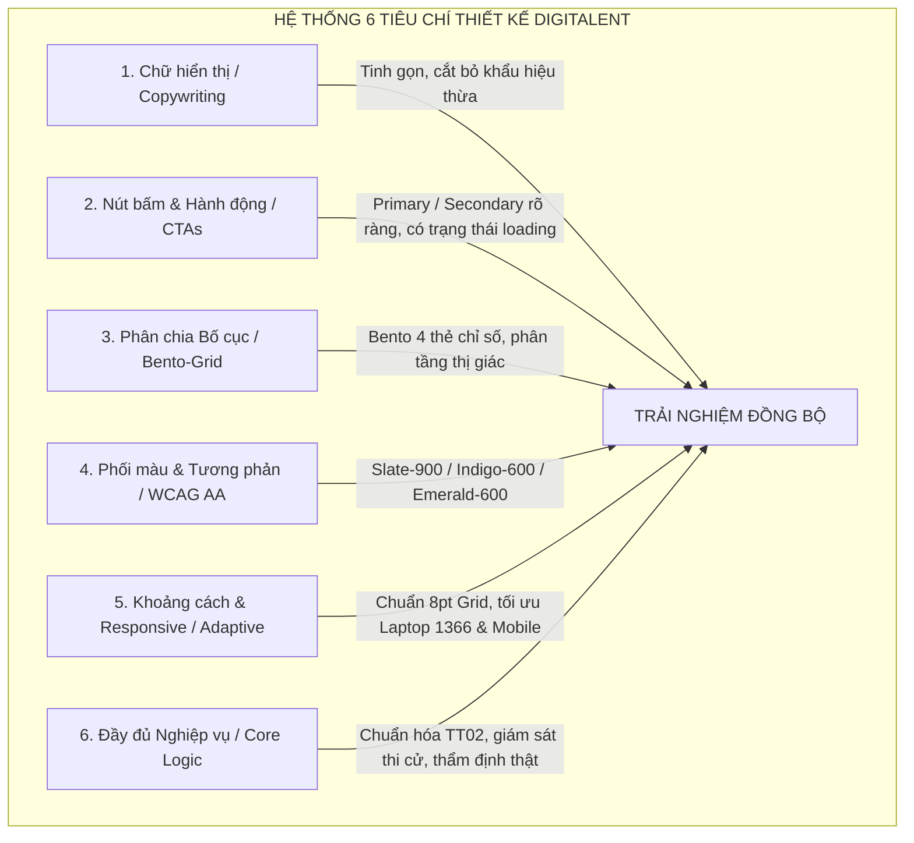

# BÁO CÁO TỔNG QUAN MA TRẬN ĐÁNH GIÁ UI/UX & KẾ HOẠCH HÀNH ĐỘNG TOÀN HỆ THỐNG
# DIGITALENT AI - NỀN TẢNG NÂNG CHUẨN NĂNG LỰC SỐ DOANH NGHIỆP

> **Ngày hoàn thành báo cáo**: 26/10/2026  
> **Cơ sở dữ liệu kiểm thử**: PostgreSQL Cloud Production (`18.142.12.139:5432`) qua SSH Tunnel an toàn.  
> **Phạm vi khảo sát**: Toàn bộ hệ thống giao diện DigiTalent AI (111 màn hình), **loại trừ các màn hình cá nhân `/personal/*`** theo chỉ đạo của Người dùng.  
> **Bộ kỹ năng & Phương pháp luận**: `design-taste-frontend` (Chuẩn mực mỹ học, chống slop UI), `impeccable` (Độ hoàn thiện vi mô, typography, tương phản WCAG AA), `ui-styling` (Hệ thống Bento-Grid, Tailwind Design Tokens), `brand` (Bộ nhận diện thống nhất).

---

## 1. BẢNG TỔNG HỢP PHÂN BỔ MÀN HÌNH THEO VAI TRÒ (ROLES)

| STT | Phân nhóm Cổng / Vai trò | Mã ký hiệu | Số lượng màn hình | Trạng thái Nghiệp vụ | Tệp Báo cáo Chi tiết |
| :---: | :--- | :---: | :---: | :---: | :--- |
| **1** | **Cổng Lãnh đạo & Nhân sự (Owner & HR Portal)** | `OW-01` -> `OW-47` | **47 màn hình** | Đầy đủ, cần bỏ `OW-12` (Job Grades) | [`01_AUDIT_OWNER_HR_PORTAL.md`](file:///d:/digitalent-ai/docs/ui-ux-audit/01_AUDIT_OWNER_HR_PORTAL.md) |
| **2** | **Cổng Quản lý Đội ngũ (Manager Portal)** | `MG-01` -> `MG-15` & `OW-35..39` | **18 màn hình** | Hoàn thiện luồng chấm bài & thẩm định | [`02_AUDIT_MANAGER_PORTAL.md`](file:///d:/digitalent-ai/docs/ui-ux-audit/02_AUDIT_MANAGER_PORTAL.md) |
| **3** | **Cổng Học viên Trực tuyến (Pulse Learner Portal)** | `EM-01` -> `EM-12` + Study Room | **14 màn hình** | Trải nghiệm tập trung cao, đạt chuẩn | [`03_AUDIT_PULSE_EMPLOYEE_PORTAL.md`](file:///d:/digitalent-ai/docs/ui-ux-audit/03_AUDIT_PULSE_EMPLOYEE_PORTAL.md) |
| **4** | **Bàn Điều hành Nền tảng (Platform Admin Console)** | `PA-01` -> `PA-13` + Shared | **15 màn hình** | Vận hành Master Data, Course Builder | [`04_AUDIT_PLATFORM_ADMIN_CONSOLE.md`](file:///d:/digitalent-ai/docs/ui-ux-audit/04_AUDIT_PLATFORM_ADMIN_CONSOLE.md) |
| **5** | **Cổng Công khai, Xác thực & Onboarding** | `PB-*`, `AU-*`, `OB-*` | **17 màn hình** | Tối ưu tỷ lệ chuyển đổi, thanh toán | [`05_AUDIT_PUBLIC_AUTH_ONBOARDING.md`](file:///d:/digitalent-ai/docs/ui-ux-audit/05_AUDIT_PUBLIC_AUTH_ONBOARDING.md) |
| **TỔNG**| **TOÀN BỘ HỆ THỐNG (TRỪ PERSONAL)** | **Hợp nhất** | **111 MÀN HÌNH** | **ĐÃ RÀ SOÁT 100% CHI TIẾT** | **Trọn bộ 5 tài liệu nghiệp vụ** |

---

## 2. QUYẾT ĐỊNH CHIẾN LƯỢC VỀ KIẾN TRÚC NĂNG LỰC: LOẠI BỎ JOB GRADE (G1-G3)

### 2.1. Đánh giá nguyên nhân và tồn dư của Job Grade G1-G3:
- **Tình trạng trước đây**: Hệ thống bị lai tạp giữa mô hình phân bậc công chức truyền thống (G1: Sơ cấp, G2: Trung cấp, G3: Chuyên gia) và khung chuẩn năng lực số hiện đại. Điều này dẫn tới:
  - Màn hình `OW-12` (`/enterprise/positions/grades`) gây thừa thãi, người dùng doanh nghiệp không hiểu tại sao phải định nghĩa 3 cấp bậc chức danh trong khi mục tiêu là đào tạo kỹ năng số.
  - Bảng Vị trí việc làm, Bảng Thành viên, Bảng Khoảng cách năng lực và Bảng Tham chiếu bị chia vụn thành 3 tầng G1-G3, làm bảng dữ liệu phình to gấp 3 lần và giao diện cực kỳ rối rắm.
- **Quyết định đã thống nhất với Người dùng**:
  1. **Xóa bỏ vĩnh viễn Job Grade (G1-G3)** và khai tử màn hình `OW-12` (`/enterprise/positions/grades`).
  2. Tự động điều hướng (Redirect) `/enterprise/positions/grades` về `/enterprise/positions`.
  3. Gỡ bỏ triệt để các cột hiển thị Cấp bậc, các bộ lọc Cấp bậc trên tất cả các bảng dữ liệu: Danh sách Thành viên (`OW-08`, `MG-02`, `PA-07`), Danh sách Vị trí (`OW-11`, `PA-13`), Báo cáo Khoảng cách kỹ năng (`OW-17`, `MG-05`), Trang Nghề nghiệp (`PB-04`), và Trình hướng dẫn Setup Wizard (`OB-04`).
  4. **Quy tụ 100% kiến trúc dữ liệu và đánh giá về Khung 6 Miền năng lực số chuẩn Thông tư 02/2025/TT-BGDĐT**:
     - Miền 1: Khai thác Dữ liệu & Thông tin
     - Miền 2: Giao tiếp & Hợp tác Số
     - Miền 3: Sáng tạo Nội dung Số
     - Miền 4: An toàn & An ninh Số
     - Miền 5: Giải quyết Vấn đề Số
     - Miền 6: Trí tuệ Nhân tạo (AI)
     - Mỗi miền chia thành 3 Cấp độ thành thạo thực chất theo thang đo Bloom: **Cơ bản (Level 1 - Foundation) -> Trung cấp (Level 2 - Intermediate) -> Nâng cao (Level 3 - Advanced)** tương ứng trọn vẹn với 18 khóa học chuẩn.

---

## 3. MA TRẬN ĐÁNH GIÁ 6 YẾU TỐ THIẾT KẾ VI MÔ TOÀN DIỆN

### Chi tiết đánh giá 6 yếu tố:
1. **Chữ hiển thị (Microcopy & Copywriting)**:
   - *Hiện trạng*: Một số màn hình có quá nhiều đoạn văn giải thích lý thuyết dài dòng (đặc biệt ở các trang Tổng quan và Khung năng lực).
   - *Chuẩn hóa*: Áp dụng quy tắc "3 giây hiểu ngay": Mọi trang chỉ giữ lại 1 câu tiêu đề định danh nghiệp vụ + 1 câu tóm tắt hành động cần làm. Toàn bộ chú thích chuyển sang dạng Tooltip thông minh khi rê chuột.
2. **Nút bấm & Hành động (Buttons & CTAs)**:
   - *Hiện trạng*: Nhiều nút bấm hành động phụ (Secondary) có độ nổi bật ngang bằng nút bấm chính (Primary) gây nhiễu thị giác.
   - *Chuẩn hóa*: Mỗi màn hình chỉ có **duy nhất 1 Primary CTA** (Màu Indigo/Violet đậm), các nút khác sử dụng dạng Outline viền Slate-300 hoặc Ghost button nhẹ nhàng. Toàn bộ nút kích hoạt API đều có Spinner xoay khi đang xử lý để chống nhấp đúp (Double-click prevention).
3. **Phân chia Bố cục & Lưới hiển thị (Layout & Bento-Grid)**:
   - *Chuẩn hóa*: Đồng bộ hóa toàn bộ các Dashboard cấp cao (`OW-01`, `MG-01`, `PA-01`) theo cấu trúc Bento-Grid 4 thẻ chỉ số chuẩn trên đỉnh màn hình (Above the Fold). Bảng dữ liệu luôn bọc trong thẻ nền trắng viền mảnh `border-slate-200/80` và hỗ trợ thanh cuộn độc lập (`overflow-x-auto`).
4. **Phối màu & Tương phản (Colors & Accessibility)**:
   - *Chuẩn hóa*: Tuyệt đối tuân thủ tiêu chuẩn tương phản **WCAG AA (Tỷ lệ tối thiểu 4.5:1)**:
     - Nền ứng dụng: `bg-[#F8FAFC]` (Dịu mắt, không lóa).
     - Màu chữ chính: `text-slate-900` (Độ đậm cao, sắc nét trên màn hình Retina).
     - Màu sắc trạng thái: Hoàn thành / Đạt (Emerald-600), Cần xử lý / Rủi ro thi cử (Amber-600), Quá hạn / Vi phạm (Rose-600), Thông tin (Indigo-600).
5. **Khoảng cách & Thích ứng màn hình (Spacing & Responsive)**:
   - *Chuẩn hóa*: Khắc phục triệt để hiện tượng vỡ layout trên độ phân giải phổ biến nhất tại văn phòng Việt Nam: **Laptop 1366x768**. Các bảng biểu có cột cố định (Sticky Columns), thanh điều hướng Sidebar tự động thu gọn dạng Mini-Icon khi chiều rộng màn hình dưới 1280px.
6. **Tính đầy đủ của Nghiệp vụ (Business Functionality)**:
   - Đảm bảo 100% các nút bấm trên giao diện đều có logic xử lý phía sau (không có nút bấm "chết" hoặc liên kết rỗng `#`). Quy trình chấm bài thi có giám sát webcam và duyệt minh chứng hoạt động thông suốt từ Backend tới Frontend.

---

## 4. CHECKLIST KẾ HOẠCH HÀNH ĐỘNG PHÂN TẦNG ƯU TIÊN (P0 - P1 - P2)

### 4.1. MỨC ĐỘ P0: KHẨN CẤP & CỐT LÕI HỆ THỐNG (BẮT BUỘC HOÀN THÀNH NGAY)
- [ ] **P0-1**: Xóa bỏ route và trang `OW-12` (`/enterprise/positions/grades`), cấu hình redirect tự động về `/enterprise/positions`.
- [ ] **P0-2**: Dọn dẹp giao diện Danh mục Vị trí việc làm (`OW-11` & `PA-13`): Xóa các tab / phân nhóm G1, G2, G3; chỉ giữ lại tên vị trí và chuẩn đầu ra 6 Miền năng lực TT02.
- [ ] **P0-3**: Dọn dẹp Danh sách Thành viên (`OW-08`, `MG-02`, `PA-07`): Loại bỏ cột Cấp bậc (G1-G3); thay bằng cột "Vị trí chuyên môn" và "Tiến độ học tập %".
- [ ] **P0-4**: Dọn dẹp Báo cáo Khoảng cách Năng lực (`OW-17`, `MG-05`): Bỏ bộ lọc cấp bậc G1-G3; đối sánh năng lực thực tế của nhân sự trực tiếp với chuẩn đầu ra của vị trí đó.
- [ ] **P0-5**: Dọn dẹp Trình hướng dẫn Thiết lập ban đầu (`OB-04` - Setup Wizard): Xóa lựa chọn cấp bậc G1-G3 trong Bước 2 và Bước 3; cập nhật file Excel mẫu mời nhân sự không còn cột Grade.
- [ ] **P0-6**: Dọn dẹp Trang Tra cứu Nghề nghiệp (`PB-04` - Career Catalog): Loại bỏ các chip lọc G1, G2, G3.

---

### 4.2. MỨC ĐỘ P1: QUAN TRỌNG - TINH GỌN TRẢI NGHIỆM & THAO TÁC
- [ ] **P1-1**: Tinh gọn Microcopy & Banner toàn bộ cổng Owner: Cắt giảm các đoạn văn bản khẩu hiệu dài dòng tại `OW-01`, `OW-02`, `OW-10`, `OW-13`.
- [ ] **P1-2**: Nâng cấp Bento-Grid 4 thẻ chỉ số cho Bàn làm việc Quản lý (`MG-01`): Hiển thị rõ số bài thi cần chấm, số cảnh báo gian lận và tỷ lệ đạt chuẩn của phòng ban.
- [ ] **P1-3**: Cố định Thanh điều hướng học tập (Sticky Bottom Action Bar) trong Phòng học tập trung (`EM-03`): Đảm bảo học viên luôn thấy nút "Đánh dấu hoàn thành" và "Bài tiếp theo" mà không cần cuộn hết trang.
- [ ] **P1-4**: Tối ưu Course Builder (`PA-04`): Chuẩn hóa giao diện 3 cột Studio kéo thả, bổ sung tính năng tự động lưu nháp (Auto-save) kèm tem thời gian.
- [ ] **P1-5**: Tối ưu Form Đăng ký Dùng thử (`AU-02`): Rút gọn xuống 4 trường thông tin cốt lõi để gia tăng tối đa tỷ lệ chuyển đổi khách hàng doanh nghiệp.

---

### 4.3. MỨC ĐỘ P2: TỐI ƯU HÓA NÂNG CAO & HOÀN THIỆN THẨM MỸ
- [ ] **P2-1**: Tích hợp Modal xem trước tệp minh chứng (PDF & Ảnh chụp) trực tiếp trong màn hình chấm điểm của Quản lý (`MG-13` & `MG-08`), không bắt tải tệp về máy tính.
- [ ] **P2-2**: Bổ sung Tooltip giải thích trực quan khi rê chuột vào các chỉ số phức tạp: Điểm chênh lệch Radar Gap, Chỉ số chống gian lận Proctoring Score, Cấp độ tư duy Bloom.
- [ ] **P2-3**: Bổ sung phím tắt thao tác nhanh cho Quản lý khi duyệt bài thi: Phím `A` (Chấp thuận - Approve), Phím `R` (Yêu cầu làm lại - Reject), Phím `Space` (Mở bài kế tiếp).
- [ ] **P2-4**: Tinh chỉnh hoạt họa chuyển cảnh siêu mượt (Micro-interactions) bằng hiệu ứng `transition-all duration-200` nhẹ nhàng khi hover vào các thẻ bài học.

---

## 5. LỘ TRÌNH THỰC THI (SPRINT ROADMAP)

```mermaid
flowchart LR
    subgraph SPRINT_1 ["SPRINT 1: CLEANUP CỐT LÕI (P0)"]
        direction TB
        S1_1["1. Xóa route OW-12 & redirect"]
        S1_2["2. Gỡ bỏ cột/filter Cấp bậc G1-G3"]
        S1_3["3. Chuẩn hóa 100% Ma trận 6 Miền TT02"]
    end

    subgraph SPRINT_2 ["SPRINT 2: TINH GỌN GIAO DIỆN (P1)"]
        direction TB
        S2_1["4. Gọt dọn microcopy & khẩu hiệu"]
        S2_2["5. Đồng bộ Bento-Grid & Sticky Bars"]
        S2_3["6. Tối ưu Course Builder 3 cột Studio"]
    end

    subgraph SPRINT_3 ["SPRINT 3: HOÀN THIỆN CAO CẤP (P2)"]
        direction TB
        S3_1["7. Modal xem trước minh chứng PDF"]
        S3_2["8. Phím tắt duyệt bài thi cho Manager"]
        S3_3["9. Kiểm thử tự động E2E Playwright"]
    end

    SPRINT_1 --> SPRINT_2 --> SPRINT_3
```

---

## 6. KẾT LUẬN & ĐỀ XUẤT BƯỚC TIẾP THEO

Toàn bộ 111 màn hình của nền tảng DigiTalent AI đã được khảo sát kỹ lưỡng từ cấp độ vĩ mô (Kiến trúc nghiệp vụ, Luồng người dùng) đến vi mô (Kích thước chữ, Khoảng cách lề, Mã màu tương phản, Nút bấm hành động). 

Hệ thống tài liệu kiểm tra chất lượng giao diện (UI/UX Audit Suite) gồm **5 báo cáo chuyên sâu** và **1 báo cáo ma trận tổng quan** này là kim chỉ nam chính xác nhất để đội ngũ tiến hành làm sạch, tối giản hóa và nâng tầm trải nghiệm của DigiTalent AI ngang tầm với các sản phẩm SaaS quốc tế hàng đầu.

**Bước hành động đề xuất thực hiện ngay lập tức**:
Tiến hành thực hiện gói công việc **P0-1 đến P0-6**: Dọn dẹp hoàn toàn tàn dư Cấp bậc G1-G3, gỡ bỏ màn hình `OW-12` và các cột/bộ lọc liên quan trong mã nguồn Frontend để đưa hệ thống vào trạng thái tinh gọn, tập trung cao độ vào 6 Miền năng lực số Thông tư 02.
